# Course Academy — Database ER Diagram ও Data Flow (বাংলা ব্যাখ্যা)

> এই ফাইলটি বানানো হয়েছে **আসল কোড** পড়ে: `CourseAcademy.API/CourseAcademy.Api/Entities/*.cs`,
> `Data/Configurations/*.cs`, `Data/DbSchemas.cs`, `Data/AppDbContext.cs`, `Data/AuditInterceptor.cs`,
> migration `InitialCreate` এবং `Services/*` (কোন কাজে কোন টেবিলে ডাটা লেখা হয়)।
> ব্যবসায়িক নিয়মের (BR-ID) মূল উৎস এখনো `docs/business/` — এই ফাইল শুধু বোঝার ও কাস্টমাইজ করার জন্য।

**সূচিপত্র**
1. [ডায়াগ্রাম কীভাবে দেখবেন ও এডিট করবেন](#1-ডায়াগ্রাম-কীভাবে-দেখবেন-ও-এডিট-করবেন)
2. [ডাটাবেসের মূল নিয়ম (সব টেবিলে প্রযোজ্য)](#2-ডাটাবেসের-মূল-নিয়ম-সব-টেবিলে-প্রযোজ্য)
3. [Schema ও টেবিল তালিকা](#3-schema-ও-টেবিল-তালিকা)
4. [বড় ছবি: Schema-গুলো কীভাবে জোড়া](#4-বড়-ছবি-schema-গুলো-কীভাবে-জোড়া)
5. [সম্পূর্ণ ER Diagram (সব টেবিল, শুধু সম্পর্ক)](#5-সম্পূর্ণ-er-diagram-সব-টেবিল-শুধু-সম্পর্ক)
6. [Schema অনুযায়ী বিস্তারিত ER Diagram (কলামসহ)](#6-schema-অনুযায়ী-বিস্তারিত-er-diagram-কলামসহ)
7. [Data Flow — কোন কাজে কোন টেবিলে কী হয়](#7-data-flow--কোন-কাজে-কোন-টেবিলে-কী-হয়)
8. [Status-এর পরিবর্তন (State diagram)](#8-status-এর-পরিবর্তন-state-diagram)
9. [এখনো ডিজাইন হয়নি এমন টেবিল](#9-এখনো-ডিজাইন-হয়নি-এমন-টেবিল)
10. [ডায়াগ্রাম কাস্টমাইজ করার নিয়ম](#10-ডায়াগ্রাম-কাস্টমাইজ-করার-নিয়ম)
11. [যা লক্ষ্য করেছি (ছোট নোট)](#11-যা-লক্ষ্য-করেছি-ছোট-নোট)
12. [Appendix: DBML (dbdiagram.io-তে টেনে-সাজানো যায় এমন ডায়াগ্রাম)](#12-appendix-dbml-dbdiagramio-তে-টেনে-সাজানো-যায়-এমন-ডায়াগ্রাম)

---

## 1. ডায়াগ্রাম কীভাবে দেখবেন ও এডিট করবেন

এই ফাইলে দুই ধরনের ডায়াগ্রাম আছে — দুটোই **লেখা (text)**, তাই যেকোনো editor-এ বদলানো যায়:

| ফরম্যাট | কোথায় দেখবেন | কখন ভালো |
|---|---|---|
| **Mermaid** (` ```mermaid ` ব্লক) | GitHub-এ সরাসরি দেখা যায়। VS Code-এ extension **"Markdown Preview Mermaid Support"** ইনস্টল করে `Ctrl+Shift+V`। অনলাইনে [mermaid.live](https://mermaid.live)-এ কোড পেস্ট করুন। draw.io-তে: *Arrange → Insert → Advanced → Mermaid* | ডকুমেন্টের ভেতরে রাখার জন্য |
| **DBML** (Appendix, §12) | [dbdiagram.io](https://dbdiagram.io) খুলে বাম পাশে পুরো কোড পেস্ট করুন | টেবিল টেনে সাজানো, রং বদলানো, PNG/PDF/SQL export |

Mermaid ER চিহ্নের মানে:

| চিহ্ন | মানে |
|---|---|
| `\|\|--o{` | একটি (ঠিক ১) → অনেক (০ বা বেশি) |
| `\|o--o{` | ০ বা ১ → অনেক (FK কলাম `NULL` হতে পারে) |
| `\|o--o\|` | ০ বা ১ → ০ বা ১ |
| `\|\|..o{` (ডট লাইন) | যুক্তিগত সম্পর্ক, ডাটাবেসে আসল Foreign Key নেই |
| `PK` / `FK` / `UK` | Primary Key / Foreign Key / Unique |

---

## 2. ডাটাবেসের মূল নিয়ম (সব টেবিলে প্রযোজ্য)

- **ডাটাবেস**: SQL Server, নাম `CourseAcademyDB`। কোড থেকে টেবিল বানায় **EF Core (code-first)**। Migration: `InitialCreate` (মূল টেবিল) + `AddCertificationAndCommunity` (Certificate ও Community-এর টেবিল)।
- **Schema**: প্রতিটি টেবিল তার এলাকার schema-তে থাকে (যেমন `Securities.User`, `Catalog.Course`)। `dbo`-তে শুধু EF-এর `__EFMigrationsHistory`। নতুন টেবিল বানালে `DbSchemas.cs`-এ যোগ করতেই হবে, না হলে অ্যাপ চালু হবে না।
- **Primary Key**: সব টেবিলে `Id int IDENTITY` (1, 2, 3 …)। URL-এ PK দেখানো হয় না; তার বদলে আলাদা unique কলাম: `Course.Slug`, `PaymentTransaction.TransactionNo`, `Certificate.Code`।
- **Standard কলাম (সব টেবিলে)** — নিচের ডায়াগ্রামে জায়গা বাঁচাতে বারবার লেখা হয়নি:

  | কলাম | টাইপ | কাজ |
  |---|---|---|
  | `CreatedAt` | datetime2(3), UTC | row তৈরির সময়, নিজে থেকে বসে |
  | `UpdatedAt` | datetime2(3), NULL | প্রতিবার save-এ নিজে থেকে বসে |
  | `IsDeleted` | bit, default 0 | soft delete flag |

  এগুলো বসায় `AuditInterceptor` — কোনো service হাতে লেখে না।
- **Soft delete**: কিছু "delete" করলে আসলে row মুছে না, শুধু `IsDeleted = 1` হয়। সব query-তে নিজে থেকে `IsDeleted = 0` filter লাগে, তাই মুছে ফেলা row আর দেখা যায় না, কিন্তু ইতিহাস থেকে যায়।
- **Hard delete (আসলেই মুছে যায়)**: যেসব টেবিল শুধু "জোড়া" বা "token" রাখে, ইতিহাসের দরকার নেই — `RoleScreen`, `UserScreen`, `CourseGrant`, `CourseGrantPermission`, `RefreshToken`, `CategorySkill`, `InstructorExpertise`, `CourseOutcome`, `CourseRequirement`।
- **Foreign Key**: সব জায়গায় `ON DELETE NO ACTION` — ডাটাবেস নিজে থেকে কিছু cascade করে না; কী মুছবে তা service ঠিক করে (§7.9)।
- **Unique index**: বেশিরভাগ filtered — `WHERE IsDeleted = 0`। তাই মুছে ফেলা কোর্সের slug বা মুছে ফেলা user-এর email আবার ব্যবহার করা যায়।
- **সময়**: সব UTC। Live class-এর সময় admin ঢাকার সময়ে দেন, save-এর সময় UTC-তে বদলায়।
- **টাকা**: `decimal(18,2)`, মুদ্রা শুধু BDT।
- **Text**: `nvarchar` (বাংলা লেখা ঠিকঠাক থাকে)। লম্বা না বললে default দৈর্ঘ্য 200।
- **Lookup টেবিল**: status/type-এর মতো স্থির তালিকা আলাদা টেবিলে, প্রতিটায় `Code` (কোডে ব্যবহার হয়, কখনো বদলায় না), `Name`, `SortOrder`। এগুলোর ID seed-এ স্থির, তাই কোড query না করেই ID জানে।
- **Concurrency token** (একসাথে দুই request এলে শুধু প্রথমটা জেতে): `PaymentTransaction.PaymentStatusId`, `RefreshToken.RevokedAt`, `MediaAsset.LastSequence`, `ExamSubmission.SubmissionStatusId` (দুজন একসাথে review করলে শুধু প্রথমজনেরটা থাকে)।

---

## 3. Schema ও টেবিল তালিকা

| Schema | টেবিল | এক কথায় কাজ |
|---|---|---|
| **Securities** | `User`, `Role`, `Screen`, `Permission`, `RoleScreen`, `UserScreen`, `CourseGrant`, `CourseGrantPermission`, `RefreshToken` | কে লগইন করে, কে কী দেখতে/করতে পারে |
| **Lookups** | `Category`, `CategorySkill`, `CourseFormat`, `CourseLevel`, `CourseBadge`, `DocumentType`, `MaterialType`, `EnrollmentStatus`, `PaymentStatus`, `PaymentMethod`, `Currency`, `MediaKind`, `MediaAssetStatus`, `CertificationMode`, `ExamType`, `SubmissionStatus` | স্থির তালিকা (status, type, category) |
| **Catalog** | `Instructor`, `InstructorExpertise`, `Course`, `CourseOutcome`, `CourseRequirement`, `CourseModule`, `Submodule`, `Section`, `SectionVideo`, `SectionDocument`, `LiveSession`, `Material` | কোর্স ও তার পুরো সিলেবাস |
| **Commerce** | `Enrollment`, `PaymentTransaction` | কেনা ও কোর্সে প্রবেশাধিকার |
| **Learning** | `LessonProgress` | কে কোন lesson কতটা শেষ করেছে |
| **Media** | `MediaAsset`, `StreamingWebhookEvent` | আপলোড করা ভিডিও/ডকুমেন্ট ফাইল |
| **Certification** | `CertificationRule`, `ExamSubmission`, `Certificate` | কোর্সের সার্টিফিকেট নিয়ম, central exam জমা, দেওয়া সার্টিফিকেট |
| **Community** | `Post`, `Comment` | কোর্সের আলোচনা (post, comment, reply) |

মোট **48টি টেবিল** (Certificate ও Community-এর ৮টি যোগ হয়েছে 2026-11-20, migration `AddCertificationAndCommunity`)।

> নোট: `Screen` ও `Permission` কোডে `LookupEntity` থেকে তৈরি (Code/Name/SortOrder আছে), কিন্তু থাকে `Securities` schema-তে।

---

## 4. বড় ছবি: Schema-গুলো কীভাবে জোড়া

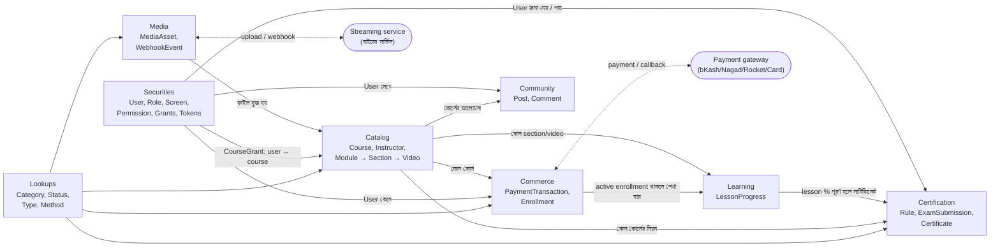

---

## 5. সম্পূর্ণ ER Diagram (সব টেবিল, শুধু সম্পর্ক)

এটাই "master" ডায়াগ্রাম — প্রতিটি আসল Foreign Key এখানে আছে। কলামগুলো §6-এ।

```mermaid
erDiagram
  %% ---------- Securities ----------
  Role ||--o{ User : "has"
  Role ||--o{ RoleScreen : "gets"
  Screen ||--o{ RoleScreen : "given to role"
  User ||--o{ UserScreen : "custom access"
  Screen ||--o{ UserScreen : "given to user"
  Screen ||--o{ Permission : "contains"
  User ||--o{ CourseGrant : "receives"
  Course ||--o{ CourseGrant : "scoped to"
  CourseGrant ||--o{ CourseGrantPermission : "lists"
  Permission ||--o{ CourseGrantPermission : "granted as"
  User ||--o{ RefreshToken : "signs in with"
  RefreshToken |o--o| RefreshToken : "replaced by"
  Instructor |o--o| User : "account of"

  %% ---------- Lookups -> Catalog ----------
  Category ||--o{ CategorySkill : "skills"
  Category ||--o{ Course : "groups"
  CourseFormat ||--o{ Course : "format"
  CourseLevel ||--o{ Course : "level"
  CourseBadge |o--o{ Course : "badge"
  DocumentType ||--o{ SectionDocument : "type"
  MaterialType ||--o{ Material : "type"

  %% ---------- Catalog ----------
  Instructor ||--o{ InstructorExpertise : "expertise"
  Instructor ||--o{ Course : "teaches"
  Course ||--o{ CourseOutcome : "what you learn"
  Course ||--o{ CourseRequirement : "requirements"
  Course ||--o{ CourseModule : "contains"
  CourseModule ||--o{ Submodule : "contains"
  Submodule |o--o{ Section : "2-3 sections"
  Section |o--o{ Section : "topics, depth 1-3"
  Course ||--o{ Section : "owns"
  Section ||--o{ SectionVideo : "videos"
  Section ||--o{ SectionDocument : "documents"
  SectionVideo |o--o{ SectionDocument : "attached to"
  Course ||--o{ LiveSession : "schedules"
  Course ||--o{ Material : "provides"

  %% ---------- Commerce ----------
  User ||--o{ Enrollment : "enrolled"
  Course ||--o{ Enrollment : "has students"
  EnrollmentStatus ||--o{ Enrollment : "status"
  PaymentTransaction |o--o| Enrollment : "granted"
  User ||--o{ PaymentTransaction : "pays"
  Course ||--o{ PaymentTransaction : "bought"
  PaymentMethod ||--o{ PaymentTransaction : "via"
  PaymentStatus ||--o{ PaymentTransaction : "status"
  Currency ||--o{ PaymentTransaction : "currency"

  %% ---------- Learning ----------
  User ||--o{ LessonProgress : "tracks"
  Course ||--o{ LessonProgress : "in course"
  Section ||--o{ LessonProgress : "lesson section"
  SectionVideo |o--o{ LessonProgress : "lesson video"

  %% ---------- Media ----------
  Course ||--o{ MediaAsset : "uploaded for"
  User ||--o{ MediaAsset : "uploaded by"
  MediaKind ||--o{ MediaAsset : "kind"
  MediaAssetStatus ||--o{ MediaAsset : "status"
  MediaAsset |o--o| SectionVideo : "file of"
  MediaAsset |o--o| SectionDocument : "file of"
  MediaAsset |o--o| Material : "file of"
  MediaAsset ||..o{ StreamingWebhookEvent : "AssetId, no FK"

  %% ---------- Certification ----------
  Course ||--o| CertificationRule : "0..1 rule"
  CertificationMode ||--o{ CertificationRule : "mode"
  ExamType ||--o{ CertificationRule : "exam type"
  User ||--o{ ExamSubmission : "hands in"
  Course ||--o{ ExamSubmission : "for"
  ExamType ||--o{ ExamSubmission : "type"
  SubmissionStatus ||--o{ ExamSubmission : "status"
  User |o--o{ ExamSubmission : "reviewed by"
  User ||--o{ Certificate : "earns"
  Course ||--o{ Certificate : "awards"
  CertificationMode ||--o{ Certificate : "mode"
  ExamType |o--o{ Certificate : "exam type"

  %% ---------- Community ----------
  Course ||--o{ Post : "community"
  User ||--o{ Post : "writes"
  Post ||--o{ Comment : "has"
  Course ||--o{ Comment : "in course"
  Comment |o--o{ Comment : "reply, 1 level"
  User ||--o{ Comment : "writes"
```

---

## 6. Schema অনুযায়ী বিস্তারিত ER Diagram (কলামসহ)

> প্রতিটি টেবিলে `CreatedAt`, `UpdatedAt`, `IsDeleted` আছে (§2) — এখানে লেখা হয়নি।
> অন্য schema-র টেবিল খালি বাক্স হিসেবে দেখা যাবে, শুধু সংযোগ বোঝাতে।

### 6.1 Securities — লগইন ও অনুমতি

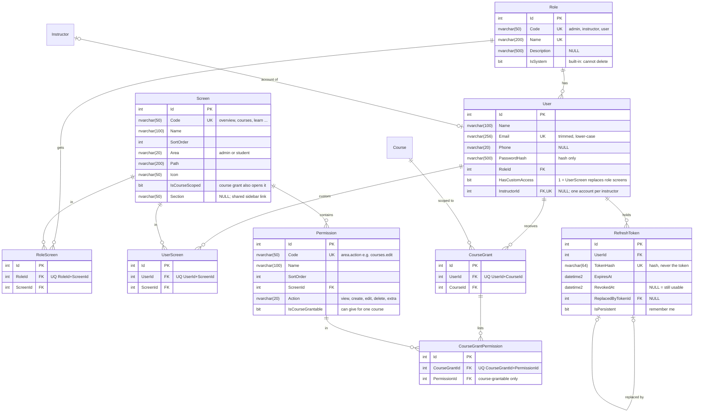

### 6.2 Lookups — স্থির তালিকা

```mermaid
erDiagram
  Category ||--o{ CategorySkill : "skills"
  Category ||--o{ Course : "groups"
  CourseFormat ||--o{ Course : "format"
  CourseLevel ||--o{ Course : "level"
  CourseBadge |o--o{ Course : "badge"
  DocumentType ||--o{ SectionDocument : "type"
  MaterialType ||--o{ Material : "type"
  EnrollmentStatus ||--o{ Enrollment : "status"
  PaymentStatus ||--o{ PaymentTransaction : "status"
  PaymentMethod ||--o{ PaymentTransaction : "method"
  Currency ||--o{ PaymentTransaction : "currency"
  MediaKind ||--o{ MediaAsset : "kind"
  MediaAssetStatus ||--o{ MediaAsset : "status"
  CertificationMode ||--o{ CertificationRule : "mode"
  ExamType ||--o{ ExamSubmission : "type"
  SubmissionStatus ||--o{ ExamSubmission : "status"

  Category {
    int Id PK
    nvarchar(50) Code UK "video-editing, digital-marketing, sports-journalism, software-development"
    nvarchar(100) Name
    int SortOrder
    nvarchar(100) ShortName
    nvarchar(500) Description
    nvarchar(50) Icon
    nvarchar(2048) ImageUrl
  }
  CategorySkill {
    int Id PK
    int CategoryId FK
    nvarchar(100) Skill
    int SortOrder
  }
  CourseFormat {
    int Id PK
    nvarchar(50) Code UK "Pre-recorded, Live, Hybrid"
    nvarchar(100) Name
    int SortOrder
  }
  CourseLevel {
    int Id PK
    nvarchar(50) Code UK "Beginner, Intermediate, Advanced"
    nvarchar(100) Name
    int SortOrder
  }
  CourseBadge {
    int Id PK
    nvarchar(50) Code UK "Bestseller, New, Popular"
    nvarchar(100) Name
    int SortOrder
  }
  DocumentType {
    int Id PK
    nvarchar(50) Code UK "PDF, DOCX, PPTX"
    nvarchar(100) Name
    int SortOrder
    nvarchar(10) FileExtension ".pdf .docx .pptx"
  }
  MaterialType {
    int Id PK
    nvarchar(50) Code UK "PDF, Slides, Worksheet, Link"
    nvarchar(100) Name
    int SortOrder
  }
  EnrollmentStatus {
    int Id PK
    nvarchar(50) Code UK "active, revoked"
    nvarchar(100) Name
    int SortOrder
  }
  PaymentStatus {
    int Id PK
    nvarchar(50) Code UK "pending, success, failed, cancelled, refunded"
    nvarchar(100) Name
    int SortOrder
  }
  PaymentMethod {
    int Id PK
    nvarchar(50) Code UK "bkash, nagad, rocket, card"
    nvarchar(100) Name
    int SortOrder
    nvarchar(200) Description
    nvarchar(2048) LogoUrl "NULL"
    nvarchar(50) Icon
  }
  Currency {
    int Id PK
    nvarchar(50) Code UK "BDT"
    nvarchar(100) Name
    int SortOrder
  }
  MediaKind {
    int Id PK
    nvarchar(50) Code UK "video, document"
    nvarchar(100) Name
    int SortOrder
  }
  MediaAssetStatus {
    int Id PK
    nvarchar(50) Code UK "pending_upload ... deleted, see 8.3"
    nvarchar(100) Name
    int SortOrder
  }
  CertificationMode {
    int Id PK
    nvarchar(50) Code UK "completion, exam"
    nvarchar(100) Name
    int SortOrder
  }
  ExamType {
    int Id PK
    nvarchar(50) Code UK "project, presentation"
    nvarchar(100) Name
    int SortOrder
  }
  SubmissionStatus {
    int Id PK
    nvarchar(50) Code UK "submitted, passed, failed, see 8.4"
    nvarchar(100) Name
    int SortOrder
  }
```

### 6.3 Catalog — কোর্স ও সিলেবাস

কোর্সের ভেতরের গঠন (গাছের মতো):

```
Course
 └─ CourseModule            (মডিউল ১, ২, …)
     └─ Submodule           (সাবমডিউল)
         └─ Section         (Depth 0, প্রতি সাবমডিউলে 2–3টি)
             ├─ Section     (Topic, Depth 1 → 2 → 3, ParentSectionId দিয়ে)
             ├─ SectionVideo     (ভিডিও; লিংক অথবা আপলোড করা ফাইল)
             └─ SectionDocument  (PDF/DOCX/PPTX; চাইলে কোনো একটি ভিডিওর সাথে যুক্ত)
 ├─ CourseOutcome / CourseRequirement  (কী শিখবেন / কী লাগবে)
 ├─ LiveSession             (লাইভ ক্লাস)
 └─ Material                (কোর্স-লেভেলের রিসোর্স)
```

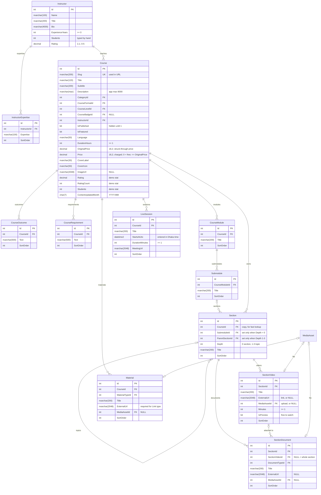

Database-এর CHECK নিয়ম: `Section`-এ হয় `SubmoduleId` আছে আর `Depth = 0`, নয়তো `ParentSectionId` আছে আর `Depth` 1–3 — দুটো একসাথে হতে পারে না। `Course`-এ `Price <= OriginalPrice`।

### 6.4 Commerce — পেমেন্ট ও এনরোলমেন্ট

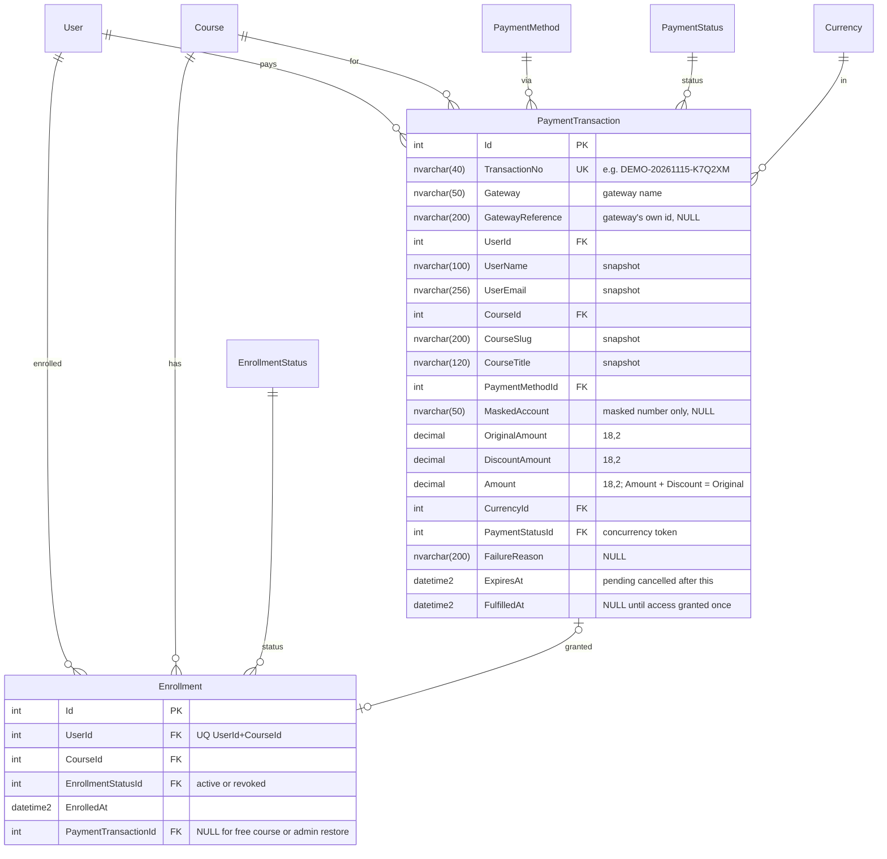

### 6.5 Learning — শেখার অগ্রগতি

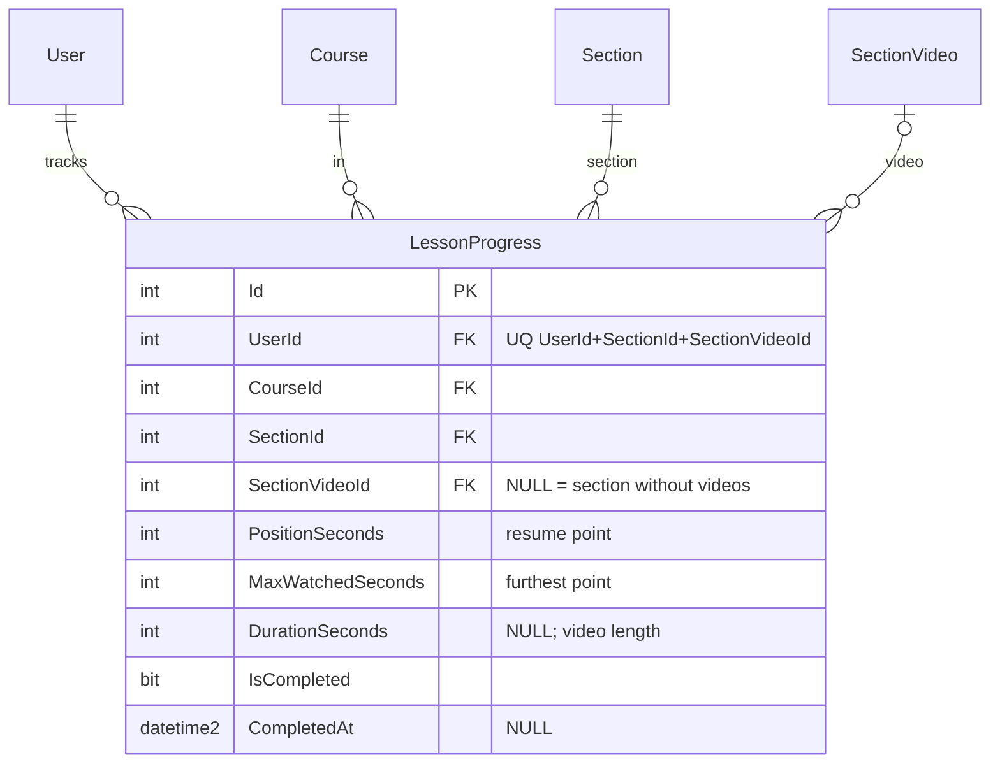

### 6.6 Media — আপলোড করা ফাইল

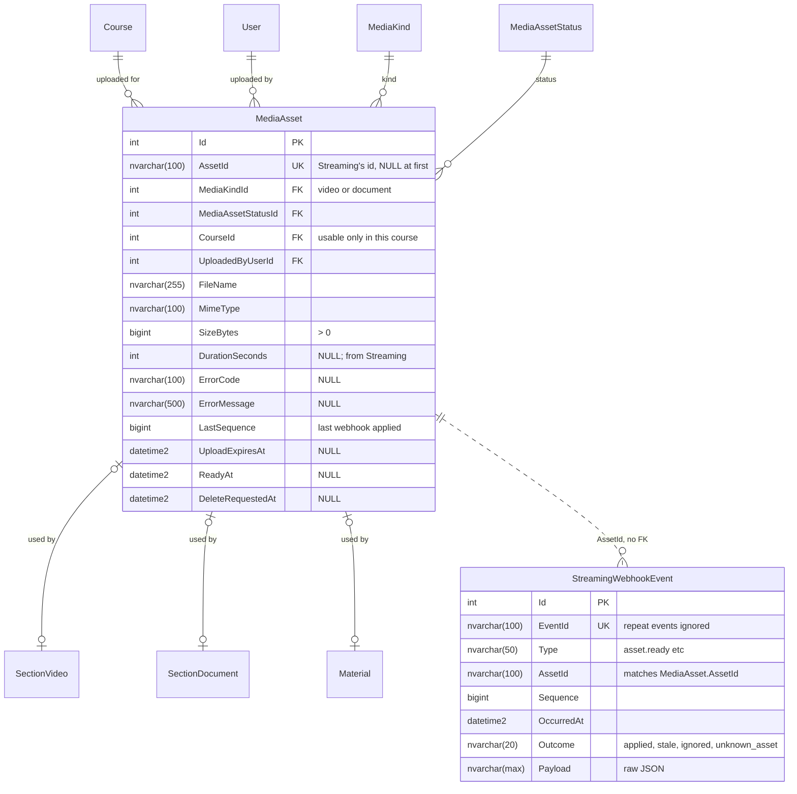

> গুরুত্বপূর্ণ: আপলোড করা ফাইলের **URL ডাটাবেসে রাখা হয় না**। শুধু Streaming-এর `AssetId` থাকে। কেউ ভিডিও চালাতে চাইলে অ্যাপ অনুমতি যাচাই করে Streaming থেকে **অল্প সময়ের জন্য বৈধ** একটা লিংক এনে দেয়।

### 6.7 Certification — সার্টিফিকেট

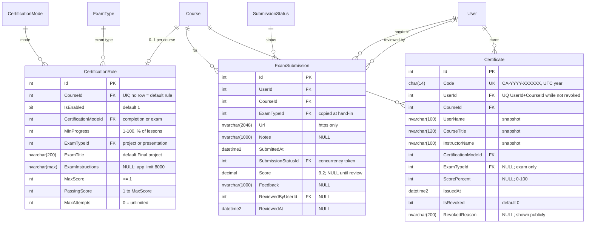

> কোর্সে নিয়ম save করা না থাকলে **default নিয়ম** চলে: চালু, completion, 100%। কোর্স মুছলেও এই তিন টেবিলের row থাকে — সার্টিফিকেট তখনও যাচাই করা যায় (নাম/শিরোনাম কপি করা থাকে)।

### 6.8 Community — কোর্সের আলোচনা

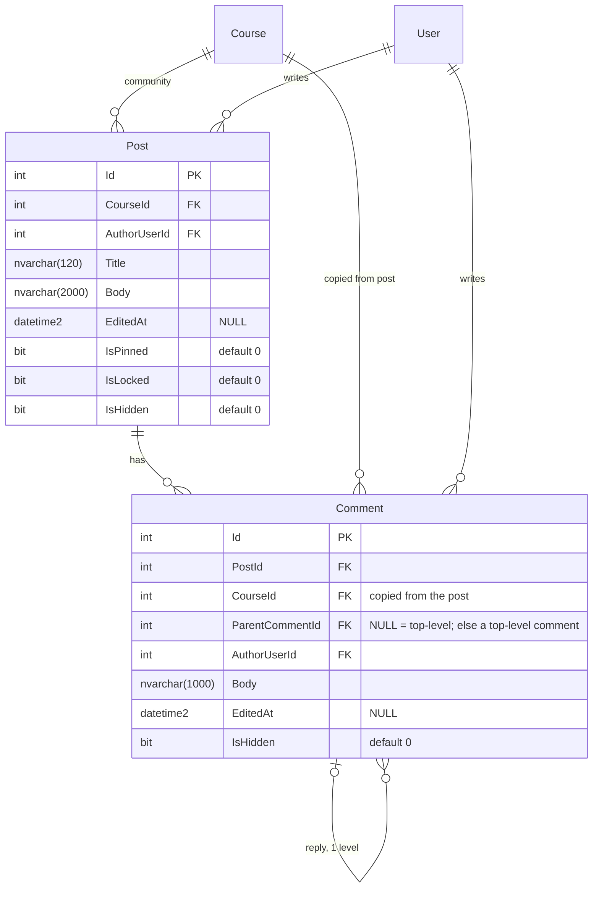

> Reply সবসময় এক ধাপ: reply-এর reply দিলে সেটা মূল (top-level) comment-এর নিচেই যায়। Index: Post `(CourseId, IsPinned DESC, CreatedAt DESC)` — pinned আগে, তারপর নতুনগুলো।

---

## 7. Data Flow — কোন কাজে কোন টেবিলে কী হয়

প্রতিটি request এই পথে যায়:

```
Angular (UI)  →  Controller  →  Service (নিয়ম + অনুমতি যাচাই)  →  Repository  →  EF Core  →  SQL Server
                                                   ↑
                         Save-এর ঠিক আগে AuditInterceptor: CreatedAt/UpdatedAt বসায়, delete-কে soft delete বানায়
```

### 7.1 রেজিস্ট্রেশন ও লগইন

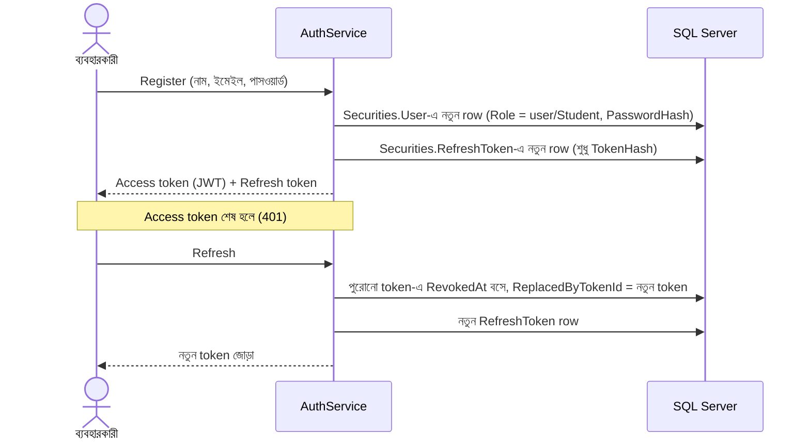

- **রেজিস্টার**: `User` টেবিলে একটা row, সবসময় Student role (`Role.Code = "user"`)। ইমেইল ছোট হাতের অক্ষরে রাখা হয়; একই ইমেইল দুবার হলে unique index আটকে দেয়। পাসওয়ার্ড কখনো সরাসরি রাখা হয় না, শুধু hash।
- **লগইন**: ইমেইল দিয়ে `User` খোঁজে, hash মিলিয়ে দেখে। মিললে পুরোনো মেয়াদোত্তীর্ণ `RefreshToken` row মুছে ফেলে (hard delete) এবং নতুন একটা যোগ করে। "Remember me" দিলে `IsPersistent = 1` আর মেয়াদ লম্বা।
- **Refresh (rotation)**: প্রতিটি refresh token একবারই চলে। ব্যবহার হলে `RevokedAt` বসে আর নতুন token তৈরি হয়।
- **চুরি ধরা**: একবার ব্যবহার করা token আবার এলে ধরে নেওয়া হয় চুরি হয়েছে — ওই user-এর **সব** সক্রিয় token বাতিল হয়।
- **Logout**: token-এর `RevokedAt` বসে।

### 7.2 অনুমতি কীভাবে হিসাব হয় (Access control)

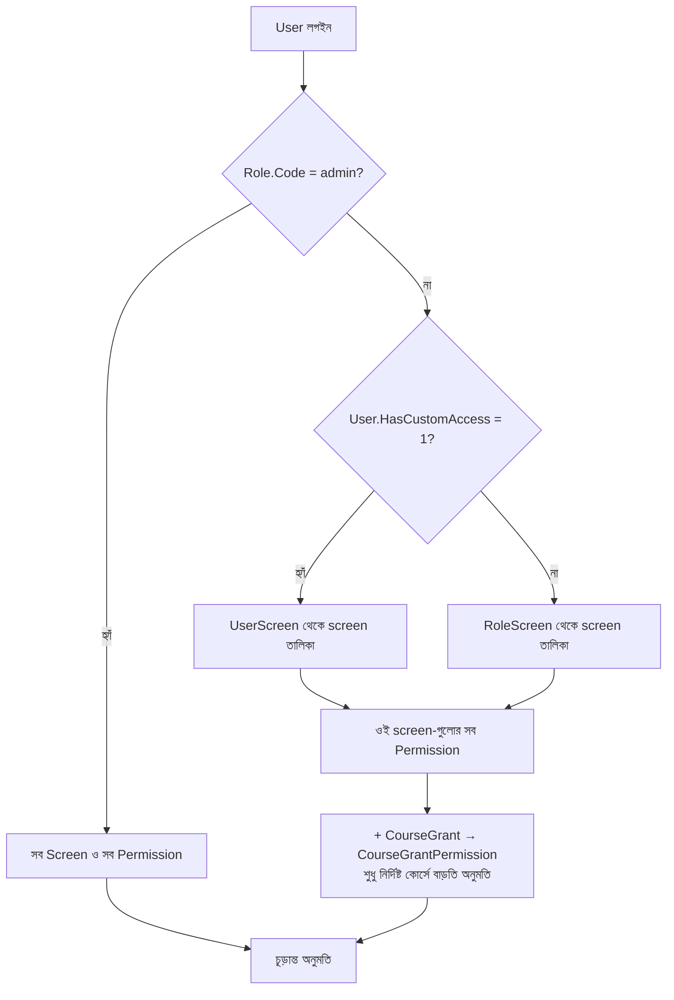

- **Screen** = একটা পাতা (যেমন `courses`, `learn`)। **Permission** = ওই পাতার একটা কাজ (`courses.view`, `courses.edit`)। অনুমতি দেওয়া হয় **পুরো screen ধরে** — একটা screen দিলে তার সব permission পাওয়া যায়।
- শুরুতে (seed) Student ও Instructor role পায় ৪টি student screen: `dashboard`, `learn`, `checkout`, `community`। Admin সবসময় সব পায়, কমানো যায় না।
- **CourseGrant**: কাউকে শুধু একটা কোর্সে বাড়তি অনুমতি দেওয়া (যেমন instructor তার নিজের কোর্সে `courses.edit`)। শুধু `IsCourseGrantable = 1` permission দেওয়া যায়: `courses.view`, `courses.edit`, `community.moderate`, `certificates.manage`। খালি তালিকা পাঠালে grant মুছে যায় (hard delete)।
- Admin যদি কোনো user-এর জন্য আলাদা screen বেছে দেন → `HasCustomAccess = 1` এবং `UserScreen`-এ row; "reset" করলে আবার role-এর অনুমতিতে ফিরে যায়।
- `admin.access` কোনো টেবিলে রাখা হয় না — কারো কোনো admin screen বা course grant থাকলে নিজে থেকে হিসাব হয়।
- **Role মোছা**: built-in role (`IsSystem = 1`) মোছা যায় না; কোনো user ওই role-এ থাকলেও মোছা যায় না।

### 7.3 কোর্স তৈরি ও সিলেবাস সাজানো (Admin/Instructor)

1. Admin `Instructor` প্রোফাইল তৈরি করেন (সাথে `InstructorExpertise` — প্রতি save-এ পুরোনো তালিকা মুছে নতুন বসে)। চাইলে কোনো user account-কে এই instructor-এর সাথে যুক্ত করা যায় (`User.InstructorId`)।
2. `Course` row তৈরি হয় — Category, Format, Level, Badge (ঐচ্ছিক) ও Instructor-এর FK নিয়ে। `IsPublished = 0` থাকলে catalogue-এ দেখা যায় না। `CourseOutcome`/`CourseRequirement` প্রতি save-এ নতুন করে লেখা হয়।
3. সিলেবাস save হলে পুরো গাছ একসাথে আসে: `CourseModule → Submodule → Section → (Topic) → SectionVideo / SectionDocument`। যেগুলো নতুন তালিকায় নেই সেগুলো soft delete হয়।
4. `LiveSession` ও `Material` আলাদা ফর্মে save হয় — একই নিয়মে (না থাকলে soft delete)।
5. কোনো ভিডিও/ডকুমেন্ট থেকে ফাইল সরিয়ে দিলে এবং ফাইলটা আর কোথাও ব্যবহার না হলে, `MediaAsset` "deleting" হয় (§7.4)।

### 7.4 ভিডিও/ডকুমেন্ট আপলোড (Media flow)

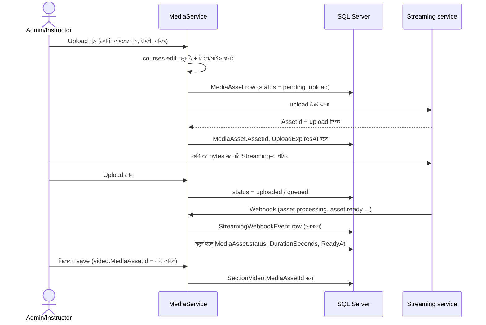

- সীমা: ভিডিও MP4/WebM/MOV, সর্বোচ্চ 2 GB; ডকুমেন্ট PDF/DOCX/PPTX, সর্বোচ্চ 50 MB।
- একটা ফাইল **শুধু যে কোর্সের জন্য আপলোড** হয়েছে সেখানেই এবং **একটাই জায়গায়** ব্যবহার করা যায়।
- **Webhook নিরাপত্তা**: signature (HMAC) ও সময় যাচাই হয়। প্রতিটি event `StreamingWebhookEvent`-এ রাখা হয়; একই `EventId` আবার এলে উপেক্ষা হয়। `Sequence` পুরোনো হলে ("stale") status বদলায় না — তাই দেরিতে আসা event ভুল করে না।
- Webhook না এলে: admin status দেখতে চাইলে ৩০ সেকেন্ডের বেশি আটকে থাকলে অ্যাপ নিজেই Streaming-কে জিজ্ঞেস করে।
- **দেখা/ডাউনলোড**: কোর্সে access থাকলে (বা ভিডিওটা preview হলে) অ্যাপ Streaming থেকে অল্প সময়ের লিংক আনে। ফাইল `ready` না হলে দেখানো হয় না।
- **মোছা**: ফাইল "deleting" হয় → background worker (প্রতি মিনিটে বা সাথে সাথে) Streaming-কে delete পাঠায়, `DeleteRequestedAt` বসে → Streaming `asset.deleted` পাঠালে "deleted"।

### 7.5 কোর্স কেনা (Checkout & Payment)

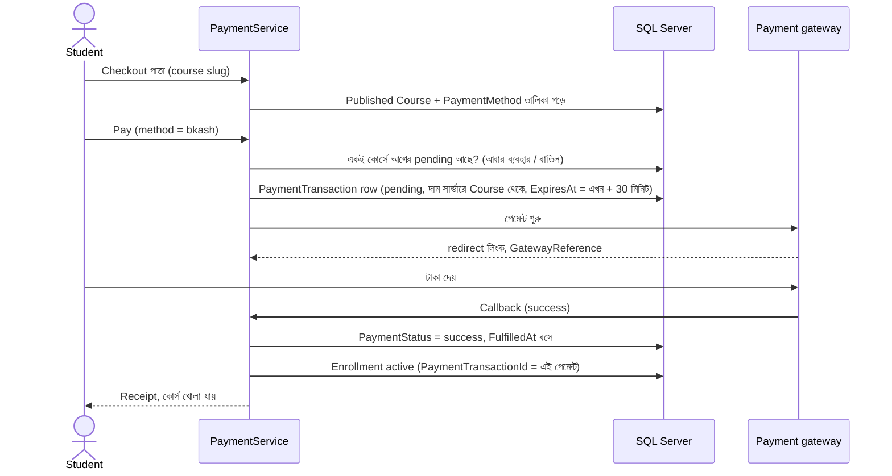

ধাপে ধাপে:
1. **দাম সার্ভার ঠিক করে**: `Amount = Course.Price`, `OriginalAmount = Course.OriginalPrice`, `DiscountAmount` = পার্থক্য। Browser থেকে আসা দাম মানা হয় না। CHECK: `Amount + DiscountAmount = OriginalAmount`।
2. **Snapshot**: user-এর নাম/ইমেইল ও কোর্সের slug/title পেমেন্টে কপি হয় — পরে কোর্সের নাম বদলালে বা মুছলেও রসিদ ঠিক থাকে।
3. **এক কোর্সে একটাই খোলা পেমেন্ট**: একই method হলে আগের pending-টাই চালিয়ে যায়; অন্য method হলে আগেরটা `cancelled` ("Replaced by a new payment")।
4. **ফলাফল**: gateway callback বা receipt পাতায় status জিজ্ঞেস করে আসে। শুধু `pending` পেমেন্ট বদলায়, তাই একই callback বারবার এলেও ক্ষতি নেই। দুটো request একসাথে এলে concurrency token-এর কারণে প্রথমটাই জেতে।
5. **Fulfilment (একবারই)**: success হলে `FulfilledAt` বসে এবং `Enrollment` active হয়। `FulfilledAt` আগে থেকে থাকলে আর কিছু হয় না।
6. **সময় শেষ**: background worker প্রতি মিনিটে মেয়াদোত্তীর্ণ pending-কে `cancelled` ("The payment time ran out.") করে। এর পরেও gateway success পাঠালে মেনে নেওয়া হয় (টাকা তো দিয়েছে)।
7. **Admin**: শুধু এই পরিবর্তন — pending → success/cancelled, success → refunded। **Refund** হলে ওই পেমেন্টের enrollment `revoked`। success পেমেন্ট মোছা যায় না (আগে refund); অন্যগুলো soft delete।
8. **Free কোর্স** (`Price = 0`): কোনো পেমেন্ট ছাড়াই সরাসরি `Enrollment` (PaymentTransactionId = NULL)।

### 7.6 Enrollment (কোর্সে প্রবেশাধিকার)

- প্রতি user + কোর্সে **একটাই row** (unique index)। আবার কিনলে নতুন row হয় না — পুরোনো row আবার `active` হয়, `EnrolledAt` ও `PaymentTransactionId` নতুন করে বসে।
- **Course access** মানে: active enrollment **অথবা** ওই কোর্সে `courses.view` অনুমতি (admin/instructor)।
- Admin হাতে `active` ↔ `revoked` করতে পারেন।

### 7.7 শেখা ও অগ্রগতি (Learning progress)

- **Lesson কী?** প্রতিটি দেখা-যায় এমন ভিডিও = ১টা lesson। যে section-এ কোনো ভিডিও নেই, সেই section নিজেই = ১টা lesson। (লিংক/ফাইল নেই বা ফাইল `ready` না হলে ভিডিও গোনা হয় না।)
- প্রতি user + lesson-এ `LessonProgress`-এ **একটাই row** — প্রথমবার দেখলে/চিহ্ন দিলে তৈরি হয়, তারপর শুধু update।
- **ভিডিও দেখার সময়** player অবস্থান পাঠায় → `PositionSeconds` (পরে এখান থেকে শুরু), `MaxWatchedSeconds` (সবচেয়ে দূর পর্যন্ত)। আপলোড করা ভিডিওতে Streaming-এর মাপা দৈর্ঘ্য ধরা হয়।
- **৯০% দেখলে নিজে থেকে complete** (`IsCompleted = 1`, `CompletedAt` বসে) — একবারই; student পরে "not done" করলে আবার নিজে থেকে complete হয় না।
- YouTube/Vimeo লিংকের অবস্থান পড়া যায় না → শুধু "Mark as complete" বাটন।
- **শতাংশ** = complete lesson ÷ মোট lesson × 100 — প্রতিবার **বর্তমান সিলেবাস** থেকে হিসাব হয়; কোথাও শতাংশ জমা রাখা হয় না। মুছে ফেলা ভিডিওর পুরোনো row থেকে যায় কিন্তু গোনা হয় না।
- অনুমতি: `learn.view` + course access থাকতে হবে।
- কোনো lesson complete হলে (বাটন বা ৯০% দেখা) সার্ভার সাথে সাথে সার্টিফিকেটের নিয়ম মিলিয়ে দেখে (§7.10)।

### 7.8 Admin Overview ও তালিকা

Overview পাতা কোনো আলাদা টেবিল রাখে না — `PaymentTransaction`, `Enrollment`, `Course`, `User` থেকে সংখ্যা গুনে দেখায়। Transaction তালিকায় মোট আয় = `success` পেমেন্টের `Amount` যোগফল (তারিখের filter বাংলাদেশ সময় ধরে)।

### 7.9 কিছু মুছলে কী হয়

| কী মুছবেন | কী হয় |
|---|---|
| **Course** | Course soft delete; এর সব `Enrollment`, `Post`, `Comment` soft delete; সব `CourseGrant` hard delete; এর সব `MediaAsset` "deleting"। **থেকে যায়**: `PaymentTransaction` (রেকর্ড), `LessonProgress`, `CertificationRule`, `ExamSubmission`, `Certificate` (যাচাই চলে) |
| **Post** | Post soft delete + তার সব `Comment` soft delete (লেখক বা moderator) |
| **Comment** | Comment soft delete + তার reply-গুলো soft delete (লেখক বা moderator) |
| **Instructor** | কোনো কোর্স পড়ালে মোছা যায় না (আগে অন্য instructor দিন)। মুছলে যুক্ত user-এর `InstructorId = NULL` |
| **Role** | Built-in বা user আছে এমন role মোছা যায় না; মুছলে তার `RoleScreen` hard delete |
| **PaymentTransaction** | success হলে মোছা যায় না; অন্যথায় soft delete |
| **সিলেবাসের অংশ** | save-এ যা বাদ পড়ে তা soft delete; অব্যবহৃত ফাইল "deleting" |
| **MediaAsset** | এখনো কোথাও ব্যবহার হলে মোছা যায় না |
| **Certificate** | মোছা হয় না — শুধু `IsRevoked = 1` (revoke) বা আবার 0 (restore) |

### 7.10 সার্টিফিকেট (Certification)

| কাজ | কে | টেবিলে কী হয় |
|---|---|---|
| নিয়ম ঠিক করা | `certificates.manage` (কোর্সে) | `CertificationRule`-এ row তৈরি/update (প্রতি কোর্সে একটাই) |
| Completion সার্টিফিকেট | active enrolled student | lesson % ≥ `MinProgress` হলে সার্ভার নিজে `Certificate` row বানায় (lesson complete হওয়ার সময়, বা "Get my certificate") |
| Exam জমা | active enrolled student, `learn.view` | `ExamSubmission` row, status `submitted` — শর্ত: % পূরণ, কোনো বৈধ বা revoked সার্টিফিকেট নেই, অপেক্ষমাণ/passed জমা নেই, attempt বাকি |
| Review | `certificates.manage` (কোর্সে) | `ExamSubmission` → `passed`/`failed`, `Score`, `Feedback`, `ReviewedByUserId`; pass হলে `Certificate` (mode exam, `ScorePercent`) |
| Revoke / Restore | `certificates.manage` (কোর্সে) | `Certificate.IsRevoked` 1/0, `RevokedReason`। Revoked থাকলে নতুন কোনো সার্টিফিকেট দেওয়া হয় না — শুধু Restore |
| যাচাই (verify) | সবাই (লগইন ছাড়াও) | `Certificate.Code` দিয়ে খোঁজা (বড়-ছোট হাতের অক্ষর একই) |

- Code: `CA-<বছর>-<৬ অক্ষর>`, বছর = UTC-তে issue-এর বছর; অক্ষরে I, O, 0, 1 নেই। একই code দুবার হয় না।
- একজন user-এর এক কোর্সে **একটাই বৈধ** সার্টিফিকেট (filtered unique index)।

### 7.11 কমিউনিটি (Community)

| কাজ | কে | টেবিলে কী হয় |
|---|---|---|
| পড়া | moderator, অথবা `community.view` + course access | `Post` (hidden বাদে; moderator সব দেখে), ২০টা করে পাতা |
| Post / comment / reply | পড়তে পারে + `community.post` (বা moderator) | `Post` / `Comment` row; locked post-এ শুধু moderator comment করতে পারে |
| Edit | শুধু লেখক | `Title`/`Body`, `EditedAt` |
| Pin / Lock / Hide | `community.moderate` (কোর্সে) | `IsPinned`, `IsLocked`, `IsHidden` |
| বাইরের কেউ | সবাই | শুধু লুকানো নয় এমন post-এর সংখ্যা |

- লেখকের badge (Admin / Instructor / Student) সার্ভার হিসাব করে: admin role → Admin; কোর্সটা পড়ান বা কোর্সে `courses.edit` grant → Instructor।
- মুছে ফেলা user-এর লেখা "Former member" নামে দেখায়।

---

## 8. Status-এর পরিবর্তন (State diagram)

### 8.1 PaymentStatus

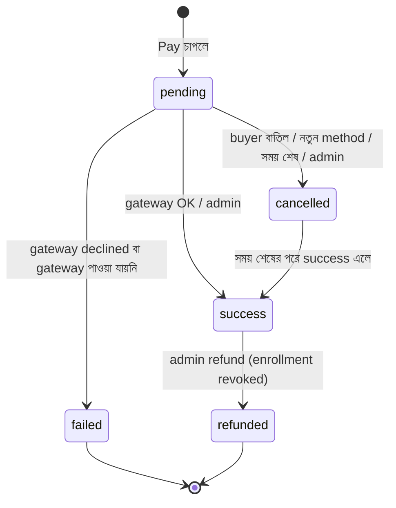

### 8.2 EnrollmentStatus

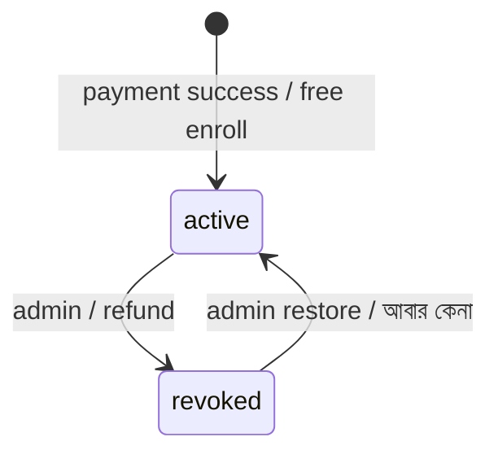

### 8.3 MediaAssetStatus

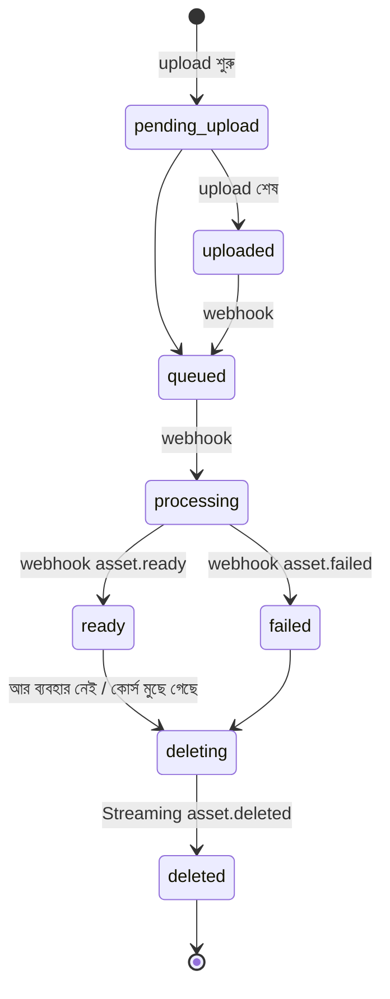

### 8.4 SubmissionStatus (central exam)

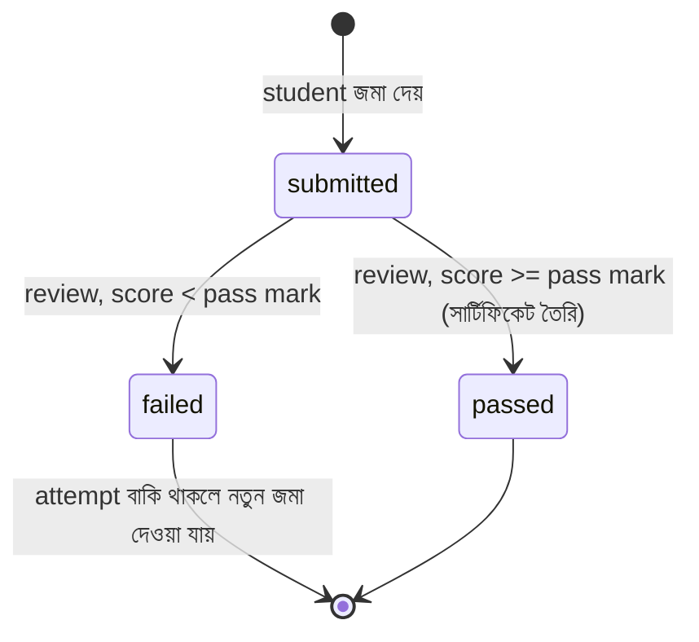

### 8.5 Certificate

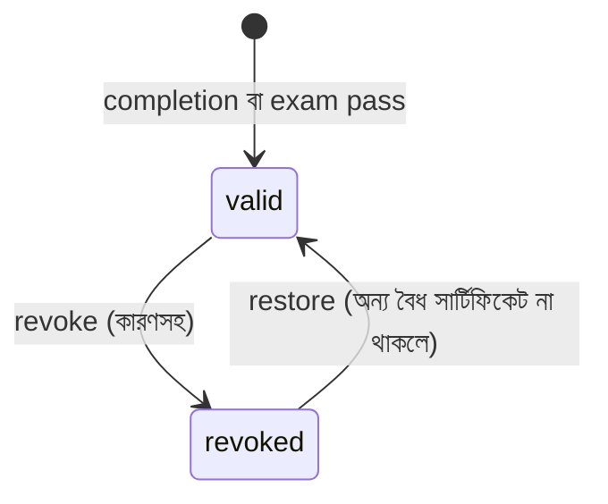

---

## 9. এখনো ডিজাইন হয়নি এমন টেবিল

Certificate ও Community-এর টেবিল 2026-11-20-এ তৈরি হয়েছে (§6.7, §6.8)। এখনো ডিজাইন হয়নি (ব্যবসায়িক সিদ্ধান্তের অপেক্ষায়): Review, ContactMessage, CareerApplication, Opportunity, SportsStory, Testimonial, FaqItem।

---

## 10. ডায়াগ্রাম কাস্টমাইজ করার নিয়ম

**Mermaid-এ নতুন টেবিল যোগ করা:**

```text
erDiagram
  Course ||--o{ CourseReview : "has reviews"     <- সম্পর্ক
  User   ||--o{ CourseReview : "writes"

  CourseReview {
    int Id PK
    int CourseId FK
    int UserId FK
    int Stars "1-5"                              <- "..." = ছোট মন্তব্য
    nvarchar(1000) Comment
  }
```

- কলামের লাইন: `টাইপ নাম [PK|FK|UK] ["মন্তব্য"]`। টাইপে কমা দেওয়া যাবে না (`decimal(18,2)` না লিখে `decimal "18,2"`)।
- টেবিলের নামে স্পেস বা ডট দেবেন না (`Securities.User` না লিখে `User`)।
- সম্পর্কের লেবেল সবসময় `: "..."` দিয়ে।
- ঐচ্ছিক FK (NULL হতে পারে) হলে বাম পাশে `|o`, বাধ্যতামূলক হলে `||`।
- বেশি বড় হলে আলাদা schema-র ছোট ডায়াগ্রামে ভাগ করুন (§6-এর মতো)।

**সাজানো/রং/ছবি চাইলে**: §12-এর DBML কোড dbdiagram.io-তে পেস্ট করুন → টেবিল টেনে সাজান → *Export → PNG/PDF* বা *SQL Server* script।

**মনে রাখবেন**: ডায়াগ্রাম বদলালে ডাটাবেস বদলায় না। আসল ডাটাবেসে বদল আনতে লাগে — Entity class (`Entities/`), configuration (`Data/Configurations/`), `DbSchemas.cs`-এ schema, নতুন migration, এবং `docs/business/data-model.md` আপডেট।

---

## 11. যা লক্ষ্য করেছি (ছোট নোট)

- `Data/Migrations`-এ `InitialCreate`-এর পাশাপাশি একটা **খালি** migration `InitialMigration` আছে (Up/Down ফাঁকা)। ক্ষতি নেই, তবে CLAUDE.md বলে "একটাই migration"।
- Certificate ও Community-এর টেবিল আলাদা migration `AddCertificationAndCommunity`-এ এসেছে, যাতে আগের ডাটা না মুছে ডাটাবেস update করা যায়।
- `Comment.CourseId` post থেকে কপি করা (অতিরিক্ত কলাম) — কোর্স ধরে খোঁজা ও কোর্স মোছার সময় দ্রুত হয়।
- `data-model.md`-এ `Course.Description`, `Instructor.Bio`, outcome/requirement text `nvarchar(max)` লেখা; কোডে app-সীমা যথাক্রমে 8000, 4000, 500 (SQL-এ Description `nvarchar(max)`, Bio `nvarchar(4000)`, text `nvarchar(500)`)।
- `MediaAsset` ↔ `SectionVideo`/`SectionDocument`/`Material` "একটা ফাইল একটা জায়গায়" — এটা অ্যাপের নিয়ম; ডাটাবেসে `MediaAssetId`-এর index unique নয়। `PaymentTransaction` ↔ `Enrollment` ১–০..১-ও একইভাবে অ্যাপের নিয়ম।
- `StreamingWebhookEvent.AssetId` আর `MediaAsset.AssetId`-এর মধ্যে আসল FK নেই (ইচ্ছাকৃত — অজানা asset-এর event-ও রাখা হয়)।
- `PaymentTransaction.UserId`/`CourseId`-এ FK আছে, কিন্তু নাম/ইমেইল/title কপি রাখা হয় যাতে পরে বদলালেও রসিদ ঠিক থাকে।

---

## 12. Appendix: DBML (dbdiagram.io-তে টেনে-সাজানো যায় এমন ডায়াগ্রাম)

[dbdiagram.io](https://dbdiagram.io/d) খুলুন → বাম পাশের সব লেখা মুছে নিচের কোড পেস্ট করুন। `headercolor` বদলে রং, `Note` বদলে ব্যাখ্যা দিতে পারবেন। Standard কলাম (`CreatedAt`, `UpdatedAt`, `IsDeleted`) সব টেবিলে লেখা আছে, যাতে এখান থেকে SQL export করলে আসল টেবিলের মতো হয়।

```dbml
Project CourseAcademy {
  database_type: 'SQL Server'
  Note: 'Course Academy — CourseAcademyDB. All tables: soft delete via IsDeleted except join/token tables.'
}

// ===================== Securities =====================
Table Securities.Role [headercolor: #C0392B] {
  Id int [pk, increment]
  Code nvarchar(50) [not null, unique, note: 'admin, instructor, user']
  Name nvarchar(200) [not null, unique]
  Description nvarchar(500)
  IsSystem bit [not null, default: false]
  CreatedAt datetime2(3) [not null, default: `sysutcdatetime()`]
  UpdatedAt datetime2(3)
  IsDeleted bit [not null, default: false]
}

Table Securities.User [headercolor: #C0392B] {
  Id int [pk, increment]
  Name nvarchar(100) [not null]
  Email nvarchar(256) [not null, unique, note: 'lower-case; unique where IsDeleted = 0']
  Phone nvarchar(20)
  PasswordHash nvarchar(500) [not null]
  RoleId int [not null]
  HasCustomAccess bit [not null, default: false]
  InstructorId int [unique, note: 'NULL or one account per instructor']
  CreatedAt datetime2(3) [not null, default: `sysutcdatetime()`]
  UpdatedAt datetime2(3)
  IsDeleted bit [not null, default: false]
}

Table Securities.Screen [headercolor: #C0392B] {
  Id int [pk, increment]
  Code nvarchar(50) [not null, unique]
  Name nvarchar(100) [not null]
  SortOrder int [not null]
  Area nvarchar(20) [not null, note: "CHECK IN ('admin','student')"]
  Path nvarchar(200) [not null]
  Icon nvarchar(50) [not null]
  IsCourseScoped bit [not null]
  Section nvarchar(50)
  CreatedAt datetime2(3) [not null, default: `sysutcdatetime()`]
  UpdatedAt datetime2(3)
  IsDeleted bit [not null, default: false]
}

Table Securities.Permission [headercolor: #C0392B] {
  Id int [pk, increment]
  Code nvarchar(50) [not null, unique, note: 'area.action']
  Name nvarchar(100) [not null]
  SortOrder int [not null]
  ScreenId int [not null]
  Action nvarchar(20) [not null, note: 'view/create/edit/delete/extra']
  IsCourseGrantable bit [not null]
  CreatedAt datetime2(3) [not null, default: `sysutcdatetime()`]
  UpdatedAt datetime2(3)
  IsDeleted bit [not null, default: false]
}

Table Securities.RoleScreen [headercolor: #C0392B, note: 'hard delete'] {
  Id int [pk, increment]
  RoleId int [not null]
  ScreenId int [not null]
  CreatedAt datetime2(3) [not null, default: `sysutcdatetime()`]
  UpdatedAt datetime2(3)
  IsDeleted bit [not null, default: false]
  Indexes { (RoleId, ScreenId) [unique] }
}

Table Securities.UserScreen [headercolor: #C0392B, note: 'hard delete'] {
  Id int [pk, increment]
  UserId int [not null]
  ScreenId int [not null]
  CreatedAt datetime2(3) [not null, default: `sysutcdatetime()`]
  UpdatedAt datetime2(3)
  IsDeleted bit [not null, default: false]
  Indexes { (UserId, ScreenId) [unique] }
}

Table Securities.CourseGrant [headercolor: #C0392B, note: 'hard delete'] {
  Id int [pk, increment]
  UserId int [not null]
  CourseId int [not null]
  CreatedAt datetime2(3) [not null, default: `sysutcdatetime()`]
  UpdatedAt datetime2(3)
  IsDeleted bit [not null, default: false]
  Indexes { (UserId, CourseId) [unique] }
}

Table Securities.CourseGrantPermission [headercolor: #C0392B, note: 'hard delete'] {
  Id int [pk, increment]
  CourseGrantId int [not null]
  PermissionId int [not null]
  CreatedAt datetime2(3) [not null, default: `sysutcdatetime()`]
  UpdatedAt datetime2(3)
  IsDeleted bit [not null, default: false]
  Indexes { (CourseGrantId, PermissionId) [unique] }
}

Table Securities.RefreshToken [headercolor: #C0392B, note: 'hard delete; rotation'] {
  Id int [pk, increment]
  UserId int [not null]
  TokenHash nvarchar(64) [not null, unique]
  ExpiresAt datetime2(3) [not null]
  RevokedAt datetime2(3) [note: 'concurrency token']
  ReplacedByTokenId int
  IsPersistent bit [not null]
  CreatedAt datetime2(3) [not null, default: `sysutcdatetime()`]
  UpdatedAt datetime2(3)
  IsDeleted bit [not null, default: false]
  Indexes { (UserId, ExpiresAt) }
}

// ===================== Lookups =====================
Table Lookups.Category [headercolor: #7F8C8D] {
  Id int [pk, increment]
  Code nvarchar(50) [not null, unique]
  Name nvarchar(100) [not null]
  SortOrder int [not null]
  ShortName nvarchar(100) [not null]
  Description nvarchar(500) [not null]
  Icon nvarchar(50) [not null]
  ImageUrl nvarchar(2048) [not null]
  CreatedAt datetime2(3) [not null, default: `sysutcdatetime()`]
  UpdatedAt datetime2(3)
  IsDeleted bit [not null, default: false]
}

Table Lookups.CategorySkill [headercolor: #7F8C8D, note: 'hard delete'] {
  Id int [pk, increment]
  CategoryId int [not null]
  Skill nvarchar(100) [not null]
  SortOrder int [not null]
  CreatedAt datetime2(3) [not null, default: `sysutcdatetime()`]
  UpdatedAt datetime2(3)
  IsDeleted bit [not null, default: false]
}

Table Lookups.CourseFormat [headercolor: #7F8C8D] {
  Id int [pk, increment]
  Code nvarchar(50) [not null, unique, note: 'Pre-recorded, Live, Hybrid']
  Name nvarchar(100) [not null]
  SortOrder int [not null]
  CreatedAt datetime2(3) [not null, default: `sysutcdatetime()`]
  UpdatedAt datetime2(3)
  IsDeleted bit [not null, default: false]
}

Table Lookups.CourseLevel [headercolor: #7F8C8D] {
  Id int [pk, increment]
  Code nvarchar(50) [not null, unique, note: 'Beginner, Intermediate, Advanced']
  Name nvarchar(100) [not null]
  SortOrder int [not null]
  CreatedAt datetime2(3) [not null, default: `sysutcdatetime()`]
  UpdatedAt datetime2(3)
  IsDeleted bit [not null, default: false]
}

Table Lookups.CourseBadge [headercolor: #7F8C8D] {
  Id int [pk, increment]
  Code nvarchar(50) [not null, unique, note: 'Bestseller, New, Popular']
  Name nvarchar(100) [not null]
  SortOrder int [not null]
  CreatedAt datetime2(3) [not null, default: `sysutcdatetime()`]
  UpdatedAt datetime2(3)
  IsDeleted bit [not null, default: false]
}

Table Lookups.DocumentType [headercolor: #7F8C8D] {
  Id int [pk, increment]
  Code nvarchar(50) [not null, unique, note: 'PDF, DOCX, PPTX']
  Name nvarchar(100) [not null]
  SortOrder int [not null]
  FileExtension nvarchar(10) [not null]
  CreatedAt datetime2(3) [not null, default: `sysutcdatetime()`]
  UpdatedAt datetime2(3)
  IsDeleted bit [not null, default: false]
}

Table Lookups.MaterialType [headercolor: #7F8C8D] {
  Id int [pk, increment]
  Code nvarchar(50) [not null, unique, note: 'PDF, Slides, Worksheet, Link']
  Name nvarchar(100) [not null]
  SortOrder int [not null]
  CreatedAt datetime2(3) [not null, default: `sysutcdatetime()`]
  UpdatedAt datetime2(3)
  IsDeleted bit [not null, default: false]
}

Table Lookups.EnrollmentStatus [headercolor: #7F8C8D] {
  Id int [pk, increment]
  Code nvarchar(50) [not null, unique, note: 'active, revoked']
  Name nvarchar(100) [not null]
  SortOrder int [not null]
  CreatedAt datetime2(3) [not null, default: `sysutcdatetime()`]
  UpdatedAt datetime2(3)
  IsDeleted bit [not null, default: false]
}

Table Lookups.PaymentStatus [headercolor: #7F8C8D] {
  Id int [pk, increment]
  Code nvarchar(50) [not null, unique, note: 'pending, success, failed, cancelled, refunded']
  Name nvarchar(100) [not null]
  SortOrder int [not null]
  CreatedAt datetime2(3) [not null, default: `sysutcdatetime()`]
  UpdatedAt datetime2(3)
  IsDeleted bit [not null, default: false]
}

Table Lookups.PaymentMethod [headercolor: #7F8C8D] {
  Id int [pk, increment]
  Code nvarchar(50) [not null, unique, note: 'bkash, nagad, rocket, card']
  Name nvarchar(100) [not null]
  SortOrder int [not null]
  Description nvarchar(200) [not null]
  LogoUrl nvarchar(2048)
  Icon nvarchar(50) [not null]
  CreatedAt datetime2(3) [not null, default: `sysutcdatetime()`]
  UpdatedAt datetime2(3)
  IsDeleted bit [not null, default: false]
}

Table Lookups.Currency [headercolor: #7F8C8D] {
  Id int [pk, increment]
  Code nvarchar(50) [not null, unique, note: 'BDT']
  Name nvarchar(100) [not null]
  SortOrder int [not null]
  CreatedAt datetime2(3) [not null, default: `sysutcdatetime()`]
  UpdatedAt datetime2(3)
  IsDeleted bit [not null, default: false]
}

Table Lookups.MediaKind [headercolor: #7F8C8D] {
  Id int [pk, increment]
  Code nvarchar(50) [not null, unique, note: 'video, document']
  Name nvarchar(100) [not null]
  SortOrder int [not null]
  CreatedAt datetime2(3) [not null, default: `sysutcdatetime()`]
  UpdatedAt datetime2(3)
  IsDeleted bit [not null, default: false]
}

Table Lookups.MediaAssetStatus [headercolor: #7F8C8D] {
  Id int [pk, increment]
  Code nvarchar(50) [not null, unique, note: 'pending_upload, uploaded, queued, processing, ready, failed, deleting, deleted']
  Name nvarchar(100) [not null]
  SortOrder int [not null]
  CreatedAt datetime2(3) [not null, default: `sysutcdatetime()`]
  UpdatedAt datetime2(3)
  IsDeleted bit [not null, default: false]
}

Table Lookups.CertificationMode [headercolor: #7F8C8D] {
  Id int [pk, increment]
  Code nvarchar(50) [not null, unique, note: 'completion, exam']
  Name nvarchar(100) [not null]
  SortOrder int [not null]
  CreatedAt datetime2(3) [not null, default: `sysutcdatetime()`]
  UpdatedAt datetime2(3)
  IsDeleted bit [not null, default: false]
}

Table Lookups.ExamType [headercolor: #7F8C8D] {
  Id int [pk, increment]
  Code nvarchar(50) [not null, unique, note: 'project, presentation']
  Name nvarchar(100) [not null]
  SortOrder int [not null]
  CreatedAt datetime2(3) [not null, default: `sysutcdatetime()`]
  UpdatedAt datetime2(3)
  IsDeleted bit [not null, default: false]
}

Table Lookups.SubmissionStatus [headercolor: #7F8C8D] {
  Id int [pk, increment]
  Code nvarchar(50) [not null, unique, note: 'submitted, passed, failed']
  Name nvarchar(100) [not null]
  SortOrder int [not null]
  CreatedAt datetime2(3) [not null, default: `sysutcdatetime()`]
  UpdatedAt datetime2(3)
  IsDeleted bit [not null, default: false]
}

// ===================== Catalog =====================
Table Catalog.Instructor [headercolor: #2980B9] {
  Id int [pk, increment]
  Name nvarchar(100) [not null]
  Title nvarchar(200) [not null]
  Bio nvarchar(4000) [not null]
  ExperienceYears int [not null, note: '>= 0']
  Students int [not null, note: 'typed by hand']
  Rating decimal(2,1) [not null, note: '0-5']
  CreatedAt datetime2(3) [not null, default: `sysutcdatetime()`]
  UpdatedAt datetime2(3)
  IsDeleted bit [not null, default: false]
}

Table Catalog.InstructorExpertise [headercolor: #2980B9, note: 'hard delete'] {
  Id int [pk, increment]
  InstructorId int [not null]
  Expertise nvarchar(100) [not null]
  SortOrder int [not null]
  CreatedAt datetime2(3) [not null, default: `sysutcdatetime()`]
  UpdatedAt datetime2(3)
  IsDeleted bit [not null, default: false]
}

Table Catalog.Course [headercolor: #2980B9] {
  Id int [pk, increment]
  Slug nvarchar(200) [not null, unique]
  Title nvarchar(120) [not null]
  Subtitle nvarchar(200) [not null]
  Description nvarchar(max) [not null]
  CategoryId int [not null]
  CourseFormatId int [not null]
  CourseLevelId int [not null]
  CourseBadgeId int
  InstructorId int [not null]
  IsPublished bit [not null]
  IsFeatured bit [not null]
  Language nvarchar(50) [not null]
  DurationHours int [not null, note: '>= 1']
  OriginalPrice decimal(18,2) [not null]
  Price decimal(18,2) [not null, note: '0 = free; Price <= OriginalPrice']
  CoverLabel nvarchar(30) [not null]
  CoverIcon nvarchar(50) [not null]
  ImageUrl nvarchar(2048)
  Rating decimal(2,1) [not null]
  RatingCount int [not null]
  Students int [not null]
  ContentUpdatedMonth char(7) [not null, note: 'YYYY-MM']
  CreatedAt datetime2(3) [not null, default: `sysutcdatetime()`]
  UpdatedAt datetime2(3)
  IsDeleted bit [not null, default: false]
  Indexes {
    (IsPublished, CategoryId)
    InstructorId
    IsFeatured
  }
}

Table Catalog.CourseOutcome [headercolor: #2980B9, note: 'hard delete'] {
  Id int [pk, increment]
  CourseId int [not null]
  Text nvarchar(500) [not null]
  SortOrder int [not null]
  CreatedAt datetime2(3) [not null, default: `sysutcdatetime()`]
  UpdatedAt datetime2(3)
  IsDeleted bit [not null, default: false]
}

Table Catalog.CourseRequirement [headercolor: #2980B9, note: 'hard delete'] {
  Id int [pk, increment]
  CourseId int [not null]
  Text nvarchar(500) [not null]
  SortOrder int [not null]
  CreatedAt datetime2(3) [not null, default: `sysutcdatetime()`]
  UpdatedAt datetime2(3)
  IsDeleted bit [not null, default: false]
}

Table Catalog.CourseModule [headercolor: #2980B9] {
  Id int [pk, increment]
  CourseId int [not null]
  Title nvarchar(200) [not null]
  SortOrder int [not null]
  CreatedAt datetime2(3) [not null, default: `sysutcdatetime()`]
  UpdatedAt datetime2(3)
  IsDeleted bit [not null, default: false]
}

Table Catalog.Submodule [headercolor: #2980B9] {
  Id int [pk, increment]
  CourseModuleId int [not null]
  Title nvarchar(200) [not null]
  SortOrder int [not null]
  CreatedAt datetime2(3) [not null, default: `sysutcdatetime()`]
  UpdatedAt datetime2(3)
  IsDeleted bit [not null, default: false]
}

Table Catalog.Section [headercolor: #2980B9, note: 'Depth 0 = section under Submodule; Depth 1-3 = topic under ParentSection'] {
  Id int [pk, increment]
  CourseId int [not null]
  SubmoduleId int
  ParentSectionId int
  Depth int [not null]
  Title nvarchar(200) [not null]
  SortOrder int [not null]
  CreatedAt datetime2(3) [not null, default: `sysutcdatetime()`]
  UpdatedAt datetime2(3)
  IsDeleted bit [not null, default: false]
}

Table Catalog.SectionVideo [headercolor: #2980B9] {
  Id int [pk, increment]
  SectionId int [not null]
  Title nvarchar(200) [not null]
  ExternalUrl nvarchar(2048)
  MediaAssetId int
  Minutes int [not null, note: '>= 1']
  IsPreview bit [not null]
  SortOrder int [not null]
  CreatedAt datetime2(3) [not null, default: `sysutcdatetime()`]
  UpdatedAt datetime2(3)
  IsDeleted bit [not null, default: false]
}

Table Catalog.SectionDocument [headercolor: #2980B9] {
  Id int [pk, increment]
  SectionId int [not null]
  SectionVideoId int [note: 'NULL = whole section']
  DocumentTypeId int [not null]
  Title nvarchar(200) [not null]
  ExternalUrl nvarchar(2048)
  MediaAssetId int
  SortOrder int [not null]
  CreatedAt datetime2(3) [not null, default: `sysutcdatetime()`]
  UpdatedAt datetime2(3)
  IsDeleted bit [not null, default: false]
}

Table Catalog.LiveSession [headercolor: #2980B9] {
  Id int [pk, increment]
  CourseId int [not null]
  Title nvarchar(200) [not null]
  StartsAtUtc datetime2(3) [not null]
  DurationMinutes int [not null, note: '>= 1']
  MeetingUrl nvarchar(2048) [not null]
  SortOrder int [not null]
  CreatedAt datetime2(3) [not null, default: `sysutcdatetime()`]
  UpdatedAt datetime2(3)
  IsDeleted bit [not null, default: false]
}

Table Catalog.Material [headercolor: #2980B9] {
  Id int [pk, increment]
  CourseId int [not null]
  MaterialTypeId int [not null]
  Title nvarchar(200) [not null]
  ExternalUrl nvarchar(2048)
  MediaAssetId int
  SortOrder int [not null]
  CreatedAt datetime2(3) [not null, default: `sysutcdatetime()`]
  UpdatedAt datetime2(3)
  IsDeleted bit [not null, default: false]
}

// ===================== Commerce =====================
Table Commerce.Enrollment [headercolor: #27AE60] {
  Id int [pk, increment]
  UserId int [not null]
  CourseId int [not null]
  EnrollmentStatusId int [not null]
  EnrolledAt datetime2(3) [not null]
  PaymentTransactionId int [note: 'NULL for free course / admin restore']
  CreatedAt datetime2(3) [not null, default: `sysutcdatetime()`]
  UpdatedAt datetime2(3)
  IsDeleted bit [not null, default: false]
  Indexes {
    (UserId, CourseId) [unique]
    (CourseId, EnrollmentStatusId)
  }
}

Table Commerce.PaymentTransaction [headercolor: #27AE60] {
  Id int [pk, increment]
  TransactionNo nvarchar(40) [not null, unique]
  Gateway nvarchar(50) [not null]
  GatewayReference nvarchar(200)
  UserId int [not null]
  UserName nvarchar(100) [not null, note: 'snapshot']
  UserEmail nvarchar(256) [not null, note: 'snapshot']
  CourseId int [not null]
  CourseSlug nvarchar(200) [not null, note: 'snapshot']
  CourseTitle nvarchar(120) [not null, note: 'snapshot']
  PaymentMethodId int [not null]
  MaskedAccount nvarchar(50)
  OriginalAmount decimal(18,2) [not null]
  DiscountAmount decimal(18,2) [not null]
  Amount decimal(18,2) [not null, note: 'Amount + DiscountAmount = OriginalAmount']
  CurrencyId int [not null]
  PaymentStatusId int [not null, note: 'concurrency token']
  FailureReason nvarchar(200)
  ExpiresAt datetime2(3) [not null]
  FulfilledAt datetime2(3)
  CreatedAt datetime2(3) [not null, default: `sysutcdatetime()`]
  UpdatedAt datetime2(3)
  IsDeleted bit [not null, default: false]
  Indexes {
    (UserId, CreatedAt)
    (PaymentStatusId, ExpiresAt)
    (Gateway, GatewayReference)
  }
}

// ===================== Learning =====================
Table Learning.LessonProgress [headercolor: #8E44AD] {
  Id int [pk, increment]
  UserId int [not null]
  CourseId int [not null]
  SectionId int [not null]
  SectionVideoId int [note: 'NULL = section without videos']
  PositionSeconds int [not null, default: 0]
  MaxWatchedSeconds int [not null, default: 0]
  DurationSeconds int
  IsCompleted bit [not null, default: false]
  CompletedAt datetime2(3)
  CreatedAt datetime2(3) [not null, default: `sysutcdatetime()`]
  UpdatedAt datetime2(3)
  IsDeleted bit [not null, default: false]
  Indexes {
    (UserId, SectionId, SectionVideoId) [unique]
    (UserId, CourseId)
  }
}

// ===================== Media =====================
Table Media.MediaAsset [headercolor: #E67E22] {
  Id int [pk, increment]
  AssetId nvarchar(100) [unique, note: 'Streaming id; NULL until created']
  MediaKindId int [not null]
  MediaAssetStatusId int [not null]
  CourseId int [not null]
  UploadedByUserId int [not null]
  FileName nvarchar(255) [not null]
  MimeType nvarchar(100) [not null]
  SizeBytes bigint [not null]
  DurationSeconds int
  ErrorCode nvarchar(100)
  ErrorMessage nvarchar(500)
  LastSequence bigint [not null, note: 'concurrency token']
  UploadExpiresAt datetime2(3)
  ReadyAt datetime2(3)
  DeleteRequestedAt datetime2(3)
  CreatedAt datetime2(3) [not null, default: `sysutcdatetime()`]
  UpdatedAt datetime2(3)
  IsDeleted bit [not null, default: false]
  Indexes { (MediaAssetStatusId, DeleteRequestedAt) }
}

Table Media.StreamingWebhookEvent [headercolor: #E67E22] {
  Id int [pk, increment]
  EventId nvarchar(100) [not null, unique]
  Type nvarchar(50) [not null]
  AssetId nvarchar(100) [not null, note: 'matches MediaAsset.AssetId (no FK)']
  Sequence bigint [not null]
  OccurredAt datetime2(3) [not null]
  Outcome nvarchar(20) [not null]
  Payload nvarchar(max) [not null]
  CreatedAt datetime2(3) [not null, default: `sysutcdatetime()`]
  UpdatedAt datetime2(3)
  IsDeleted bit [not null, default: false]
  Indexes { AssetId }
}

// ===================== Certification =====================
Table Certification.CertificationRule [headercolor: #C9A227, note: 'no row = default rule (enabled, completion, 100%)'] {
  Id int [pk, increment]
  CourseId int [not null, unique]
  IsEnabled bit [not null, default: true]
  CertificationModeId int [not null]
  MinProgress int [not null, default: 100, note: '1-100, % of lessons']
  ExamTypeId int [not null]
  ExamTitle nvarchar(200) [not null]
  ExamInstructions nvarchar(max)
  MaxScore int [not null, default: 100]
  PassingScore int [not null, default: 60, note: '1 to MaxScore']
  MaxAttempts int [not null, default: 0, note: '0 = unlimited']
  CreatedAt datetime2(3) [not null, default: `sysutcdatetime()`]
  UpdatedAt datetime2(3)
  IsDeleted bit [not null, default: false]
}

Table Certification.ExamSubmission [headercolor: #C9A227] {
  Id int [pk, increment]
  UserId int [not null]
  CourseId int [not null]
  ExamTypeId int [not null, note: 'copied at hand-in']
  Url nvarchar(2048) [not null]
  Notes nvarchar(1000)
  SubmittedAt datetime2(3) [not null]
  SubmissionStatusId int [not null, note: 'concurrency token']
  Score decimal(9,2) [note: '>= 0; NULL until reviewed']
  Feedback nvarchar(1000)
  ReviewedByUserId int
  ReviewedAt datetime2(3)
  CreatedAt datetime2(3) [not null, default: `sysutcdatetime()`]
  UpdatedAt datetime2(3)
  IsDeleted bit [not null, default: false]
  Indexes {
    (CourseId, SubmissionStatusId, SubmittedAt)
    (UserId, CourseId)
  }
}

Table Certification.Certificate [headercolor: #C9A227] {
  Id int [pk, increment]
  Code char(14) [not null, unique, note: 'CA-YYYY-XXXXXX']
  UserId int [not null]
  CourseId int [not null]
  UserName nvarchar(100) [not null, note: 'snapshot']
  CourseTitle nvarchar(120) [not null, note: 'snapshot']
  InstructorName nvarchar(100) [not null, note: 'snapshot']
  CertificationModeId int [not null]
  ExamTypeId int [note: 'exam only']
  ScorePercent int [note: '0-100; exam only']
  IssuedAt datetime2(3) [not null]
  IsRevoked bit [not null, default: false]
  RevokedReason nvarchar(200)
  CreatedAt datetime2(3) [not null, default: `sysutcdatetime()`]
  UpdatedAt datetime2(3)
  IsDeleted bit [not null, default: false]
  Indexes {
    (UserId, CourseId) [unique, note: 'WHERE IsRevoked = 0 AND IsDeleted = 0']
    CourseId
  }
}

// ===================== Community =====================
Table Community.Post [headercolor: #16A085] {
  Id int [pk, increment]
  CourseId int [not null]
  AuthorUserId int [not null]
  Title nvarchar(120) [not null]
  Body nvarchar(2000) [not null]
  EditedAt datetime2(3)
  IsPinned bit [not null, default: false]
  IsLocked bit [not null, default: false]
  IsHidden bit [not null, default: false]
  CreatedAt datetime2(3) [not null, default: `sysutcdatetime()`]
  UpdatedAt datetime2(3)
  IsDeleted bit [not null, default: false]
  Indexes {
    (CourseId, IsPinned, CreatedAt)
    AuthorUserId
  }
}

Table Community.Comment [headercolor: #16A085, note: 'reply = ParentCommentId set; one level deep'] {
  Id int [pk, increment]
  PostId int [not null]
  CourseId int [not null, note: 'copied from the post']
  ParentCommentId int
  AuthorUserId int [not null]
  Body nvarchar(1000) [not null]
  EditedAt datetime2(3)
  IsHidden bit [not null, default: false]
  CreatedAt datetime2(3) [not null, default: `sysutcdatetime()`]
  UpdatedAt datetime2(3)
  IsDeleted bit [not null, default: false]
  Indexes {
    (PostId, CreatedAt)
    ParentCommentId
    (CourseId, CreatedAt)
  }
}

// ===================== Relationships =====================
// Securities
Ref: Securities.User.RoleId > Securities.Role.Id
Ref: Securities.User.InstructorId - Catalog.Instructor.Id
Ref: Securities.RoleScreen.RoleId > Securities.Role.Id
Ref: Securities.RoleScreen.ScreenId > Securities.Screen.Id
Ref: Securities.UserScreen.UserId > Securities.User.Id
Ref: Securities.UserScreen.ScreenId > Securities.Screen.Id
Ref: Securities.Permission.ScreenId > Securities.Screen.Id
Ref: Securities.CourseGrant.UserId > Securities.User.Id
Ref: Securities.CourseGrant.CourseId > Catalog.Course.Id
Ref: Securities.CourseGrantPermission.CourseGrantId > Securities.CourseGrant.Id
Ref: Securities.CourseGrantPermission.PermissionId > Securities.Permission.Id
Ref: Securities.RefreshToken.UserId > Securities.User.Id
Ref: Securities.RefreshToken.ReplacedByTokenId - Securities.RefreshToken.Id

// Lookups -> Catalog
Ref: Lookups.CategorySkill.CategoryId > Lookups.Category.Id
Ref: Catalog.Course.CategoryId > Lookups.Category.Id
Ref: Catalog.Course.CourseFormatId > Lookups.CourseFormat.Id
Ref: Catalog.Course.CourseLevelId > Lookups.CourseLevel.Id
Ref: Catalog.Course.CourseBadgeId > Lookups.CourseBadge.Id
Ref: Catalog.SectionDocument.DocumentTypeId > Lookups.DocumentType.Id
Ref: Catalog.Material.MaterialTypeId > Lookups.MaterialType.Id

// Catalog
Ref: Catalog.InstructorExpertise.InstructorId > Catalog.Instructor.Id
Ref: Catalog.Course.InstructorId > Catalog.Instructor.Id
Ref: Catalog.CourseOutcome.CourseId > Catalog.Course.Id
Ref: Catalog.CourseRequirement.CourseId > Catalog.Course.Id
Ref: Catalog.CourseModule.CourseId > Catalog.Course.Id
Ref: Catalog.Submodule.CourseModuleId > Catalog.CourseModule.Id
Ref: Catalog.Section.SubmoduleId > Catalog.Submodule.Id
Ref: Catalog.Section.ParentSectionId > Catalog.Section.Id
Ref: Catalog.Section.CourseId > Catalog.Course.Id
Ref: Catalog.SectionVideo.SectionId > Catalog.Section.Id
Ref: Catalog.SectionDocument.SectionId > Catalog.Section.Id
Ref: Catalog.SectionDocument.SectionVideoId > Catalog.SectionVideo.Id
Ref: Catalog.LiveSession.CourseId > Catalog.Course.Id
Ref: Catalog.Material.CourseId > Catalog.Course.Id
Ref: Catalog.SectionVideo.MediaAssetId > Media.MediaAsset.Id
Ref: Catalog.SectionDocument.MediaAssetId > Media.MediaAsset.Id
Ref: Catalog.Material.MediaAssetId > Media.MediaAsset.Id

// Commerce
Ref: Commerce.Enrollment.UserId > Securities.User.Id
Ref: Commerce.Enrollment.CourseId > Catalog.Course.Id
Ref: Commerce.Enrollment.EnrollmentStatusId > Lookups.EnrollmentStatus.Id
Ref: Commerce.Enrollment.PaymentTransactionId > Commerce.PaymentTransaction.Id
Ref: Commerce.PaymentTransaction.UserId > Securities.User.Id
Ref: Commerce.PaymentTransaction.CourseId > Catalog.Course.Id
Ref: Commerce.PaymentTransaction.PaymentMethodId > Lookups.PaymentMethod.Id
Ref: Commerce.PaymentTransaction.CurrencyId > Lookups.Currency.Id
Ref: Commerce.PaymentTransaction.PaymentStatusId > Lookups.PaymentStatus.Id

// Learning
Ref: Learning.LessonProgress.UserId > Securities.User.Id
Ref: Learning.LessonProgress.CourseId > Catalog.Course.Id
Ref: Learning.LessonProgress.SectionId > Catalog.Section.Id
Ref: Learning.LessonProgress.SectionVideoId > Catalog.SectionVideo.Id

// Media
Ref: Media.MediaAsset.CourseId > Catalog.Course.Id
Ref: Media.MediaAsset.UploadedByUserId > Securities.User.Id
Ref: Media.MediaAsset.MediaKindId > Lookups.MediaKind.Id
Ref: Media.MediaAsset.MediaAssetStatusId > Lookups.MediaAssetStatus.Id

// Certification
Ref: Certification.CertificationRule.CourseId - Catalog.Course.Id
Ref: Certification.CertificationRule.CertificationModeId > Lookups.CertificationMode.Id
Ref: Certification.CertificationRule.ExamTypeId > Lookups.ExamType.Id
Ref: Certification.ExamSubmission.UserId > Securities.User.Id
Ref: Certification.ExamSubmission.CourseId > Catalog.Course.Id
Ref: Certification.ExamSubmission.ExamTypeId > Lookups.ExamType.Id
Ref: Certification.ExamSubmission.SubmissionStatusId > Lookups.SubmissionStatus.Id
Ref: Certification.ExamSubmission.ReviewedByUserId > Securities.User.Id
Ref: Certification.Certificate.UserId > Securities.User.Id
Ref: Certification.Certificate.CourseId > Catalog.Course.Id
Ref: Certification.Certificate.CertificationModeId > Lookups.CertificationMode.Id
Ref: Certification.Certificate.ExamTypeId > Lookups.ExamType.Id

// Community
Ref: Community.Post.CourseId > Catalog.Course.Id
Ref: Community.Post.AuthorUserId > Securities.User.Id
Ref: Community.Comment.PostId > Community.Post.Id
Ref: Community.Comment.CourseId > Catalog.Course.Id
Ref: Community.Comment.ParentCommentId > Community.Comment.Id
Ref: Community.Comment.AuthorUserId > Securities.User.Id

// ===================== Groups (colored boxes) =====================
TableGroup Securities {
  Securities.User
  Securities.Role
  Securities.Screen
  Securities.Permission
  Securities.RoleScreen
  Securities.UserScreen
  Securities.CourseGrant
  Securities.CourseGrantPermission
  Securities.RefreshToken
}

TableGroup Catalog {
  Catalog.Instructor
  Catalog.InstructorExpertise
  Catalog.Course
  Catalog.CourseOutcome
  Catalog.CourseRequirement
  Catalog.CourseModule
  Catalog.Submodule
  Catalog.Section
  Catalog.SectionVideo
  Catalog.SectionDocument
  Catalog.LiveSession
  Catalog.Material
}

TableGroup Commerce_Learning {
  Commerce.Enrollment
  Commerce.PaymentTransaction
  Learning.LessonProgress
}

TableGroup Media {
  Media.MediaAsset
  Media.StreamingWebhookEvent
}

TableGroup Certification {
  Certification.CertificationRule
  Certification.ExamSubmission
  Certification.Certificate
}

TableGroup Community {
  Community.Post
  Community.Comment
}
```
