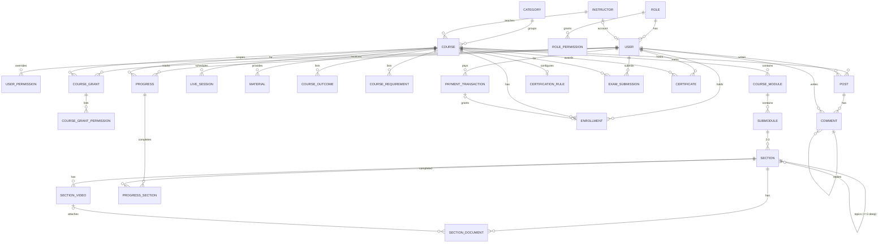

# Course Academy — Application Overview

> Combined documentation of the whole application, generated from the files in `docs/business/`.
> The separate files remain the **source of truth**; this file is kept in sync with them (see CLAUDE.md).
> Part A is for business readers, Part B for developers, Part C lists open questions and likely bugs.

## Table of Contents
- [Part A — Business Overview](#part-a--business-overview)
  - [A1. App purpose](#a1-app-purpose)
  - [A2. User roles](#a2-user-roles)
  - [A3. Glossary](#a3-glossary)
  - [A4. Modules at a glance](#a4-modules-at-a-glance)
  - [A5. Main workflows](#a5-main-workflows)
- [Part B — Technical Detail](#part-b--technical-detail)
  - [B0. Global rules](#b0-global-rules)
  - [B1. Accounts & Authentication](#b1-accounts--authentication)
  - [B2. Access Control](#b2-access-control)
  - [B3. Course Catalog](#b3-course-catalog)
  - [B4. Course Management](#b4-course-management)
  - [B5. Checkout & Payments](#b5-checkout--payments)
  - [B6. Enrollments](#b6-enrollments)
  - [B7. Learning Area, Progress & Dashboard](#b7-learning-area-progress--dashboard)
  - [B8. Certification](#b8-certification)
  - [B9. Course Community](#b9-course-community)
  - [B10. Admin Overview & Reports](#b10-admin-overview--reports)
  - [B11. Site Content, Contact, Career & Language](#b11-site-content-contact-career--language)
  - [B12. Data Model](#b12-data-model)
  - [B13. API Contract](#b13-api-contract)
- [Part C — Open Questions & Likely Bugs](#part-c--open-questions--likely-bugs)

---

# Part A — Business Overview

## A1. App purpose
Online academy (Bangladesh) selling skills courses — Video Editing, Digital Marketing, Sports Journalism, Software Development — in Pre-recorded, Live and Hybrid formats. Students buy with bKash/Nagad/Rocket/card, learn, discuss in course communities and earn verifiable certificates. Staff manage courses, payments, access and certification.

Current state: a frontend-only Angular demo (data stored in the browser). A .NET backend is planned.

## A2. User roles
| Role (id) | Can do |
|---|---|
| Guest | Browse published courses, watch free previews, verify certificates, read site pages, send contact/career forms, register/login. |
| Student (`user`) | Guest + checkout/buy, dashboard, learning area for enrolled courses, mark progress, community post/comment, hand in exams, download certificates. |
| Instructor (`instructor`) | Same global rights as Student, **plus course grants** on the courses they teach: view/edit course & curriculum, moderate community, manage certification (rules, reviews, revoke). Opens admin panel for those courses. |
| Admin (`admin`) | Everything (all permissions, cannot be reduced). |
| Custom roles | Admin can create roles from the permission list; a user can also get a custom permission set overriding their role. |

## A3. Glossary
| Term | Meaning |
|---|---|
| Course format | Pre-recorded (self-paced), Live (scheduled classes), Hybrid (both) |
| Module → Submodule → Section → Topic | Curriculum tree. Submodule has 2–3 sections; sections can nest topics ≤ 3 levels; each section/topic counts for progress |
| Preview video | Video free to watch without enrolling |
| Material | Course-level resource (PDF, Slides, Worksheet, Link) |
| Document | Section-level file (PDF/DOCX/PPTX), optionally attached to one video |
| Live session | Scheduled class with meeting link |
| Price / Original price | Sale price charged / regular price shown struck through |
| Enrollment | User's access to a course (`active` / `revoked`) |
| Course access | Active enrollment OR `courses.view` on the course |
| Transaction | One payment attempt (pending/success/failed/cancelled/refunded) |
| Fulfilment | Granting the enrollment once for a successful transaction |
| Course grant | Per-course permissions for one user |
| Screen | Admin/student page in the access matrix; each has view/create/edit/delete permissions |
| Certification rule | Per-course: completion or central exam |
| Central exam | Project or presentation link handed in and scored by an instructor |
| Certificate code | Public id `CA-YYYY-XXXXXX` for verification |
| Moderator | User with `community.moderate` on a course |

## A4. Modules at a glance
| # | Module | Status | What it does (plain language) |
|---|---|---|---|
| 1 | Accounts & Auth | Partial | People sign up and log in. Sign-up always creates a Student. No password reset or profile editing yet. |
| 2 | Access Control | Done | Admin decides who can open which screen and do what, using roles, a personal override per user, and per-course rights for instructors. |
| 3 | Course Catalog | Done (reviews fake) | Visitors browse, search and filter courses, open a course page, watch free previews and see price, curriculum and instructor. |
| 4 | Course Management | Done | Admin/instructor creates and edits courses, builds the curriculum, schedules live classes, adds materials, publishes, and manages instructor profiles. |
| 5 | Checkout & Payments | Partial (demo gateway) | Student pays with bKash/Nagad/Rocket/card; each attempt is a transaction. Admin can mark paid, cancel or refund. Free courses enroll directly. |
| 6 | Enrollments | Done | Records who has access to which course. Admin can revoke or restore access. |
| 7 | Learning & Progress | Partial (Live progress missing) | Enrolled students watch lessons, open documents, join live classes and mark sections complete. Dashboard shows courses, certificates, upcoming classes, payments. |
| 8 | Certification | Done | Each course awards a certificate on completion or after an exam (project/presentation scored by instructor). Anyone can verify a certificate by code. |
| 9 | Community | Done | Each course has a discussion board. Moderators can pin, lock, hide and delete. |
| 10 | Admin Overview | Done | Summary numbers (courses, students, enrollments, money collected) and recent payments. |
| 11 | Site Content | Partial (forms not stored) | About, sports media, career, contact, FAQ, testimonials, legal pages; Bangla/English switch. |

## A5. Main workflows
1. **Buy a course**: Guest opens course → Enroll Now → logs in / registers → checkout (review price, choose method) → payment page → success → course opens in dashboard. Failed/cancelled → can try again. Free course → enrolled immediately.
2. **Learn**: Dashboard → Continue learning → watch section → Mark as complete → next section → 100% → certificate (completion) or exam hand-in (exam).
3. **Exam certificate**: Student hands in project/presentation link → instructor scores it → pass = certificate issued; fail = try again if attempts remain.
4. **Verify certificate**: Anyone enters the certificate code at `/verify` → valid / revoked / not found.
5. **Create a course**: Admin creates course as draft → builds curriculum → (Live/Hybrid) adds live sessions → publishes.
6. **Refund**: Admin refunds a successful payment → student loses access to the course.
7. **Moderate community**: Moderator pins / locks / hides / deletes posts and comments, from the course page or the admin Community screen.
8. **Manage access**: Admin creates roles, assigns roles to users, sets a custom permission set for a user, or gives per-course rights.

---

# Part B — Technical Detail

## B0. Global rules
- **Auth**: Route guards only control navigation; every service write re-checks permissions. **Backend must enforce all permission checks server-side.** Session: "remember me" = persistent, else browser-session only. Signed-out users hitting protected routes go to `/login?returnUrl=`.
- **Permissions**: names `area.action` (28 values, see data-model). Effective = Admin→ALL, else user override ?? role permissions, plus course grants. `admin.access` is derived, never stored.
- **Currency**: BDT only, integer amounts, shown as `৳1,234` (Bangla digits in bn). No tax, no coupons.
- **Language**: Bangla default, English switch. UI strings translated by English key; admin-entered content not translated.
- **Dates**: stored as ISO 8601 UTC strings; displayed in viewer's locale/time zone. `LiveSession.startsAt` is local `YYYY-MM-DDTHH:mm` (no zone). `Course.updated` is `YYYY-MM`.
- **IDs / codes**: browser-created ids `<prefix>-<base36 timestamp>-<6 random>`; Course id = numeric timestamp (never reused); Transaction id `DEMO-YYYYMMDD-XXXXXX`; Certificate code `CA-YYYY-XXXXXX` (alphabet without I, O, 0, 1); Progress id `userId:courseId`; CertificationRule id = courseId. Backend may use its own keys but must keep slug, transaction id and certificate code as unique public identifiers.
- **Snapshots**: Transactions copy user + course data; Certificates copy user, course and instructor names — later edits don't change them.
- **Deletion**: hard deletes everywhere. "Soft" states instead: course `published=false`, enrollment `revoked`, certificate `revoked`, post/comment `hidden`. Course delete cascades enrollments, community, grants (not payments/progress/certificates).
- **Pagination**: none server-side. Client: catalogue "load more" 6 per page; admin community latest 20 comments; overview 5 recent payments; dashboard 5 upcoming classes.
- **Sorting defaults**: newest first for admin lists/transactions/enrollments/certificates; catalogue by popularity.
- **Text**: inputs trimmed before save; validation messages are English keys (translated in UI).
- **Phone**: Bangladeshi mobile `^(?:\+?88)?01[3-9]\d{8}$`. **URL**: `^https?://[^\s.]+\.[^\s]{2,}$` (exam links require https).
- **Demo-only (do not port)**: localStorage persistence, plain-text passwords, simulated gateway page, reset demo data, fake latency.

## B1. Accounts & Authentication

### 1. Purpose
Lets visitors create an account and sign in so they can buy courses, learn, and (for staff) open the admin panel. Holds the user record that every other module references.

### 2. Screens & Routes
| Route | Component | What the user sees / does |
|---|---|---|
| `/login` | `Login` | Email + password + "Remember me". Demo-account quick-fill buttons (Admin, Instructor, Software instructor, Student). "Forgot password" shows a "not available yet" toast. Accepts `?returnUrl=`. |
| `/register` | `Register` | Name, email, optional BD phone, password (with 0–4 strength meter), confirm password, accept-terms checkbox. Accepts `?returnUrl=`. |
| (navbar) | `Navbar` | Shows login/register when signed out; account menu + logout when signed in; link to "home URL" (admin panel or dashboard). |

### 3. Entities & Fields
**User** (`AppUser`)
| Field | Type | Required | Validation | Default | Notes |
|---|---|---|---|---|---|
| id | string | yes | — | `user-<time36>-<rand6>` | PK |
| name | string | yes | min 2 chars (register), trimmed | — | |
| email | string | yes | valid email; unique (case-insensitive) | — | Stored trimmed + lower-case on register |
| phone | string | no | `^(?:\+?88)?01[3-9]\d{8}$` | — | Empty → not stored |
| password | string | yes | register: `^(?=.*[A-Za-z])(?=.*\d).{8,}$`; login form: min 6 | — | Demo stores plain text. Backend must hash. |
| role | string (Role.id) | yes | must exist | `user` (Student) | Public sign-up always Student |
| access | Permission[] | no | only assignable permissions | absent | Per-user override, see access-control |
| instructorId | string (Instructor.id) | no | — | absent | Links an account to an instructor profile |
| createdAt | ISO datetime | yes | — | now | |

**Register form-only fields**: `confirm` (required, must equal password → "mismatch"), `terms` (must be true).
**Login form-only field**: `remember` (bool, default true).

### 4. Business Rules
- **BR-AUTH-01** Login matches email case-insensitively after trimming; password must match exactly. Failure message: "Incorrect email or password." (no distinction between unknown email and wrong password).
- **BR-AUTH-02** Register rejects an email that already exists (case-insensitive): "An account with this email already exists."
- **BR-AUTH-03** Public registration always assigns role `user` (Student). Role cannot be chosen at sign-up.
- **BR-AUTH-04** Successful registration signs the user in immediately with "remember" = true.
- **BR-AUTH-05** "Remember me" on → session persists across browser restarts (localStorage); off → session ends when the tab/browser session ends (sessionStorage).
- **BR-AUTH-06** After login/register, redirect to `returnUrl` if given, otherwise to the user's home URL (BR-ACL-09).
- **BR-AUTH-07** Password strength score (display only) = count of: length ≥ 8; has a letter; has a digit; has a symbol or upper-case letter. Range 0–4.
- **BR-AUTH-08** Phone is optional; when given it must be a Bangladeshi mobile number (`01[3-9]` + 8 digits, optional `+88`/`88` prefix).
- **BR-AUTH-09** Protected routes redirect a signed-out user to `/login?returnUrl=<requested url>`.
- **BR-AUTH-10** Logout clears the session from both persistent and session storage.
- **BR-AUTH-11** Session changes in another tab are picked up (logging out in one tab logs out the others).
- **BR-AUTH-12** Password reset is not implemented (toast only).
- **BR-AUTH-13** A user whose id no longer exists in the user list is treated as signed out.

### 5. Workflows & Status Transitions
**Register**: Guest fills form → client validation → server checks unique email → user created (role Student) → session started → redirect.
**Login**: Guest submits → credentials checked → session started (persistent or tab-only) → redirect.
**Logout**: Signed-in user → session cleared → public view.
No status field on User (no active/blocked state exists).

### 6. Permissions
| Action | Guest | Student | Instructor | Admin |
|---|---|---|---|---|
| Register | ✓ | — | — | — |
| Login | ✓ | — | — | — |
| Logout | — | ✓ | ✓ | ✓ |
| View user list | — | — | via `users.view` | ✓ |
| Change role / access | see access-control | | | |

### 7. Calculations
- Password strength = number of satisfied criteria (BR-AUTH-07).

### 8. Data Source
| Current | Future endpoint |
|---|---|
| `AuthService.login()` (localStorage `ca-users`, 600 ms fake delay) | `POST /api/auth/login` |
| `AuthService.register()` (700 ms fake delay) | `POST /api/auth/register` |
| `AuthService.logout()` | `POST /api/auth/logout` |
| Session key `ca-demo-session` (local/session storage) | `GET /api/auth/me` + token/cookie |
| `AuthService.users` | `GET /api/users` (see access-control) |
| Forgot password (toast) | `POST /api/auth/forgot-password`, `POST /api/auth/reset-password` (planned) |

### 9. Open Questions / Assumptions
See [Part C](#part-c--open-questions--likely-bugs).

### 10. Source Files
- `src/app/core/services/auth.service.ts`
- `src/app/core/models/user.model.ts`
- `src/app/pages/auth/login.ts`, `register.ts`
- `src/app/shared/forms/validators.ts`
- `src/app/core/guards/auth.guards.ts`
- `src/app/core/data/demo-records.data.ts` (demo users)

## B2. Access Control

### 1. Purpose
Decides who can open which screen and perform which action. Supports roles, a per-user override of a role, and per-course permissions (e.g. an instructor managing only the courses they teach).

### 2. Screens & Routes
| Route | Component | What the user sees / does |
|---|---|---|
| `/admin` (layout) | `AdminLayout` | Sidebar lists only admin screens the user can view; Roles + User access collapse into one "Security" link. Guard: `admin.access`. |
| `/admin/security` | `SecurityLayout` | Redirects to the first security tab the user can view. Tabs: Roles, User access. |
| `/admin/security/roles` | `AdminRoles` | List roles with screen count + member count. Create / edit (name, description, access matrix) / delete. |
| `/admin/security/access` | `AdminAccess` | List users (search name/email) with role dropdown and access label (Full access / Custom / Role defaults). Change a user's role. |
| `/admin/security/access/:userId` | `UserAccess` | One user's access matrix (edit + save, or "reset to role defaults") and per-course grant checkboxes. |
| `/admin/users` | `AdminUsers` | Read-only user list: name, email, role name, active course count; search. |

### 3. Entities & Fields
**Role**
| Field | Type | Required | Validation | Default | Notes |
|---|---|---|---|---|---|
| id | string | yes | — | `role-<time36>-<rand6>`; system: `admin`, `instructor`, `user` | PK |
| name | string | yes | trimmed, non-empty, unique (case-insensitive) | — | |
| description | string | no | trimmed | '' | |
| permissions | Permission[] | yes | only assignable permissions (all except `admin.access`) | [] | Admin role always saved with ALL permissions |
| system | bool | yes | cannot be set by client; kept from existing record | false | Built-in roles cannot be deleted |

**CourseGrant**
| Field | Type | Required | Validation | Default | Notes |
|---|---|---|---|---|---|
| id | string | yes | — | `grant-…` | PK |
| userId | string | yes | FK User | — | unique with courseId |
| courseId | number | yes | FK Course | — | |
| permissions | Permission[] | yes | subset of course permissions: `courses.view`, `courses.edit`, `community.moderate`, `certificates.manage`; non-empty | — | Empty list deletes the grant |

**User.access** (override) — Permission[]; when present it *replaces* the role's permissions. See accounts-auth.

**Screen** (static config, not stored) — id, label, area (admin/student), path, icon, view/create/edit/delete/extra permission, courseScoped, section.

**Permission enum** — see data-model.md (28 values).

### 4. Business Rules
- **BR-ACL-01** Effective permissions = (role `admin` → ALL) else (`user.access` if set, else role.permissions) **plus** course grants for the specific course.
- **BR-ACL-02** `admin.access` is never assigned directly; it is derived: true if the user can view any admin screen OR has at least one course grant.
- **BR-ACL-03** A course-scoped check (`can(p, courseId)`) passes if the user has `p` globally or a grant with `p` on that course.
- **BR-ACL-04** Course-scoped screens (Courses, Community moderation, Certificates) open if the user has the view permission globally or on **any** course; they then list only the courses the user has rights on.
- **BR-ACL-05** Role save: name required and unique (case-insensitive); `admin.access` stripped; Admin role permissions always forced to ALL; `system` flag cannot be changed.
- **BR-ACL-06** Built-in (system) roles cannot be deleted: "Built-in roles cannot be deleted."
- **BR-ACL-07** A role with users assigned cannot be deleted: "Move the users with this role to another role first."
- **BR-ACL-08** A user cannot change their own role ("You can't change your own role.") or their own access ("You can't change your own access.").
- **BR-ACL-09** Home URL after login = first admin screen (in sidebar order) the user can view (section screens → `/admin/security`); else `/dashboard` if `dashboard.view`; else `/`.
- **BR-ACL-10** Users with role Admin always have full access; their access cannot be customised ("Admin users always have full access.").
- **BR-ACL-11** "Reset to role defaults" removes `user.access`, returning the user to role permissions.
- **BR-ACL-12** Access matrix: unticking a screen's View removes all its actions; ticking any action also ticks View.
- **BR-ACL-13** Setting a course grant keeps only course permissions; an empty list deletes the grant.
- **BR-ACL-14** Deleting a course deletes all grants on it (requires `courses.delete` on the course).
- **BR-ACL-15** Guard failure shows "You don't have permission to open that page." and redirects to home URL (never loops).
- **BR-ACL-16** Every service write re-checks permissions (`assert`), independent of UI hiding. Backend must do the same on every endpoint.
- **BR-ACL-17** Changing a role requires `roles.edit`; changing user access / course grants requires `access.edit`.
- **BR-ACL-18** Demo seed: each instructor account gets a grant (`courses.view`, `courses.edit`, `community.moderate`, `certificates.manage`) on every course whose `instructorId` matches the account's `instructorId`.

### 5. Workflows & Status Transitions
- **Create role**: Admin (roles.edit) → New role → name, description, matrix → Save → validated (BR-ACL-05).
- **Assign role**: (roles.edit) → User access list → choose role → saved (BR-ACL-08).
- **Custom access**: (access.edit) → user page → edit matrix → Save → `user.access` set. → Reset → `user.access` cleared.
- **Course grant**: (access.edit) → user page → tick course × permission → grant upserted/deleted immediately.
No status transitions.

### 6. Permissions
| Action | Permission | Default holders |
|---|---|---|
| Open admin panel | derived `admin.access` | Admin; instructors with grants |
| View roles | `roles.view` | Admin |
| Create/edit/delete/assign roles | `roles.edit` | Admin |
| View user access | `access.view` | Admin |
| Change user access / course grants | `access.edit` | Admin |
| View users list | `users.view` | Admin |

Default role permissions:
| Role | Permissions |
|---|---|
| Admin (`admin`) | ALL |
| Instructor (`instructor`) | dashboard.view, learn.view, checkout.view, community.view, community.post (+ course grants) |
| Student (`user`) | dashboard.view, learn.view, checkout.view, community.view, community.post |

### 7. Calculations
- Role "screen count" = number of screens whose view permission is in the role's permissions.
- Role "member count" = users with `role = role.id`.
- Users list "active courses" = enrollments of the user with status `active`.

### 8. Data Source
| Current | Future endpoint |
|---|---|
| `PermissionService.roles` (`ca-roles`) | `GET /api/roles` |
| `saveRole` | `POST /api/roles`, `PUT /api/roles/{id}` |
| `removeRole` | `DELETE /api/roles/{id}` |
| `setUserRole` | `PUT /api/users/{id}/role` |
| `setUserAccess` / `resetUserAccess` | `PUT /api/users/{id}/access`, `DELETE /api/users/{id}/access` |
| `grants` (`ca-course-grants`) | `GET /api/users/{id}/course-grants` |
| `setCourseGrant` | `PUT /api/users/{id}/course-grants/{courseId}` (empty → delete) |
| `AuthService.users` | `GET /api/users?search=` |
| client `permissionsOf` | `GET /api/auth/me` returns effective permissions + grants |

### 9. Open Questions / Assumptions
See [Part C](#part-c--open-questions--likely-bugs).

### 10. Source Files
- `src/app/core/services/permission.service.ts`
- `src/app/core/models/permission.model.ts`
- `src/app/core/data/screens.data.ts`, `access.data.ts`
- `src/app/core/guards/auth.guards.ts`
- `src/app/pages/admin/security/*`, `admin-users.ts`, `admin-layout.ts`
- `src/app/shared/components/access-matrix/access-matrix.ts`

## B3. Course Catalog

### 1. Purpose
Lets visitors discover, filter and evaluate courses before buying: catalogue list, category filters, course detail page with curriculum, free previews, instructor, reviews and pricing.

### 2. Screens & Routes
| Route | Component | What the user sees / does |
|---|---|---|
| `/` | `Home` (+ Hero, Categories, Courses, Features, LearningJourney, SportsTeaser, CareerTeaser, Testimonials, Faq, FinalCta) | Featured courses (max 4), category tiles with course counts, marketing sections. |
| `/courses` | `CourseList` | Search, category, price range, level, format filters; sort; "Load more" (6 per page); skeleton loading. Query params `?category=`, `?q=`. |
| `/courses/:slug` | `CourseDetail` | Title, subtitle, rating, students, price + discount, format intro, outcomes, curriculum (expand/collapse modules), free preview videos inline, live schedule (links hidden until enrolled), materials (locked icons), requirements, instructor card, reviews + rating breakdown, related courses, community teaser/board, CTA (Enroll Now → checkout, or Go to course), share link, WhatsApp enquiry. |

### 3. Entities & Fields
**Category** (static, not editable)
| Field | Type | Required | Validation | Default | Notes |
|---|---|---|---|---|---|
| id | enum CategoryId | yes | `video-editing`, `digital-marketing`, `sports-journalism`, `software-development` | — | PK |
| name | string | yes | — | — | |
| shortName | string | yes | — | — | |
| description | string | yes | — | — | |
| icon | string | yes | Bootstrap icon class | — | |
| image | string | yes | site path | — | |
| skills | string[] | yes | — | — | |

**Review** (static demo pool)
| Field | Type | Required | Validation | Default | Notes |
|---|---|---|---|---|---|
| name | string | yes | — | — | reviewer name |
| rating | number | yes | 1–5 (inferred) | — | |
| date | string | yes | — | — | |
| text | string | yes | — | — | |

**CourseFilter** (UI state, not stored)
| Field | Type | Required | Validation | Default | Notes |
|---|---|---|---|---|---|
| search | string | no | trimmed, case-insensitive | '' | from `?q=` |
| category | CategoryId \| all | no | must be a known category else `all` | all | from `?category=` |
| price | PriceRange | no | `all`, `under-2500`, `2500-4500`, `over-4500` | all | |
| levels | Level[] | no | Beginner/Intermediate/Advanced | [] | multi-select |
| formats | CourseFormat[] | no | Pre-recorded/Live/Hybrid | [] | multi-select |
| sort | CourseSort | no | popular, rating, newest, price-asc, price-desc | popular | |

Course, Instructor, curriculum entities: see `course-management.md`.

### 4. Business Rules
- **BR-CAT-01** Only courses with `published = true` appear in the catalogue, home, related lists, category counts, contact topic list and checkout.
- **BR-CAT-02** An unpublished course detail page is visible only to users with `courses.view` on that course; others see "not found".
- **BR-CAT-03** Search matches title, subtitle or coverLabel (contains, case-insensitive), in English or the current translated text.
- **BR-CAT-04** Price ranges: under-2500 = price < 2500; 2500-4500 = 2500 ≤ price ≤ 4500; over-4500 = price > 4500 (BDT, sale price).
- **BR-CAT-05** Level/format filters: empty selection = all; otherwise course must match one of the selected values.
- **BR-CAT-06** Sort: popular = students desc; rating = rating desc then ratingCount desc; newest = `updated` desc (string compare YYYY-MM); price-asc / price-desc on sale price.
- **BR-CAT-07** Page size 6; "Load more" adds 6; any filter change resets to 6.
- **BR-CAT-08** Active filter count = (price ≠ all) + #levels + #formats + (category ≠ all). Search and sort are not counted.
- **BR-CAT-09** Level/format option counts are computed within the active category.
- **BR-CAT-10** Featured (home) = published courses with `featured = true`, first 4.
- **BR-CAT-11** Related courses = other published courses, same category first, then others, max 4.
- **BR-CAT-12** Reviews shown = 3 entries from the demo pool chosen by `course.id mod poolSize` (deterministic, demo only).
- **BR-CAT-13** Free preview: videos with `preview = true` can be played by anyone; their attached documents are unlocked for everyone.
- **BR-CAT-14** Non-preview documents and all materials show as locked unless the user has course access (BR-ENR-03).
- **BR-CAT-15** Live session meeting links are shown only to users with course access.
- **BR-CAT-16** CTA: user with access → "Go to course" (`/learn/:slug`); otherwise "Enroll Now" (`/checkout/:slug`).
- **BR-CAT-17** "Play preview" opens the first module containing a preview video; if none: "This course has no free preview videos yet."
- **BR-CAT-18** Instructor card course count = number of **published** courses by that instructor.
- **BR-CAT-19** Format intro text: Pre-recorded = self-paced recorded; Live = instructor-led live classes; Hybrid = recorded + scheduled live.
- **BR-CAT-20** Video URLs: YouTube (`youtu.be`, `youtube.com/watch|embed|shorts`), Vimeo (`vimeo.com/<id>`) or direct `https://…mp4|webm`; anything else shows a placeholder player.

### 5. Workflows & Status Transitions
Browse: Guest → `/courses` → filter/sort → open course → preview → Enroll Now → (login if needed) → checkout (see checkout-payments).
No status transitions in this module.

### 6. Permissions
| Action | Guest | Student | Instructor | Admin |
|---|---|---|---|---|
| View published catalogue/detail | ✓ | ✓ | ✓ | ✓ |
| View unpublished course detail | — | — | if grant `courses.view` | ✓ |
| Watch preview videos | ✓ | ✓ | ✓ | ✓ |
| Open locked docs/materials/meeting links | — | if enrolled | if enrolled or grant | ✓ |

### 7. Calculations
- `discountPercent = originalPrice > 0 ? round((1 − price / originalPrice) × 100) : 0`
- Section count = all sections incl. nested topics.
- Module minutes = Σ video minutes of all sections/topics in the module.
- Rating breakdown (demo): five = max(0, round((rating − 4) × 85)); four = max(0, 92 − five); then 5★=five, 4★=four, 3★=5, 2★=2, 1★=1 (each capped at 100). Not real data.

### 8. Data Source
| Current | Future endpoint |
|---|---|
| `CourseService.published` + `filterCourses()` (client) | `GET /api/courses?search=&category=&price=&levels=&formats=&sort=&page=&pageSize=` |
| `CourseService.bySlug()` | `GET /api/courses/{slug}` |
| `CourseService.featured()` | `GET /api/courses?featured=true&limit=4` |
| `CourseService.related()` | `GET /api/courses/{id}/related?limit=4` |
| `CourseService.categories` (static `CATEGORIES`) | `GET /api/categories` (with published course counts) |
| `CourseService.reviews()` / `ratingBreakdown()` (static demo) | `GET /api/courses/{id}/reviews` (planned) |
| `CourseService.instructor()` | included in course detail response |
| Simulated latency 350 ms | — |

### 9. Open Questions / Assumptions
See [Part C](#part-c--open-questions--likely-bugs).

### 10. Source Files
- `src/app/core/services/course.service.ts` (`filterCourses`, `discountPercent`)
- `src/app/pages/course-list/course-list.ts`
- `src/app/pages/course-detail/course-detail.ts` / `.html`
- `src/app/pages/home/home.html`, `src/app/components/*`
- `src/app/core/data/courses.data.ts`
- `src/app/shared/components/video-embed/video-embed.ts`

## B4. Course Management

### 1. Purpose
Lets admins and granted instructors create, edit, publish and delete courses, build the curriculum (modules → submodules → sections → topics, with videos and documents), schedule live sessions, attach materials, and manage instructor profiles.

### 2. Screens & Routes
| Route | Component | What the user sees / does |
|---|---|---|
| `/admin/courses` | `AdminCourses` | Table of courses the user can view (search by title, filter by format): title, instructor, format, price + discount, sections/live/materials counts, active enrollments, Published/Draft. Actions: publish/unpublish, view page, certification, curriculum, edit, delete. "New course" button. |
| `/admin/courses/new` | `CourseForm` | Create course. Guard `courses.create`. |
| `/admin/courses/:id` | `CourseForm` | Edit course details, live sessions, materials. Guard `courses.edit` (global or on course). |
| `/admin/courses/:id/curriculum` | `CurriculumEditor` | Nested editor: add/remove/reorder modules, submodules, sections, topics, videos, documents; collapse modules. Guard `courses.edit` on course. |
| `/admin/instructors` | `AdminInstructors` | Instructor cards (name, title, bio, years, assigned course count). Inline create/edit form, delete. |

### 3. Entities & Fields
**Course**
| Field | Type | Required | Validation | Default | Notes |
|---|---|---|---|---|---|
| id | number | yes | — | `Date.now()` on create | PK. Time-based so a deleted id is never reused |
| slug | string | yes | `^[a-z0-9]+(?:-[a-z0-9]+)*$`; unique | auto from title on blur if empty | "Another course already uses this slug." |
| title | string | yes | 5–120 chars, trimmed | — | |
| subtitle | string | yes | ≤ 200 chars | — | |
| description | string | yes | non-empty | — | |
| category | CategoryId | yes | one of 4 | `video-editing` | FK Category |
| format | CourseFormat | yes | Pre-recorded / Live / Hybrid | Pre-recorded | |
| instructorId | string | yes | FK Instructor | first instructor | |
| level | Level | yes | Beginner / Intermediate / Advanced | Beginner | |
| language | string | yes | free text | `Bangla` | |
| durationHours | number | yes | ≥ 1 | 1 | |
| originalPrice | number (BDT) | yes | ≥ 0 | 0 | Regular price |
| price | number (BDT) | yes | ≥ 0; ≤ originalPrice | 0 | Sale price actually charged. 0 = free |
| coverLabel | string | yes | ≤ 30 chars | — | Text on generated cover |
| coverIcon | string | yes | free text (icon class) | `bi-journal-text` | |
| image | string | no | `^(?:\/[^\s/]\|https?:\/\/)\S*$` | — | Optional photo; preset site images offered |
| badge | enum | no | Bestseller / New / Popular | none | |
| featured | bool | no | — | false | Shown on home |
| published | bool | yes | see BR-CMS-04/05 | false | |
| rating | number | yes | not editable | 0 (new) | Demo stat, kept on edit |
| ratingCount | number | yes | not editable | 0 | Demo stat |
| students | number | yes | not editable | 0 | Demo stat |
| updated | string `YYYY-MM` | yes | — | set on every save | |
| outcomes | string[] | yes | ≥ 1 line | — | Entered one per line |
| requirements | string[] | no | — | [] | One per line |
| modules | CourseModule[] | yes | see curriculum rules | [] | Edited on curriculum page only |
| schedule | LiveSession[] | yes | see below | [] | Ordered |
| materials | Material[] | yes | see below | [] | Ordered |

**CourseModule**: id (`module-…`), title (required, trimmed), submodules[] (ordered).
**Submodule**: id (`submodule-…`), title (required), sections[] (2–3).
**Section** (also used for Topics, self-nested)
| Field | Type | Required | Validation | Default | Notes |
|---|---|---|---|---|---|
| id | string | yes | — | `section-…` | |
| title | string | yes | trimmed, non-empty | — | "Every section/topic needs a title." |
| videos | SectionVideo[] | no | — | one empty video on create | Ordered |
| documents | SectionDocument[] | no | — | [] | |
| topics | Section[] | no | max nesting depth 3 | [] | Each topic counts as a section for progress |

**SectionVideo**
| Field | Type | Required | Validation | Default | Notes |
|---|---|---|---|---|---|
| id | string | yes | — | `video-…` | |
| title | string | yes | trimmed | — | |
| url | string | yes | `^https?:\/\/[^\s.]+\.[^\s]{2,}$` | — | See BR-CAT-20 for playable formats |
| minutes | number | yes | ≥ 1 | 10 | |
| preview | bool | no | — | false | Free preview for non-enrolled |

**SectionDocument**
| Field | Type | Required | Validation | Default | Notes |
|---|---|---|---|---|---|
| id | string | yes | — | `document-…` | |
| title | string | yes | — | — | |
| type | DocumentType | yes | PDF / DOCX / PPTX | PDF | |
| url | string | yes | URL pattern; path must end in `.pdf`/`.docx`/`.pptx` matching type (ignoring `?query`/`#hash`) | — | |
| videoId | string | no | must reference a video in the same section | first video of section | Empty = document for whole section |

**LiveSession**
| Field | Type | Required | Validation | Default | Notes |
|---|---|---|---|---|---|
| id | string | yes | — | `session-…` | |
| title | string | yes | — | — | |
| startsAt | string `YYYY-MM-DDTHH:mm` | yes | — | — | Local time, no timezone |
| durationMinutes | number | yes | ≥ 1 | 60 | |
| meetingUrl | string | yes | URL pattern | `https://meet.example.com/your-class` | Placeholder |

**Material**
| Field | Type | Required | Validation | Default | Notes |
|---|---|---|---|---|---|
| id | string | yes | — | `material-…` | |
| title | string | yes | — | — | |
| type | MaterialType | yes | PDF / Slides / Worksheet / Link | PDF | |
| url | string | yes | URL pattern | `https://example.com/demo-materials/file` | |

**Instructor**
| Field | Type | Required | Validation | Default | Notes |
|---|---|---|---|---|---|
| id | string | yes | — | `instructor-…` (seed uses name slug) | PK |
| name | string | yes | min 2, trimmed | — | |
| title | string | yes | trimmed | — | Professional title |
| bio | string | yes | trimmed | — | |
| expertise | string[] | no | comma-separated input, trimmed, empties removed | [] | |
| experienceYears | number | yes | ≥ 0 | 0 | |
| students | number | yes | ≥ 0 | 0 | Manually entered |
| rating | number | yes | not editable | 0 (new) | |

### 4. Business Rules
- **BR-CMS-01** Create requires `courses.create`; edit requires `courses.edit` globally or on that course; delete requires `courses.delete` (global or course).
- **BR-CMS-02** Slug must be unique among all courses (excluding itself). Auto-filled from title when empty: lower-case, `&` → "and", non-alphanumerics → `-`, trimmed hyphens.
- **BR-CMS-03** Sale `price` must not exceed `originalPrice`: "The sale price can't be above the regular price."
- **BR-CMS-04** A published course must have ≥ 1 section in its saved curriculum. (Drafts may be incomplete.)
- **BR-CMS-05** A published Live or Hybrid course must have ≥ 1 live session.
- **BR-CMS-06** Curriculum save (server-side check in service) fails with the first broken rule: every module/submodule/section/topic has a title; each submodule has 2–3 sections; topics nest ≤ 3 levels; document URL extension matches type; document `videoId` refers to a video in the same section.
- **BR-CMS-07** In the editor, a submodule's section delete button is disabled at 2 sections; "add section" is disabled at 3. New submodules start with 2 empty sections; new sections start with 1 empty video.
- **BR-CMS-08** Curriculum of a published course cannot be emptied: "A published course needs at least one section. Unpublish it first to remove them all."
- **BR-CMS-09** Removing a video detaches its documents (they become whole-section documents), not deletes them.
- **BR-CMS-10** New documents attach to the section's first video by default.
- **BR-CMS-11** Every save sets `updated` = current `YYYY-MM`. `rating`, `ratingCount`, `students` are preserved (0 for new).
- **BR-CMS-12** Publish/unpublish toggle from the list goes through the same save (and same validation, BR-CMS-06; the form-only checks BR-CMS-04/05 are **not** re-run by the toggle).
- **BR-CMS-13** Delete course (after confirm) removes: all enrollments for it, all community posts/comments, all course grants, then the course. Payment transactions are kept (they hold a snapshot).
- **BR-CMS-14** Instructor delete is blocked while any course (published or not) has that `instructorId`: "{name} teaches {n} course(s). Reassign them before deleting."
- **BR-CMS-15** Instructor create/edit/delete require `instructors.create` / `.edit` / `.delete`.
- **BR-CMS-16** Admin course list shows only courses where the user has `courses.view` (global or grant).
- **BR-CMS-17** Text fields are trimmed on save; outcomes/requirements split by line, blank lines removed.
- **BR-CMS-18** Rows (sessions, materials, modules, submodules, sections, topics, videos, documents) can be reordered up/down; array order = display order.

### 5. Workflows & Status Transitions
Course publish state: `Draft (published=false) → Published (published=true) → Draft` — triggered by Admin or instructor with `courses.edit` on the course.
Typical flow: Create course as Draft (details) → Save → open Curriculum → add modules/sections → Save → (Live/Hybrid) add sessions → tick Published → Save.

### 6. Permissions
| Action | Student | Instructor (granted course) | Admin |
|---|---|---|---|
| View admin course list | — | own granted courses | all |
| Create course | — | — (unless `courses.create`) | ✓ |
| Edit details / curriculum / publish | — | ✓ | ✓ |
| Delete course | — | — (grant can't include delete) | ✓ |
| View instructors | — | — | ✓ |
| Create/edit/delete instructor | — | — | ✓ |

### 7. Calculations
- Discount preview in form = `originalPrice > 0 && price ≤ originalPrice ? round((1 − price/originalPrice) × 100) : 0`.
- Section count = every section + every nested topic.
- Module minutes = Σ video minutes in module (all depths).
- Admin list "Enrolled" = count of enrollments with status `active`.
- Instructor card "assigned courses" = all courses (incl. drafts) with that instructorId.

### 8. Data Source
| Current | Future endpoint |
|---|---|
| `CourseService.courses` (`ca-courses`) | `GET /api/admin/courses?search=&format=` |
| `CourseService.saveCourse` (create) | `POST /api/admin/courses` |
| `CourseService.saveCourse` (edit / publish toggle) | `PUT /api/admin/courses/{id}`, `PATCH /api/admin/courses/{id}/publish` |
| Curriculum save | `PUT /api/admin/courses/{id}/curriculum` |
| `isSlugTaken` | `GET /api/admin/courses/slug-available?slug=&exceptId=` |
| `removeCourse` (+ cascades) | `DELETE /api/admin/courses/{id}` |
| `CourseService.instructors` (`ca-instructors`) | `GET /api/instructors` |
| `saveInstructor` | `POST /api/instructors`, `PUT /api/instructors/{id}` |
| `removeInstructor` | `DELETE /api/instructors/{id}` |

### 9. Open Questions / Assumptions
See [Part C](#part-c--open-questions--likely-bugs).

### 10. Source Files
- `src/app/core/services/course.service.ts` (`curriculumError`, `saveCourse`)
- `src/app/core/models/course.model.ts`
- `src/app/pages/admin/admin-courses.ts`, `admin-instructors.ts`
- `src/app/pages/admin/course-form/course-form.ts` / `.html`
- `src/app/pages/admin/curriculum-editor/curriculum-editor.ts` / `.html`

## B5. Checkout & Payments

### 1. Purpose
Lets a signed-in user buy a course with bKash, Nagad, Rocket or card, records each payment attempt as a transaction, grants course access on success, and lets admins manage transactions (mark paid, cancel, refund, delete). Currently uses a simulated gateway.

### 2. Screens & Routes
| Route | Component | What the user sees / does |
|---|---|---|
| `/payment` | `PaymentMethods` | Public "How to enroll & pay" page: 4 steps, method list, WhatsApp link (pre-filled with course title + price if `?course=<slug>`). |
| `/checkout/:slug` | `Checkout` | Order summary (course, instructor, original price, discount %, total), method choice (default bKash), Pay button. "Already enrolled" state. Free courses enroll directly. Guards: auth + `checkout.view`. |
| `/checkout/pay/:id` | `DemoGateway` | Simulated gateway page: shows method test account + amount, buttons Success / Fail / Cancel. Only the buyer can see it. Revisiting a finished payment redirects to the result. |
| `/checkout/result/:id` | `PaymentResult` | Receipt: status (success/failed/cancelled/pending/refunded) message, transaction details, "Go to course" if access exists. Visible to buyer or `transactions.view`. Also opened from dashboard. |
| `/admin/transactions` | `AdminTransactions` | Filters (search, status, method, course, from/to date), totals, table, detail row, actions per allowed transition, delete. |

### 3. Entities & Fields
**PaymentTransaction**
| Field | Type | Required | Validation | Default | Notes |
|---|---|---|---|---|---|
| id | string | yes | — | `DEMO-YYYYMMDD-XXXXXX` (6 upper-case base36) | PK |
| gateway | string | yes | — | `demo` | Which processor |
| userId | string | yes | FK User | — | |
| userName | string | yes | — | snapshot | Copied at purchase |
| userEmail | string | yes | — | snapshot | |
| courseId | number | yes | FK Course (may be deleted later) | — | |
| courseSlug | string | yes | — | snapshot | |
| courseTitle | string | yes | — | snapshot | |
| method | PaymentMethodId | yes | bkash / nagad / rocket / card | bkash | |
| maskedAccount | string | yes | — | from method | Never full card/wallet |
| originalAmount | number (BDT) | yes | — | course.originalPrice | |
| discountAmount | number (BDT) | yes | — | originalPrice − price | |
| amount | number (BDT) | yes | — | course.price | Charged amount |
| currency | 'BDT' | yes | — | BDT | |
| status | PaymentStatus | yes | pending/success/failed/cancelled/refunded | pending | |
| failureReason | string | no | — | method's simulated reason on fail | |
| fulfilledAt | ISO datetime | no | — | set when access granted | Grants access only once |
| createdAt | ISO datetime | yes | — | now | |
| updatedAt | ISO datetime | yes | — | now | |

**PaymentMethod** (static config)
| Field | Type | Required | Validation | Default | Notes |
|---|---|---|---|---|---|
| id | PaymentMethodId | yes | — | — | bkash, nagad, rocket, card |
| name | string | yes | — | — | bKash, Nagad, Rocket, Visa / Mastercard |
| description | string | yes | — | — | |
| logo / icon | string | no / yes | — | — | |
| testAccountLabel, testAccount, maskedAccount | string | yes | — | — | Demo only |
| failureReason | string | yes | — | — | Simulated decline text |

**TransactionFilter** (UI): search, status|all, method|all, courseId|all, from (YYYY-MM-DD), to (YYYY-MM-DD).

### 4. Business Rules
- **BR-PAY-01** Checkout is only possible for a **published** course; otherwise "not found".
- **BR-PAY-02** If the user already has an active enrollment, checkout shows "You're already enrolled" and no payment is possible.
- **BR-PAY-03** Free course (`price = 0`): no transaction; enrollment granted immediately; redirect to `/learn/:slug`.
- **BR-PAY-04** Paid course: a `pending` transaction is created with amounts copied from the course; user is redirected to the gateway page.
- **BR-PAY-05** The server must recompute the amount from its own course price; amounts from the browser are display-only.
- **BR-PAY-06** Gateway outcome can only change a `pending` transaction (success / failed / cancelled). A non-pending transaction is returned unchanged.
- **BR-PAY-07** On `failed`, `failureReason` = method's reason (e.g. "Insufficient wallet balance (simulated)").
- **BR-PAY-08** Confirm: after gateway result, if status = success and not yet `fulfilledAt`, grant enrollment (with transactionId) and set `fulfilledAt`. Repeatable/idempotent (reopening the receipt never re-grants).
- **BR-PAY-09** Only the buyer can see the gateway page; buyer or `transactions.view` can see the receipt.
- **BR-PAY-10** Admin status transitions allowed only: `pending → success`, `pending → cancelled`, `success → refunded`. Others rejected: "This change is not allowed for this transaction."
- **BR-PAY-11** Admin marks `success` → fulfil (grant access once). Admin `refunded` → enrollment linked to this transaction set to `revoked`.
- **BR-PAY-12** A `success` transaction cannot be deleted (refund first). Delete requires `transactions.delete`. *(Enforced in UI only — see Open Questions.)*
- **BR-PAY-13** Transaction filter: date bounds inclusive, using the admin's local day (from 00:00:00 to 23:59:59.999); search matches id, userName, userEmail, courseTitle (contains, case-insensitive); result sorted newest first.
- **BR-PAY-14** Admin course filter options = distinct courses appearing in transactions (includes deleted courses, by snapshot title).
- **BR-PAY-15** Transactions keep a snapshot of user and course data so they survive course edits/deletion.
- **BR-PAY-16** Card/wallet credentials are never collected or stored; only masked test account.
- **BR-PAY-17** Admins buying a course see a note that the test payment is recorded under their account.
- **BR-PAY-18** Receipt "Go to course" shows only if status = success and user still has course access.

### 5. Workflows & Status Transitions
**Purchase (Student)**: Course detail → Enroll Now → (login) → Checkout → choose method → Pay → `pending` created → Gateway page → choose outcome → status set → confirm → Result page.

Transitions:
| From → To | Triggered by |
|---|---|
| (new) → `pending` | Buyer (Pay) |
| `pending` → `success` | Gateway (buyer simulates) / Admin "Mark as paid" |
| `pending` → `failed` | Gateway |
| `pending` → `cancelled` | Gateway (buyer cancels) / Admin "Cancel payment" |
| `success` → `refunded` | Admin "Refund" (revokes access) |
`failed`, `cancelled`, `refunded` are final.

### 6. Permissions
| Action | Guest | Student | Instructor | Admin |
|---|---|---|---|---|
| View `/payment` info | ✓ | ✓ | ✓ | ✓ |
| Checkout / pay (`checkout.view`) | — (login) | ✓ | ✓ | ✓ |
| View own receipt | — | ✓ | ✓ | ✓ |
| View all transactions (`transactions.view`) | — | — | — | ✓ |
| Change status (`transactions.edit`) | — | — | — | ✓ |
| Delete non-success (`transactions.delete`) | — | — | — | ✓ |

### 7. Calculations
- `discountAmount = originalPrice − price`; `amount = price`.
- Checkout discount % = `round((1 − price/originalPrice) × 100)` if originalPrice > 0.
- Admin totals (over the **filtered** list): collected = Σ amount where success; refunded = Σ amount where refunded; successful = count success; unsuccessful = count failed + cancelled.

### 8. Data Source
| Current | Future endpoint |
|---|---|
| `PaymentService.checkout` → `DemoPaymentGateway.initiate` | `POST /api/payments` `{courseId, method}` → `{transactionId, redirectUrl}` |
| `DemoPaymentGateway.simulate` | Replaced by real gateway hosted page + `POST /api/payments/callback/{gateway}` (IPN) |
| `PaymentService.confirm` / gateway `transaction()` | `GET /api/payments/{id}` (verified status) |
| `PaymentService.mine` | `GET /api/me/payments` |
| `PaymentService.transactions` + `filterTransactions` | `GET /api/admin/transactions?search=&status=&method=&courseId=&from=&to=&page=&pageSize=` (+ totals) |
| `PaymentService.setStatus` | `PATCH /api/admin/transactions/{id}/status` |
| `PaymentService.remove` | `DELETE /api/admin/transactions/{id}` |
| Free enroll `EnrollmentService.grant` | `POST /api/courses/{id}/enroll-free` |

### 9. Open Questions / Assumptions
See [Part C](#part-c--open-questions--likely-bugs).

### 10. Source Files
- `src/app/core/payments/payment.service.ts`, `payment.model.ts`, `payment-gateway.ts`, `demo-payment-gateway.ts`
- `src/app/pages/checkout/checkout.ts`, `demo-gateway.ts`, `payment-result.ts`
- `src/app/pages/admin/admin-transactions.ts` / `.html`
- `src/app/components/payment-methods/payment-methods.ts`

## B6. Enrollments

### 1. Purpose
Records which user has access to which course, links access to the payment that granted it, and lets admins revoke or restore access.

### 2. Screens & Routes
| Route | Component | What the user sees / does |
|---|---|---|
| `/admin/enrollments` | `AdminEnrollments` | All enrollments (newest first): student name, email, course title, status, date. Search (student/email/course), status filter (all/active/revoked). Revoke (with confirm) / Restore. |
| `/dashboard` | `Dashboard` | "My courses" list incl. revoked ones (tagged). See learning-progress. |

### 3. Entities & Fields
**Enrollment**
| Field | Type | Required | Validation | Default | Notes |
|---|---|---|---|---|---|
| id | string | yes | — | `enrollment-…` | PK |
| userId | string | yes | FK User | — | unique with courseId (one record per user+course) |
| courseId | number | yes | FK Course | — | |
| status | EnrollmentStatus | yes | `active` / `revoked` | active | |
| enrolledAt | ISO datetime | yes | — | now | Overwritten on re-grant |
| transactionId | string | no | FK PaymentTransaction | — | Absent for free courses |

### 4. Business Rules
- **BR-ENR-01** One enrollment record per (user, course). Granting again reuses the existing record id, sets status `active`, resets `enrolledAt` to now and replaces `transactionId`.
- **BR-ENR-02** "Enrolled" = enrollment exists with status `active`.
- **BR-ENR-03** Course access (learning area, locked docs, meeting links, community read) = enrolled OR has `courses.view` on the course (global or grant).
- **BR-ENR-04** A user may grant an enrollment to themselves (via checkout). Granting for someone else requires `enrollments.edit` or `transactions.edit`.
- **BR-ENR-05** Admin revoke/restore requires `enrollments.edit`. Revoking does not change the payment record.
- **BR-ENR-06** Refunding a transaction revokes the enrollment whose `transactionId` matches (requires `transactions.edit`).
- **BR-ENR-07** Deleting a course hard-deletes all its enrollments.
- **BR-ENR-08** Enrollment counts: admin courses list and overview count only `active`; delete-course confirmation counts all.
- **BR-ENR-09** Rows whose user or course was deleted show "Deleted user" / "Deleted course".
- **BR-ENR-10** A revoked enrollment still appears on the student dashboard (tagged revoked), without "Continue learning".

### 5. Workflows & Status Transitions
| Transition | Triggered by |
|---|---|
| (none) → `active` | Student (free checkout / successful payment fulfilment), Admin (mark payment as paid) |
| `active` → `revoked` | Admin (Revoke, `enrollments.edit`), Admin refund of the linked transaction |
| `revoked` → `active` | Admin (Restore, `enrollments.edit`); or a new successful purchase |

### 6. Permissions
| Action | Student | Instructor | Admin |
|---|---|---|---|
| See own enrollments | ✓ | ✓ | ✓ |
| View all enrollments (`enrollments.view`) | — | — | ✓ |
| Revoke / restore (`enrollments.edit`) | — | — | ✓ |

### 7. Calculations
- Active count per course = count(status = active).
- Dashboard active count = own enrollments (for existing courses) with status active.

### 8. Data Source
| Current | Future endpoint |
|---|---|
| `EnrollmentService.enrollments` (`ca-enrollments`) | `GET /api/admin/enrollments?search=&status=&page=&pageSize=` |
| `EnrollmentService.mine` | `GET /api/me/enrollments` |
| `EnrollmentService.setStatus` | `PATCH /api/admin/enrollments/{id}/status` |
| `EnrollmentService.grant` | Server-side only (payment fulfilment, free enroll) |
| `hasAccess` / `isEnrolled` | `GET /api/me/courses/{id}/access` or included in course/me payloads |

### 9. Open Questions / Assumptions
See [Part C](#part-c--open-questions--likely-bugs).

### 10. Source Files
- `src/app/core/services/enrollment.service.ts`
- `src/app/core/models/enrollment.model.ts`
- `src/app/pages/admin/admin-enrollments.ts`

## B7. Learning Area, Progress & Dashboard

### 1. Purpose
Gives enrolled users a place to watch lessons, open documents and materials, join live classes, track completion per section, and see their courses, certificates, upcoming classes and payments on one dashboard.

### 2. Screens & Routes
| Route | Component | What the user sees / does |
|---|---|---|
| `/dashboard` | `Dashboard` | Guards: auth + `dashboard.view`. Sections: My courses (progress bar, revoked tag, Continue learning), My certificates (download PDF, verify), Upcoming live classes (max 5), Payment history (View receipt). |
| `/learn/:slug` | `Learn` | Guards: auth + `learn.view`. Without access: "enrolled students only" message. With access: progress (x of y sections), outline sidebar (sections + nested topics, ✓ when complete), player, breadcrumb trail, video switcher, documents per video and per section, topic shortcuts, "Mark as complete" toggle, certificate box, live classes with links, materials, link to community. |

### 3. Entities & Fields
**Progress**
| Field | Type | Required | Validation | Default | Notes |
|---|---|---|---|---|---|
| id | string | yes | `userId:courseId` | — | PK; one per user+course |
| userId | string | yes | FK User | — | |
| courseId | number | yes | FK Course | — | |
| completedSectionIds | string[] | yes | each must be a section/topic of the course | [] | |
| updatedAt | ISO datetime | yes | — | now | |

### 4. Business Rules
- **BR-LRN-01** The learning page content requires course access (BR-ENR-03). An unpublished course is still learnable by enrolled users.
- **BR-LRN-02** Marking a section complete requires: signed in, `learn.view`, and course access; the section id must exist in the course ("Section not found.").
- **BR-LRN-03** Completion is a toggle (complete / undo). After marking complete, the next section in reading order is selected automatically.
- **BR-LRN-04** Reading order = for each module → submodule → section, the section then its topics depth-first. Each topic counts as one section.
- **BR-LRN-05** Only completed ids that still exist in the course count (removed sections don't count).
- **BR-LRN-06** Reaching 100% shows "You have completed every section of {course}!".
- **BR-LRN-07** After each completion, a completion-mode certificate is evaluated and issued if the rule is met (BR-CERT-04).
- **BR-LRN-08** For **Live** format courses the player and "Mark as complete" are not shown; the outline is static (see Open Questions).
- **BR-LRN-09** Documents attached to a video show under that video; documents without `videoId` show for the whole section.
- **BR-LRN-10** Live sessions are "past" when `startsAt + durationMinutes` < now.
- **BR-LRN-11** Dashboard "Upcoming live classes" = sessions of courses with **active** enrollments that have not ended, sorted by start, max 5.
- **BR-LRN-12** Dashboard hides enrollments whose course was deleted.
- **BR-LRN-13** If an admin edits the curriculum while a student is on the page, the current section/video is kept if it still exists, otherwise the first is selected.
- **BR-LRN-14** Dashboard payment history = own transactions, newest first.

### 5. Workflows & Status Transitions
Learn: Dashboard → Continue learning → pick section → watch → Mark as complete → auto-advance → … → 100% → certificate (completion mode) or exam hand-in (exam mode).
Section state per user: `Not completed ⇄ Completed` (student toggles).

### 6. Permissions
| Action | Student | Instructor | Admin |
|---|---|---|---|
| Open dashboard (`dashboard.view`) | ✓ | ✓ | ✓ |
| Open learning area (`learn.view` + access) | if enrolled | if enrolled or grant `courses.view` | ✓ |
| Mark complete | if enrolled | if access | ✓ |

### 7. Calculations
- `percent = total > 0 ? round(completedStillInCourse / totalSections × 100) : 0` (totalSections includes topics).
- Session end = `startsAt + durationMinutes × 60 000 ms`.

### 8. Data Source
| Current | Future endpoint |
|---|---|
| `ProgressService` (`ca-progress`) | `GET /api/me/courses/{courseId}/progress` |
| `setComplete(course, sectionId, bool)` | `PUT /api/me/courses/{courseId}/progress/sections/{sectionId}` `{completed}` |
| `percentFor(userId, course)` | server-side (certificate checks) |
| Dashboard aggregate | `GET /api/me/dashboard` (or the individual `/api/me/*` endpoints) |
| `CourseService.bySlug` (learn) | `GET /api/learn/{slug}` (full curriculum incl. non-preview URLs, access-checked) |

### 9. Open Questions / Assumptions
See [Part C](#part-c--open-questions--likely-bugs).

### 10. Source Files
- `src/app/core/services/progress.service.ts`
- `src/app/core/models/progress.model.ts`
- `src/app/pages/learn/learn.ts` / `.html`
- `src/app/pages/dashboard/dashboard.ts` / `.html`
- `src/app/shared/components/session-list/session-list.ts`, `document-list/document-list.ts`

## B8. Certification

### 1. Purpose
Awards each course a certificate either on completion or after passing a "central exam" (a project or presentation scored by an instructor), and lets anyone verify a certificate by its public code.

### 2. Screens & Routes
| Route | Component | What the user sees / does |
|---|---|---|
| `/admin/courses/:id/certification` | `CertificationSettings` | Per-course rule: enabled, mode (completion / exam), required progress %, and for exam: type, title, instructions, max score, pass mark, max attempts. Guard `certificates.manage` on course. |
| `/admin/certificates` | `AdminCertificates` | (1) Exam submissions to review (filter status, default "submitted"): student, course, exam title/type, link, notes; Review → score + feedback. (2) Issued certificates (search code/name/course): download PDF, Revoke (with reason ≤ 200), Restore. Only courses the user can manage. |
| `/learn/:slug` (box) | `CourseCertificate` | Student status: requirement text, progress step, exam step (pass mark, attempts left), past submissions with result/feedback, hand-in form (link + notes), "Get my certificate" (completion), earned certificate (download PDF, verification page). |
| `/dashboard` (section) | `Dashboard` | My certificates: download, verify, revoked tag. |
| `/verify`, `/verify/:code` | `Verify` | Public: enter code → valid / revoked (+ reason) / not found; shows name, course, type, score, instructor, issue date, code. |

### 3. Entities & Fields
**CertificationRule** (one per course; id = courseId)
| Field | Type | Required | Validation | Default | Notes |
|---|---|---|---|---|---|
| id | number | yes | = Course.id | — | PK + FK Course (1-1) |
| enabled | bool | yes | — | true | |
| mode | enum | yes | `completion` / `exam` | completion | |
| minProgress | int % | yes | integer 1–100 | 100 | |
| examType | enum | yes (exam) | `project` / `presentation` | project | |
| examTitle | string | yes (exam) | trimmed non-empty | `Final project` | |
| examInstructions | string | no | trimmed | '' | |
| maxScore | int | yes (exam) | integer ≥ 1 | 100 | |
| passingScore | int | yes (exam) | integer 1..maxScore | 60 | |
| maxAttempts | int | yes (exam) | integer ≥ 0; 0 = unlimited | 0 | |

**ExamSubmission**
| Field | Type | Required | Validation | Default | Notes |
|---|---|---|---|---|---|
| id | string | yes | — | `submission-…` | PK |
| userId | string | yes | FK User | — | |
| courseId | number | yes | FK Course | — | |
| examType | enum | yes | from rule at submit time | — | snapshot |
| url | string | yes | `^https:\/\/\S+\.\S+$` (https only), trimmed | — | Repo / slides / video link |
| notes | string | no | ≤ 1000 chars | '' | Trimmed |
| submittedAt | ISO datetime | yes | — | now | |
| status | enum | yes | `submitted` / `passed` / `failed` | submitted | |
| score | number | no | 0..maxScore | — | Set on review |
| feedback | string | no | trimmed; UI max 1000 | — | |
| reviewedBy | string | no | FK User | — | |
| reviewedAt | ISO datetime | no | — | — | |

**Certificate**
| Field | Type | Required | Validation | Default | Notes |
|---|---|---|---|---|---|
| id | string | yes | — | `certificate-…` | PK |
| code | string | yes | unique; `CA-<YYYY>-<6 chars>` from `ABCDEFGHJKLMNPQRSTUVWXYZ23456789` | generated | Public verification code |
| userId | string | yes | FK User | — | |
| courseId | number | yes | FK Course | — | |
| userName | string | yes | snapshot | user name or "Student" | |
| courseTitle | string | yes | snapshot | — | |
| instructorName | string | yes | snapshot | instructor name or '' | |
| mode | enum | yes | completion / exam | — | |
| examType | enum | no | — | — | exam certificates |
| scorePercent | int | no | — | — | exam certificates |
| issuedAt | ISO datetime | yes | — | now | |
| revoked | bool | yes | — | false | |
| revokedReason | string | no | trimmed; UI max 200 | — | Shown publicly |

### 4. Business Rules
- **BR-CERT-01** A course without a saved rule uses the default rule (enabled, completion, 100%).
- **BR-CERT-02** Rule save requires `certificates.manage` on the course. minProgress integer 1–100 always; exam fields validated only when mode = exam (title required; maxScore ≥ 1; 1 ≤ passingScore ≤ maxScore; maxAttempts ≥ 0; all integers).
- **BR-CERT-03** A user has at most one **valid** (non-revoked) certificate per course; issuing returns the existing valid one.
- **BR-CERT-04** Completion mode: when an **active-enrolled** user's progress ≥ minProgress, a certificate is issued (automatically after marking a section, or via "Get my certificate").
- **BR-CERT-05** Disabled rule: no certificate box; nothing issued.
- **BR-CERT-06** Exam hand-in allowed only if: rule enabled, mode exam, progress ≥ minProgress, no valid certificate, no submission that is `submitted` or `passed`, and attempts left ≠ 0. Also requires `learn.view` and active enrollment.
- **BR-CERT-07** Attempts left = maxAttempts = 0 → unlimited; else max(0, maxAttempts − number of submissions).
- **BR-CERT-08** Hand-in error messages: progress not met → "Complete the course before the central exam."; no attempts → "You have used all your attempts."; otherwise "You cannot hand in the exam right now."; bad link → "Enter a link that starts with https://."
- **BR-CERT-09** Review requires `certificates.manage` on the course; only `submitted` submissions can be reviewed ("already been reviewed"); score must be 0..maxScore.
- **BR-CERT-10** Pass = score ≥ passingScore → status `passed` + certificate issued immediately (mode exam, examType, scorePercent). Otherwise `failed`.
- **BR-CERT-11** Revoke/restore requires `certificates.manage` on the course. Restore is refused if the student already has another valid certificate for that course.
- **BR-CERT-12** Certificate names/titles are snapshots; later edits don't change them.
- **BR-CERT-13** Verification is public; code lookup is trimmed and case-insensitive (upper-cased).
- **BR-CERT-14** Certificate codes are unique (regenerate on collision); year = issue year.
- **BR-CERT-15** PDF: A4 landscape; "Certificate of Completion" or "Certificate of Achievement" (exam, with exam type and score %); instructor name (or "Course Academy"); issue date `d MMMM yyyy` (en-GB); code; verify link `<origin>/verify/<code>`; file `certificate-<code>.pdf`. English/Latin fonts only.
- **BR-CERT-16** Students see "out of attempts" message only when attempts left = 0 and nothing is waiting for review.

### 5. Workflows & Status Transitions
**Completion mode**: Student completes sections → progress ≥ min → Certificate issued.
**Exam mode**: Student reaches min progress → hands in link → `submitted` → Instructor/Admin reviews → `passed` (certificate issued) or `failed` → (if attempts left) student hands in again.

ExamSubmission: `submitted → passed` | `submitted → failed` (Instructor with grant / Admin).
Certificate: `valid → revoked` (Revoke, manager) → `valid` (Restore, manager; only if no other valid certificate).

### 6. Permissions
| Action | Guest | Student | Instructor (granted course) | Admin |
|---|---|---|---|---|
| Verify certificate | ✓ | ✓ | ✓ | ✓ |
| Claim / hand in exam | — | if enrolled | if enrolled | if enrolled |
| Download own certificate | — | ✓ | ✓ | ✓ |
| Configure rule | — | — | ✓ | ✓ |
| Review submissions | — | — | ✓ | ✓ |
| Revoke / restore / download any | — | — | ✓ | ✓ |

### 7. Calculations
- `scorePercent = round(score / maxScore × 100)`.
- Progress % — see BR-LRN calculations (`percentFor`).
- Attempts left — BR-CERT-07.

### 8. Data Source
| Current | Future endpoint |
|---|---|
| `rule(courseId)` (`ca-certification-rules`) | `GET /api/courses/{id}/certification-rule` |
| `saveRule` | `PUT /api/admin/courses/{id}/certification-rule` |
| `status(course)` | `GET /api/me/courses/{id}/certification` |
| `evaluate(course)` | `POST /api/me/courses/{id}/certificate` (claim; also server-triggered on progress) |
| `submitExam` (`ca-exam-submissions`) | `POST /api/me/courses/{id}/exam-submissions` |
| `submissions` (admin) | `GET /api/admin/exam-submissions?status=&courseId=&page=` |
| `review` | `POST /api/admin/exam-submissions/{id}/review` |
| `certificates` (`ca-certificates`) | `GET /api/admin/certificates?search=&page=` |
| `mine` | `GET /api/me/certificates` |
| `setRevoked` | `POST /api/admin/certificates/{id}/revoke`, `POST …/restore` |
| `findByCode` | `GET /api/certificates/verify/{code}` (public) |
| `downloadCertificatePdf` (client jsPDF) | `GET /api/certificates/{code}/pdf` (optional, or keep client-side) |

### 9. Open Questions / Assumptions
See [Part C](#part-c--open-questions--likely-bugs).

### 10. Source Files
- `src/app/core/services/certificate.service.ts`, `certificate-pdf.ts`
- `src/app/core/models/certificate.model.ts`
- `src/app/pages/admin/certification-settings.ts`, `admin-certificates.ts`
- `src/app/pages/learn/course-certificate/course-certificate.ts`
- `src/app/pages/verify/verify.ts`

## B9. Course Community

### 1. Purpose
Each course has its own discussion board where enrolled students, the course's instructors and admins post questions, comment and reply; moderators can pin, lock, hide and delete.

### 2. Screens & Routes
| Route | Component | What the user sees / does |
|---|---|---|
| `/courses/:slug#community` | `CourseCommunity` (inside `CourseDetail`) | Outsiders: teaser with visible post count and "Log in to join" (returnUrl = course page). Members: post list (pinned first), new post form, expand comments, comment, reply, edit/delete own, role badges (Admin/Instructor/Student). Moderators: pin, lock, hide/unhide posts and comments, delete any. |
| `/learn/:slug` | `Learn` | Link to the community if the user can read it. |
| `/admin/community` | `AdminCommunity` | Moderation list for courses the user can moderate: filter by course, status (all/visible/hidden/pinned/locked), search (title/body/author). Posts list + latest 20 comments. Pin/lock/hide/delete. Guard `community.moderate` (any course). |

### 3. Entities & Fields
**Post**
| Field | Type | Required | Validation | Default | Notes |
|---|---|---|---|---|---|
| id | string | yes | — | `post-…` | PK |
| courseId | number | yes | FK Course | — | |
| authorId | string | yes | FK User | current user | |
| title | string | yes | trimmed, 1–120 chars | — | |
| body | string | yes | trimmed, 1–2000 chars | — | |
| createdAt | ISO datetime | yes | — | now | |
| editedAt | ISO datetime | no | — | set on edit | |
| pinned | bool | yes | — | false | |
| locked | bool | yes | — | false | |
| hidden | bool | yes | — | false | |

**Comment** (comment or reply)
| Field | Type | Required | Validation | Default | Notes |
|---|---|---|---|---|---|
| id | string | yes | — | `comment-…` | PK |
| postId | string | yes | FK Post | — | |
| courseId | number | yes | FK Course | from post | denormalised |
| parentId | string \| null | no | FK Comment (top-level only) | null | Replies are 1 level deep |
| authorId | string | yes | FK User | current user | |
| body | string | yes | trimmed, 1–1000 chars | — | |
| createdAt | ISO datetime | yes | — | now | |
| editedAt | ISO datetime | no | — | set on edit | |
| hidden | bool | yes | — | false | |

### 4. Business Rules
- **BR-COM-01** Moderator = `community.moderate` globally or on the course.
- **BR-COM-02** Read = moderator OR (`community.view` AND course access per BR-ENR-03).
- **BR-COM-03** Post/comment = can read AND (moderator OR `community.post`).
- **BR-COM-04** Comment on a locked post only by moderators; others get "This discussion is locked."
- **BR-COM-05** Post list: pinned first, then newest first. Hidden posts visible to moderators only.
- **BR-COM-06** Comments: oldest first; hidden ones visible to moderators only. Comment count = visible comments incl. replies.
- **BR-COM-07** Replies are one level deep: replying to a reply attaches to the top-level comment. Replying to a removed comment fails ("The comment you replied to was removed.").
- **BR-COM-08** Edit post/comment: author only (and must still be able to read). Sets `editedAt`. Moderators cannot edit others' content.
- **BR-COM-09** Delete post: author (who can read) or moderator; deletes all its comments. Delete comment: author or moderator; deletes its replies. Hard delete, with confirm dialog.
- **BR-COM-10** Pin / lock / hide post and hide comment: moderators only.
- **BR-COM-11** Text limits: title ≤ 120, body ≤ 2000, comment ≤ 1000 (after trim); empty → "Give your post a title." / "Write something in your post." / "Write a comment."; too long → "This is too long. Please shorten it."
- **BR-COM-12** Author badge: Admin if user role admin; Instructor if user's instructorId = course instructorId OR has grant `courses.edit` on course; else Student.
- **BR-COM-13** Deleted authors show as "Former member".
- **BR-COM-14** Public teaser count = non-hidden posts of the course.
- **BR-COM-15** Deleting a course deletes all its posts and comments.
- **BR-COM-16** Admin moderation list shows the latest 20 comments only; status filter pinned/locked doesn't filter comments.

### 5. Workflows & Status Transitions
Post flags (independent toggles), by Moderator: `pinned: false ⇄ true`, `locked: false ⇄ true`, `hidden: false ⇄ true`. Comment: `hidden: false ⇄ true`.
Discussion: Member creates post → members comment/reply → moderator may pin/lock/hide → author or moderator deletes.

### 6. Permissions
| Action | Guest | Enrolled student | Course instructor (grant) | Admin |
|---|---|---|---|---|
| See teaser count | ✓ | ✓ | ✓ | ✓ |
| Read | — | ✓ | ✓ | ✓ |
| Post / comment / reply | — | ✓ | ✓ | ✓ |
| Comment on locked post | — | — | ✓ | ✓ |
| Edit own | — | ✓ | ✓ | ✓ |
| Delete own | — | ✓ | ✓ | ✓ |
| Delete any / pin / lock / hide | — | — | ✓ | ✓ |
| Admin moderation screen | — | — | ✓ (own courses) | ✓ |

### 7. Calculations
- Comment count per post = visible comments + replies.

### 8. Data Source
| Current | Future endpoint |
|---|---|
| `postsFor(courseId)` (`ca-posts`) | `GET /api/courses/{id}/posts?page=` |
| `publicCount` | `GET /api/courses/{id}/posts/count` (public) |
| `createPost` / `editPost` / `deletePost` | `POST /api/courses/{id}/posts`, `PUT /api/posts/{id}`, `DELETE /api/posts/{id}` |
| `commentsFor` / `repliesTo` (`ca-comments`) | `GET /api/posts/{id}/comments` (tree, 1 level) |
| `addComment` / `editComment` / `deleteComment` | `POST /api/posts/{id}/comments` `{body, parentId?}`, `PUT /api/comments/{id}`, `DELETE /api/comments/{id}` |
| `setPostFlags` | `PATCH /api/posts/{id}/flags` `{pinned?, locked?, hidden?}` |
| `setCommentHidden` | `PATCH /api/comments/{id}/hidden` |
| Admin lists | `GET /api/admin/community/posts?courseId=&status=&search=`, `GET /api/admin/community/comments?courseId=&status=&search=&limit=20` |

### 9. Open Questions / Assumptions
See [Part C](#part-c--open-questions--likely-bugs).

### 10. Source Files
- `src/app/core/services/community.service.ts`
- `src/app/core/models/community.model.ts`
- `src/app/pages/course-detail/course-community/course-community.ts` / `.html`
- `src/app/pages/admin/admin-community.ts`

## B10. Admin Overview & Reports

### 1. Purpose
Gives admins a summary of the academy (courses, students, enrollments, revenue, recent payments) and a demo-only "Reset demo data" action.

### 2. Screens & Routes
| Route | Component | What the user sees / does |
|---|---|---|
| `/admin` | `AdminOverview` | 4 stat cards (link to their screens), 5 most recent transactions, "Reset demo data" button (if `system.reset`). Guard `reports.view`. |

### 3. Entities & Fields
No own entity. Reads Course, User, Enrollment, PaymentTransaction.
**Stat card** (computed)
| Field | Type | Required | Validation | Default | Notes |
|---|---|---|---|---|---|
| label | string | yes | — | — | |
| value | string | yes | — | — | formatted number / BDT |
| link | string | yes | — | — | admin route |

### 4. Business Rules
- **BR-ADM-01** "Courses" = all courses (incl. drafts); label shows published count.
- **BR-ADM-02** "Student accounts" = users with role `user` (Student) only.
- **BR-ADM-03** "Active enrollments" = enrollments with status `active`.
- **BR-ADM-04** "Demo payments collected" = Σ amount of transactions with status `success` (refunded excluded).
- **BR-ADM-05** Recent payments = 5 newest transactions by createdAt (any status).
- **BR-ADM-06** Reset demo data (confirm) restores all collections to seed data; requires `system.reset`. Demo-only, must not exist in production.
- **BR-ADM-07** If stored data can't be read on start-up, defaults are restored and a toast says so (demo-only).

### 5. Workflows & Status Transitions
None.

### 6. Permissions
| Action | Permission | Admin | Others |
|---|---|---|---|
| View overview | `reports.view` | ✓ | if granted |
| Reset demo data | `system.reset` | ✓ | if granted |

### 7. Calculations
- Collected = Σ `amount` where status = success.

### 8. Data Source
| Current | Future endpoint |
|---|---|
| Client aggregation over all stores | `GET /api/admin/overview` → `{courseCount, publishedCount, studentCount, activeEnrollments, collectedBdt, recentTransactions[5]}` |
| `DemoDataService.reset()` | none (dev-only seed script) |

### 9. Open Questions / Assumptions
See [Part C](#part-c--open-questions--likely-bugs).

### 10. Source Files
- `src/app/pages/admin/admin-overview.ts`
- `src/app/core/services/demo-data.service.ts`

## B11. Site Content, Contact, Career & Language

### 1. Purpose
Public marketing and information pages (about, sports media, career opportunities, testimonials, FAQ, legal), the contact and career-application forms, and the Bangla/English language switch.

### 2. Screens & Routes
| Route | Component | What the user sees / does |
|---|---|---|
| `/about` | `About` | Static about page. |
| `/sports` | `Sports` | Sports stories filtered by topic (All, Cricket, Football, Analysis, Interview, Journalism); clicking a story shows "preview only" toast; top 3 sports-journalism courses by students. |
| `/career` | `Career` | Opportunities filtered by team; 4-step path; application form (pre-filled role on "Apply"). |
| `/contact` | `Contact` | Contact details, WhatsApp/phone CTA, contact form. |
| `/testimonials` | `Testimonials` (as page) | Student stories. |
| `/faq` | `Faq` (as page) | FAQ list. |
| `/privacy`, `/terms` | `Legal` | Static legal text (route data `page`). |
| `**` | `NotFound` | 404 page. |
| (top bar) | `Navbar` | Language switch bn/en; course category menu. |

### 3. Entities & Fields
**ContactMessage** (form only — not stored today) *(inferred entity)*
| Field | Type | Required | Validation | Default | Notes |
|---|---|---|---|---|---|
| name | string | yes | min 2 | — | |
| email | string | yes | email | — | |
| phone | string | no | BD phone pattern | — | |
| topic | string | yes | a published course slug, or `payment`, `career`, `other` | — | "Please choose a topic." |
| message | string | yes | min 10 | — | |

**CareerApplication** (form only — not stored today) *(inferred entity)*
| Field | Type | Required | Validation | Default | Notes |
|---|---|---|---|---|---|
| name | string | yes | min 2 | — | |
| email | string | yes | email | — | |
| phone | string | **yes** | BD phone pattern | — | |
| role | string | yes | an opportunity role name | — | |
| portfolio | string | no | URL pattern `^https?://…` | — | |
| message | string | no | ≤ 600 | — | |

**Opportunity** (static): id, role, team (`Sports Media` / `Digital Platform` / `Software Projects`), type (`Part-time` / `Freelance` / `Internship`), skills[], description, icon.
**SportsStory** (static): id, topic (Cricket/Football/Analysis/Interview/Journalism), title, excerpt, date (YYYY-MM-DD), readMinutes, image?, icon.
**Testimonial** (static): name, course, outcome, rating, text.
**FaqItem** (static): question, answer.
**Contact info** (static): phone `+880 1700 000000`, WhatsApp `8801700000000`, email `support@courseacademy.com`, address Dhaka, social links.

### 4. Business Rules
- **BR-SITE-01** Contact form submission is simulated (800 ms); nothing is sent; form resets; toast tells user to use WhatsApp.
- **BR-SITE-02** Career application is simulated (900 ms); nothing is stored; form resets.
- **BR-SITE-03** Contact topic list = all published course titles + Payment & enrollment + Career + Something else.
- **BR-SITE-04** Career "Apply" on a role pre-fills the role field and scrolls to the form.
- **BR-SITE-05** Default language is Bangla (`bn`); choice saved in browser (`ca-language`). Missing translations fall back to the English text.
- **BR-SITE-06** In Bangla, numbers and dates use Bangla digits and `bn` locale; AM/PM → এএম/পিএম.
- **BR-SITE-07** Page titles follow `<Page> | Course Academy` (course pages use course title).
- **BR-SITE-08** WhatsApp links pre-fill a message, including course title (and price on the payment page).
- **BR-SITE-09** Sports stories are previews only; full articles not available.

### 5. Workflows & Status Transitions
Contact: Visitor fills form → validated → (future) stored + emailed to support.
Career: Visitor picks role → fills form → validated → (future) stored for HR review. Inferred future statuses: `New → Reviewed → Shortlisted/Rejected` *(inferred)*.

### 6. Permissions
All pages and forms are public. No admin screens exist for messages, applications, stories, opportunities, FAQs or testimonials.

### 7. Calculations
None.

### 8. Data Source
| Current | Future endpoint |
|---|---|
| Contact form (simulated) | `POST /api/contact-messages` |
| Career form (simulated) | `POST /api/career-applications` |
| `OPPORTUNITIES` (static) | `GET /api/career/opportunities?team=` |
| `SPORTS_STORIES` (static) | `GET /api/sports/stories?topic=` |
| `TESTIMONIALS`, `FAQS` (static) | `GET /api/testimonials`, `GET /api/faqs` (or keep static) |
| `CONTACT` (static) | keep in config |
| Translations (`bn.translations.ts`) | keep in frontend; course content translation TBD |

### 9. Open Questions / Assumptions
See [Part C](#part-c--open-questions--likely-bugs).

### 10. Source Files
- `src/app/core/data/site.data.ts`
- `src/app/pages/contact/contact.ts`, `career/career.ts`, `sports/sports.ts`, `legal/legal.ts`, `about/`, `not-found/`
- `src/app/components/testimonials/`, `faq/`, `navbar/`
- `src/app/core/i18n/language.service.ts`, `bn.translations.ts`, `bn-content.translations.ts`

## B12. Data Model

Conventions:
- Types are logical (`string`, `int`, `bigint`, `decimal`, `bool`, `datetime` = UTC). `(inferred)` = not explicit in code.
- In the frontend, lists inside records (string[] / child arrays) are embedded; here they are normalised into child tables.
- **Audit fields (inferred)**: every table gets `CreatedAt`, `CreatedBy` (FK User, nullable), `UpdatedAt`, `UpdatedBy`. Only fields the frontend already uses are listed explicitly below.
- PK = primary key, FK = foreign key, UQ = unique.

### Enums
| Enum | Values |
|---|---|
| CategoryId | `video-editing`, `digital-marketing`, `sports-journalism`, `software-development` |
| CourseFormat | `Pre-recorded`, `Live`, `Hybrid` |
| Level | `Beginner`, `Intermediate`, `Advanced` |
| CourseBadge | `Bestseller`, `New`, `Popular` |
| DocumentType | `PDF`, `DOCX`, `PPTX` |
| MaterialType | `PDF`, `Slides`, `Worksheet`, `Link` |
| EnrollmentStatus | `active`, `revoked` |
| PaymentMethodId | `bkash`, `nagad`, `rocket`, `card` |
| PaymentStatus | `pending`, `success`, `failed`, `cancelled`, `refunded` |
| Currency | `BDT` |
| CertificationMode | `completion`, `exam` |
| ExamType | `project`, `presentation` |
| SubmissionStatus | `submitted`, `passed`, `failed` |
| Permission | `admin.access`*, `reports.view`, `system.reset`, `courses.view`, `courses.create`, `courses.edit`, `courses.delete`, `instructors.view`, `instructors.create`, `instructors.edit`, `instructors.delete`, `users.view`, `enrollments.view`, `enrollments.edit`, `transactions.view`, `transactions.edit`, `transactions.delete`, `roles.view`, `roles.edit`, `access.view`, `access.edit`, `dashboard.view`, `learn.view`, `checkout.view`, `community.view`, `community.post`, `community.moderate`, `certificates.manage` (*derived, never stored) |
| CoursePermission (grantable per course) | `courses.view`, `courses.edit`, `community.moderate`, `certificates.manage` |
| OpportunityTeam | `Sports Media`, `Digital Platform`, `Software Projects` |
| OpportunityType | `Part-time`, `Freelance`, `Internship` |
| SportsTopic | `Cricket`, `Football`, `Analysis`, `Interview`, `Journalism` |
| ContactTopic (inferred) | course slug, `payment`, `career`, `other` |

### Identity & access
#### User
| Column | Type | PK/FK | Null | Unique | Notes |
|---|---|---|---|---|---|
| Id | string | PK | no | | |
| Name | string(100) (inferred len) | | no | | min 2 |
| Email | string(256) | | no | UQ (case-insensitive) | stored lower-case |
| Phone | string(20) | | yes | | BD pattern |
| PasswordHash | string | | no | | demo stores plain `password` |
| RoleId | string | FK Role | no | | default `user` |
| HasCustomAccess | bool (inferred) | | no | | true when `access` override exists |
| InstructorId | string | FK Instructor | yes | UQ (inferred) | account ↔ instructor profile |
| CreatedAt | datetime | | no | | |

#### Role
| Column | Type | PK/FK | Null | Unique | Notes |
|---|---|---|---|---|---|
| Id | string | PK | no | | system ids: `admin`, `instructor`, `user` |
| Name | string | | no | UQ (case-insensitive) | |
| Description | string | | yes | | |
| IsSystem | bool | | no | | not deletable |

#### RolePermission (join Role N–N Permission)
| Column | Type | PK/FK | Null | Notes |
|---|---|---|---|---|
| RoleId | string | PK, FK Role | no | |
| Permission | enum Permission | PK | no | `admin.access` not allowed |

#### UserPermission (override; join User N–N Permission)
| Column | Type | PK/FK | Null | Notes |
|---|---|---|---|---|
| UserId | string | PK, FK User | no | When any rows exist (or HasCustomAccess), they replace role permissions |
| Permission | enum Permission | PK | no | |

#### CourseGrant
| Column | Type | PK/FK | Null | Unique | Notes |
|---|---|---|---|---|---|
| Id | string | PK | no | | |
| UserId | string | FK User | no | UQ(UserId, CourseId) | |
| CourseId | bigint | FK Course | no | | cascade delete with course |

#### CourseGrantPermission
| Column | Type | PK/FK | Null | Notes |
|---|---|---|---|---|
| CourseGrantId | string | PK, FK CourseGrant | no | |
| Permission | enum CoursePermission | PK | no | grant deleted when list empty |

### Catalogue
#### Category (static seed; could be a lookup table)
| Column | Type | PK/FK | Null | Notes |
|---|---|---|---|---|
| Id | enum CategoryId | PK | no | |
| Name, ShortName, Description, Icon, Image | string | | no | |

#### CategorySkill — CategoryId (FK), Skill string, SortOrder int.

#### Instructor
| Column | Type | PK/FK | Null | Notes |
|---|---|---|---|---|
| Id | string | PK | no | |
| Name | string | | no | min 2 |
| Title | string | | no | |
| Bio | text | | no | |
| ExperienceYears | int | | no | ≥ 0 |
| Students | int | | no | ≥ 0, manual |
| Rating | decimal(2,1) | | no | not editable, 0 for new |

#### InstructorExpertise — InstructorId (FK), Expertise string, SortOrder int.

#### Course
| Column | Type | PK/FK | Null | Unique | Notes |
|---|---|---|---|---|---|
| Id | bigint | PK | no | | timestamp-based in demo |
| Slug | string(150) | | no | UQ | kebab-case |
| Title | string(120) | | no | | 5–120 |
| Subtitle | string(200) | | no | | |
| Description | text | | no | | |
| CategoryId | enum | FK Category | no | | |
| Format | enum CourseFormat | | no | | |
| IsPublished | bool | | no | | default false |
| InstructorId | string | FK Instructor | no | | delete of instructor blocked while referenced |
| Rating | decimal(2,1) | | no | | demo stat |
| RatingCount | int | | no | | demo stat |
| Students | int | | no | | demo stat |
| DurationHours | int | | no | | ≥ 1 |
| Level | enum Level | | no | | |
| Language | string | | no | | default `Bangla` |
| Price | int (BDT) | | no | | ≥ 0, ≤ OriginalPrice |
| OriginalPrice | int (BDT) | | no | | ≥ 0 |
| CoverLabel | string(30) | | no | | |
| CoverIcon | string | | no | | |
| Image | string | | yes | | URL or site path |
| Badge | enum CourseBadge | | yes | | |
| IsFeatured | bool | | no | | |
| UpdatedMonth | char(7) `YYYY-MM` | | no | | `updated` |

#### CourseOutcome / CourseRequirement — CourseId (FK), Text string, SortOrder int. (≥ 1 outcome)

#### CourseModule
| Column | Type | PK/FK | Null | Notes |
|---|---|---|---|---|
| Id | string | PK | no | |
| CourseId | bigint | FK Course | no | cascade |
| Title | string | | no | |
| SortOrder | int | | no | |

#### Submodule — Id PK, ModuleId FK CourseModule (cascade), Title, SortOrder. Rule: 2–3 sections.

#### Section (self-referencing for topics)
| Column | Type | PK/FK | Null | Notes |
|---|---|---|---|---|
| Id | string | PK | no | |
| SubmoduleId | string | FK Submodule | yes | set for top-level sections |
| ParentSectionId | string | FK Section | yes | set for topics (depth ≤ 3) |
| Title | string | | no | |
| SortOrder | int | | no | |
| Depth | tinyint (inferred) | | no | 0 = section, 1–3 = topic |
| CHECK | exactly one of SubmoduleId / ParentSectionId is set | | | |

#### SectionVideo
| Column | Type | PK/FK | Null | Notes |
|---|---|---|---|---|
| Id | string | PK | no | |
| SectionId | string | FK Section | no | cascade |
| Title | string | | no | |
| Url | string | | no | YouTube/Vimeo/mp4/webm |
| Minutes | int | | no | ≥ 1 |
| IsPreview | bool | | no | |
| SortOrder | int | | no | |

#### SectionDocument
| Column | Type | PK/FK | Null | Notes |
|---|---|---|---|---|
| Id | string | PK | no | |
| SectionId | string | FK Section | no | cascade |
| VideoId | string | FK SectionVideo | yes | same section; set NULL on video delete |
| Title | string | | no | |
| Type | enum DocumentType | | no | |
| Url | string | | no | extension must match Type |
| SortOrder | int | | no | |

#### LiveSession
| Column | Type | PK/FK | Null | Notes |
|---|---|---|---|---|
| Id | string | PK | no | |
| CourseId | bigint | FK Course | no | cascade |
| Title | string | | no | |
| StartsAt | datetime (local, no zone) | | no | (inferred: store as Asia/Dhaka or UTC) |
| DurationMinutes | int | | no | ≥ 1 |
| MeetingUrl | string | | no | |
| SortOrder | int | | no | |

#### Material — Id PK, CourseId FK (cascade), Title, Type enum MaterialType, Url, SortOrder.

#### Review (inferred, currently static demo pool) — Id, CourseId FK, UserId FK (inferred), Name, Rating int 1–5, Date, Text.

### Commerce & learning
#### Enrollment
| Column | Type | PK/FK | Null | Unique | Notes |
|---|---|---|---|---|---|
| Id | string | PK | no | | |
| UserId | string | FK User | no | UQ(UserId, CourseId) | |
| CourseId | bigint | FK Course | no | | cascade delete with course |
| Status | enum EnrollmentStatus | | no | | |
| EnrolledAt | datetime | | no | | |
| TransactionId | string | FK PaymentTransaction | yes | | null for free courses |

#### PaymentTransaction
| Column | Type | PK/FK | Null | Notes |
|---|---|---|---|---|
| Id | string(32) | PK | no | public id |
| Gateway | string | | no | `demo` now |
| GatewayReference | string (inferred) | | yes | real gateway id |
| UserId | string | FK User | no | |
| UserName, UserEmail | string | | no | snapshot |
| CourseId | bigint | (no FK enforced, inferred) | no | course may be deleted |
| CourseSlug, CourseTitle | string | | no | snapshot |
| Method | enum PaymentMethodId | | no | |
| MaskedAccount | string | | no | |
| OriginalAmount, DiscountAmount, Amount | int (BDT) | | no | |
| Currency | enum Currency | | no | `BDT` |
| Status | enum PaymentStatus | | no | |
| FailureReason | string | | yes | |
| FulfilledAt | datetime | | yes | access granted once |
| CreatedAt, UpdatedAt | datetime | | no | |

#### Progress
| Column | Type | PK/FK | Null | Unique | Notes |
|---|---|---|---|---|---|
| Id | string | PK | no | | demo `userId:courseId`; or surrogate |
| UserId | string | FK User | no | UQ(UserId, CourseId) | |
| CourseId | bigint | FK Course | no | | |
| UpdatedAt | datetime | | no | | |

#### ProgressSection (join Progress N–N Section)
| Column | Type | PK/FK | Null | Notes |
|---|---|---|---|---|
| ProgressId | string | PK, FK Progress | no | |
| SectionId | string | PK (FK Section, set null/ignore on delete) | no | ids of removed sections are ignored in % |
| CompletedAt | datetime (inferred) | | no | |

#### CertificationRule (1–1 Course)
| Column | Type | PK/FK | Null | Notes |
|---|---|---|---|---|
| CourseId | bigint | PK, FK Course | no | |
| Enabled | bool | | no | |
| Mode | enum CertificationMode | | no | |
| MinProgress | int | | no | 1–100 |
| ExamType | enum ExamType | | no | |
| ExamTitle | string | | no | |
| ExamInstructions | text | | yes | |
| MaxScore | int | | no | ≥ 1 |
| PassingScore | int | | no | 1..MaxScore |
| MaxAttempts | int | | no | 0 = unlimited |

#### ExamSubmission
| Column | Type | PK/FK | Null | Notes |
|---|---|---|---|---|
| Id | string | PK | no | |
| UserId | string | FK User | no | |
| CourseId | bigint | FK Course | no | |
| ExamType | enum ExamType | | no | snapshot |
| Url | string | | no | https |
| Notes | string(1000) | | yes | |
| SubmittedAt | datetime | | no | |
| Status | enum SubmissionStatus | | no | |
| Score | decimal | | yes | |
| Feedback | string(1000) | | yes | |
| ReviewedBy | string | FK User | yes | |
| ReviewedAt | datetime | | yes | |

#### Certificate
| Column | Type | PK/FK | Null | Unique | Notes |
|---|---|---|---|---|---|
| Id | string | PK | no | | |
| Code | string(14) | | no | UQ | `CA-YYYY-XXXXXX` |
| UserId | string | FK User | no | | |
| CourseId | bigint | FK Course | no | | |
| UserName, CourseTitle, InstructorName | string | | no | | snapshots |
| Mode | enum CertificationMode | | no | | |
| ExamType | enum ExamType | | yes | | |
| ScorePercent | int | | yes | | |
| IssuedAt | datetime | | no | | |
| IsRevoked | bool | | no | | |
| RevokedReason | string(200) | | yes | | |
| Constraint | at most one non-revoked per (UserId, CourseId) — filtered unique index | | | | |

### Community
#### Post
| Column | Type | PK/FK | Null | Notes |
|---|---|---|---|---|
| Id | string | PK | no | |
| CourseId | bigint | FK Course | no | cascade |
| AuthorId | string | FK User | no | (keep posts if user deleted → "Former member") |
| Title | string(120) | | no | |
| Body | string(2000) | | no | |
| CreatedAt | datetime | | no | |
| EditedAt | datetime | | yes | |
| IsPinned, IsLocked, IsHidden | bool | | no | |

#### Comment
| Column | Type | PK/FK | Null | Notes |
|---|---|---|---|---|
| Id | string | PK | no | |
| PostId | string | FK Post | no | cascade |
| CourseId | bigint | FK Course | no | denormalised |
| ParentId | string | FK Comment | yes | 1 level only; cascade replies |
| AuthorId | string | FK User | no | |
| Body | string(1000) | | no | |
| CreatedAt | datetime | | no | |
| EditedAt | datetime | | yes | |
| IsHidden | bool | | no | |

### Site content (currently static / not stored)
- **ContactMessage** (inferred): Id, Name, Email, Phone?, Topic, Message, CreatedAt.
- **CareerApplication** (inferred): Id, Name, Email, Phone, OpportunityId/Role, PortfolioUrl?, Message(600)?, CreatedAt, Status (inferred).
- **Opportunity**: Id int, Role, Team enum, Type enum, Description, Icon; OpportunitySkill(OpportunityId, Skill).
- **SportsStory**: Id int, Topic enum, Title, Excerpt, Date, ReadMinutes, Image?, Icon.
- **Testimonial**: Name, Course, Outcome, Rating, Text. **FaqItem**: Question, Answer.

### Relationships
| From | To | Type | Notes |
|---|---|---|---|
| Role | User | 1–N | |
| Role | Permission | N–N via RolePermission | |
| User | Permission | N–N via UserPermission (override) | |
| User | Course | N–N via CourseGrant (+ CourseGrantPermission) | |
| Instructor | User | 1–0..1 | User.InstructorId |
| Category | Course | 1–N | |
| Instructor | Course | 1–N | |
| Course | CourseModule → Submodule → Section → Section(topics) | 1–N chain | |
| Section | SectionVideo, SectionDocument | 1–N | Document → Video 0..1 |
| Course | LiveSession, Material, CourseOutcome, CourseRequirement | 1–N | |
| User | Course | N–N via Enrollment | |
| PaymentTransaction | Enrollment | 1–0..1 | |
| User | PaymentTransaction | 1–N | |
| User + Course | Progress | 1–1 per pair; Progress N–N Section | |
| Course | CertificationRule | 1–0..1 | default used when missing |
| User + Course | ExamSubmission | 1–N | |
| User + Course | Certificate | 1–N (≤ 1 valid) | |
| Course | Post → Comment → Comment(reply) | 1–N chain | |

### Suggested indexes
- User(Email) unique; User(RoleId); User(InstructorId).
- Course(Slug) unique; Course(IsPublished, CategoryId); Course(InstructorId); Course(IsFeatured).
- CourseGrant(UserId, CourseId) unique.
- Enrollment(UserId, CourseId) unique; Enrollment(CourseId, Status); Enrollment(TransactionId).
- PaymentTransaction(UserId, CreatedAt desc); (Status); (CourseId); (CreatedAt); (Method).
- Progress(UserId, CourseId) unique.
- ExamSubmission(CourseId, Status, SubmittedAt desc); (UserId, CourseId).
- Certificate(Code) unique; Certificate(UserId, CourseId) filtered unique where IsRevoked = 0.
- Post(CourseId, IsPinned desc, CreatedAt desc); Comment(PostId, CreatedAt); Comment(ParentId).
- Section(SubmoduleId, SortOrder); Section(ParentSectionId, SortOrder).

### ER diagram

## B13. API Contract

Conventions:
- Base path `/api`. JSON. Auth via bearer token or cookie (TBD). `🔒 perm` = required permission; `(course)` = global or course grant.
- `/api/me/*` = signed-in user's own data. `/api/admin/*` = staff screens.
- List endpoints accept `page` (1-based), `pageSize` (default 20), `sort`; response `{ items, total, page, pageSize }`. (Frontend has no server pagination yet — inferred.)
- Errors: `400` validation `{ errors: { field: [message] } }`, `401` not signed in, `403` permission denied ("You do not have permission to do this."), `404`, `409` conflict (duplicate slug/email/role name, invalid transition).
- Every write re-checks permissions server-side (BR-ACL-16).

### Accounts & Auth
| Method | Endpoint | Request | Response | Used by (component) | Rule refs |
|---|---|---|---|---|---|
| POST | `/api/auth/register` | `{name, email, password, phone?}` | `{user, token}` | `Register` | BR-AUTH-02,03,04,08 |
| POST | `/api/auth/login` | `{email, password, remember}` | `{user, token}` | `Login` | BR-AUTH-01,05 |
| POST | `/api/auth/logout` | — | 204 | `Navbar` | BR-AUTH-10 |
| GET | `/api/auth/me` | — | `{user, role, permissions[], courseGrants[], homeUrl}` | guards, `PermissionService` | BR-ACL-01,02,09 |
| POST | `/api/auth/forgot-password` | `{email}` | 204 | `Login` (planned) | BR-AUTH-12 |

### Access Control
| Method | Endpoint | Request | Response | Used by (component) | Rule refs |
|---|---|---|---|---|---|
| GET | `/api/users?search=` 🔒 users.view / access.view | — | `[{id,name,email,roleId,roleName,hasCustomAccess,activeCourses}]` | `AdminUsers`, `AdminAccess` | — |
| GET | `/api/users/{id}/access` 🔒 access.view | — | `{user, permissions[], isCustom, courseGrants[]}` | `UserAccess` | BR-ACL-01 |
| PUT | `/api/users/{id}/role` 🔒 roles.edit | `{roleId}` | user | `AdminAccess` | BR-ACL-08,17 |
| PUT | `/api/users/{id}/access` 🔒 access.edit | `{permissions[]}` | user | `UserAccess` | BR-ACL-08,10 |
| DELETE | `/api/users/{id}/access` 🔒 access.edit | — | user | `UserAccess` | BR-ACL-11 |
| PUT | `/api/users/{id}/course-grants/{courseId}` 🔒 access.edit | `{permissions[]}` (empty = delete) | grant \| 204 | `UserAccess` | BR-ACL-13 |
| GET | `/api/roles` 🔒 roles.view | — | `[{id,name,description,permissions[],system,memberCount}]` | `AdminRoles`, `AdminAccess` | — |
| POST | `/api/roles` 🔒 roles.edit | `{name, description, permissions[]}` | role | `AdminRoles` | BR-ACL-05 |
| PUT | `/api/roles/{id}` 🔒 roles.edit | same | role | `AdminRoles` | BR-ACL-05 |
| DELETE | `/api/roles/{id}` 🔒 roles.edit | — | 204 | `AdminRoles` | BR-ACL-06,07 |
| GET | `/api/permissions` | — | permission groups + screens | `AccessMatrix` (or keep static) | — |

### Course Catalog (public)
| Method | Endpoint | Request | Response | Used by (component) | Rule refs |
|---|---|---|---|---|---|
| GET | `/api/courses` | `?search=&category=&price=all\|under-2500\|2500-4500\|over-4500&levels=&formats=&sort=popular\|rating\|newest\|price-asc\|price-desc&featured=&page=&pageSize=6` | course cards + `total` + facet counts (category, level, format) | `CourseList`, `Courses` (home), `Sports` | BR-CAT-01,03–10 |
| GET | `/api/courses/{slug}` | — | course detail (curriculum with preview URLs only, sessions w/o meeting links unless access, materials w/o URL unless access, instructor, `hasAccess`, `isEnrolled`) | `CourseDetail` | BR-CAT-02,13–16,18 |
| GET | `/api/courses/{id}/related?limit=4` | — | course cards | `CourseDetail` | BR-CAT-11 |
| GET | `/api/courses/{id}/reviews` | — | `{reviews[], breakdown[5]}` | `CourseDetail` | BR-CAT-12 |
| GET | `/api/categories` | — | categories + published counts | `Categories`, `CourseList`, `Navbar` | — |

### Course Management
| Method | Endpoint | Request | Response | Used by (component) | Rule refs |
|---|---|---|---|---|---|
| GET | `/api/admin/courses?search=&format=` 🔒 courses.view (course) | — | courses user can view + counts (sections, sessions, materials, activeEnrollments, allEnrollments) | `AdminCourses` | BR-CMS-16 |
| GET | `/api/admin/courses/{id}` 🔒 courses.edit (course) | — | full course | `CourseForm`, `CurriculumEditor` | BR-CMS-01 |
| GET | `/api/admin/courses/slug-available?slug=&exceptId=` | — | `{available}` | `CourseForm` | BR-CMS-02 |
| POST | `/api/admin/courses` 🔒 courses.create | course details + schedule[] + materials[] | course | `CourseForm` | BR-CMS-01–05,11,17 |
| PUT | `/api/admin/courses/{id}` 🔒 courses.edit (course) | same | course | `CourseForm` | BR-CMS-03–05,11 |
| PATCH | `/api/admin/courses/{id}/publish` 🔒 courses.edit (course) | `{published}` | course | `AdminCourses` | BR-CMS-04,05,12 |
| PUT | `/api/admin/courses/{id}/curriculum` 🔒 courses.edit (course) | `{modules[]}` (nested tree) | course | `CurriculumEditor` | BR-CMS-06–10,18 |
| DELETE | `/api/admin/courses/{id}` 🔒 courses.delete (course) | — | 204 (cascades enrollments, community, grants) | `AdminCourses` | BR-CMS-13 |
| GET | `/api/instructors` 🔒 instructors.view (list also used by course form) | — | instructors + assignedCourseCount | `AdminInstructors`, `CourseForm` | — |
| POST | `/api/instructors` 🔒 instructors.create | `{name,title,bio,expertise[],experienceYears,students}` | instructor | `AdminInstructors` | BR-CMS-15 |
| PUT | `/api/instructors/{id}` 🔒 instructors.edit | same | instructor | `AdminInstructors` | BR-CMS-15 |
| DELETE | `/api/instructors/{id}` 🔒 instructors.delete | — | 204 / 409 if assigned | `AdminInstructors` | BR-CMS-14 |

### Checkout & Payments
| Method | Endpoint | Request | Response | Used by (component) | Rule refs |
|---|---|---|---|---|---|
| GET | `/api/checkout/{slug}` 🔒 checkout.view | — | `{course summary, price, originalPrice, discountPercent, alreadyEnrolled, methods[]}` | `Checkout` | BR-PAY-01,02 |
| POST | `/api/courses/{id}/enroll-free` 🔒 checkout.view | — | enrollment | `Checkout` | BR-PAY-03 |
| POST | `/api/payments` 🔒 checkout.view | `{courseId, method}` (server computes amount) | `{transactionId, redirectUrl}` | `Checkout` | BR-PAY-04,05 |
| POST | `/api/payments/callback/{gateway}` (gateway IPN, signed) | gateway payload | 200 | gateway | BR-PAY-06–08 |
| GET | `/api/payments/{id}` | — | transaction (buyer or transactions.view) | `PaymentResult`, `DemoGateway` | BR-PAY-08,09,18 |
| GET | `/api/me/payments` | — | own transactions newest first | `Dashboard` | BR-LRN-14 |
| GET | `/api/admin/transactions` 🔒 transactions.view | `?search=&status=&method=&courseId=&from=YYYY-MM-DD&to=YYYY-MM-DD&page=&pageSize=` | `{items, total, totals:{collected, refunded, successful, unsuccessful}, courseOptions[]}` | `AdminTransactions` | BR-PAY-13,14 |
| PATCH | `/api/admin/transactions/{id}/status` 🔒 transactions.edit | `{status}` | transaction (+ side effects) | `AdminTransactions` | BR-PAY-10,11 |
| DELETE | `/api/admin/transactions/{id}` 🔒 transactions.delete | — | 204 / 409 if success | `AdminTransactions` | BR-PAY-12 |
| POST | `/api/demo/payments/{id}/simulate` (dev only) | `{outcome: success\|failed\|cancelled}` | transaction | `DemoGateway` | BR-PAY-06,07 |

### Enrollments
| Method | Endpoint | Request | Response | Used by (component) | Rule refs |
|---|---|---|---|---|---|
| GET | `/api/me/enrollments` | — | `[{enrollment, course card, progressPercent}]` | `Dashboard` | BR-ENR-10, BR-LRN-12 |
| GET | `/api/admin/enrollments` 🔒 enrollments.view | `?search=&status=all\|active\|revoked&page=&pageSize=` | rows `{enrollment, studentName, email, courseTitle}` newest first | `AdminEnrollments` | BR-ENR-09 |
| PATCH | `/api/admin/enrollments/{id}/status` 🔒 enrollments.edit | `{status}` | enrollment | `AdminEnrollments` | BR-ENR-05 |

### Learning & Progress
| Method | Endpoint | Request | Response | Used by (component) | Rule refs |
|---|---|---|---|---|---|
| GET | `/api/learn/{slug}` 🔒 learn.view + access | — | full curriculum (all URLs), sessions with links, materials with URLs | `Learn` | BR-LRN-01, BR-ENR-03 |
| GET | `/api/me/courses/{courseId}/progress` | — | `{completedSectionIds[], completedCount, total, percent}` | `Learn`, `Dashboard` | BR-LRN-04,05 |
| PUT | `/api/me/courses/{courseId}/progress/sections/{sectionId}` 🔒 learn.view + access | `{completed: bool}` | progress + `certificateIssued?` | `Learn` | BR-LRN-02,03,07 |
| GET | `/api/me/upcoming-sessions?limit=5` | — | `[{session, course}]` | `Dashboard` | BR-LRN-11 |

### Certification
| Method | Endpoint | Request | Response | Used by (component) | Rule refs |
|---|---|---|---|---|---|
| GET | `/api/admin/courses/{id}/certification-rule` 🔒 certificates.manage (course) | — | rule (default if none) | `CertificationSettings` | BR-CERT-01 |
| PUT | `/api/admin/courses/{id}/certification-rule` 🔒 certificates.manage (course) | rule fields | rule | `CertificationSettings` | BR-CERT-02 |
| GET | `/api/me/courses/{id}/certification` | — | `{rule, progress, progressMet, submissions[], attemptsLeft, canSubmit, certificate?}` | `CourseCertificate` | BR-CERT-06,07,16 |
| POST | `/api/me/courses/{id}/certificate` | — | certificate \| 204 | `CourseCertificate` (claim) | BR-CERT-03,04 |
| POST | `/api/me/courses/{id}/exam-submissions` 🔒 learn.view + enrolled | `{url, notes}` | submission | `CourseCertificate` | BR-CERT-06,08 |
| GET | `/api/me/certificates` | — | own certificates newest first | `Dashboard` | — |
| GET | `/api/admin/exam-submissions` 🔒 certificates.manage (course) | `?status=submitted\|passed\|failed\|all&courseId=&page=` | submissions + student name + course title + rule exam title | `AdminCertificates` | — |
| POST | `/api/admin/exam-submissions/{id}/review` 🔒 certificates.manage (course) | `{score, feedback}` | submission + certificate? | `AdminCertificates` | BR-CERT-09,10 |
| GET | `/api/admin/certificates` 🔒 certificates.manage (course) | `?search=&page=` | certificates newest first | `AdminCertificates` | — |
| POST | `/api/admin/certificates/{id}/revoke` 🔒 certificates.manage (course) | `{reason}` | certificate | `AdminCertificates` | BR-CERT-11 |
| POST | `/api/admin/certificates/{id}/restore` 🔒 certificates.manage (course) | — | certificate / 409 | `AdminCertificates` | BR-CERT-11 |
| GET | `/api/certificates/verify/{code}` (public) | — | `{valid, revoked, revokedReason, userName, courseTitle, mode, examType, scorePercent, instructorName, issuedAt, code}` / 404 | `Verify` | BR-CERT-13 |
| GET | `/api/certificates/{code}/pdf` (optional) | — | PDF | `Dashboard`, `CourseCertificate`, `AdminCertificates` | BR-CERT-15 |

### Community
| Method | Endpoint | Request | Response | Used by (component) | Rule refs |
|---|---|---|---|---|---|
| GET | `/api/courses/{id}/community` | — | `{canRead, canPost, canModerate, publicCount}` | `CourseCommunity`, `Learn` | BR-COM-01–03,14 |
| GET | `/api/courses/{id}/posts?page=` | — | posts (pinned first, newest) with author name, role badge, commentCount | `CourseCommunity` | BR-COM-05,12,13 |
| POST | `/api/courses/{id}/posts` | `{title, body}` | post | `CourseCommunity` | BR-COM-03,11 |
| PUT | `/api/posts/{id}` | `{title, body}` | post | `CourseCommunity` | BR-COM-08 |
| DELETE | `/api/posts/{id}` | — | 204 | `CourseCommunity`, `AdminCommunity` | BR-COM-09 |
| PATCH | `/api/posts/{id}/flags` (moderator) | `{pinned?, locked?, hidden?}` | post | `CourseCommunity`, `AdminCommunity` | BR-COM-10 |
| GET | `/api/posts/{id}/comments` | — | top-level comments oldest first, each with replies | `CourseCommunity` | BR-COM-06,07 |
| POST | `/api/posts/{id}/comments` | `{body, parentId?}` | comment | `CourseCommunity` | BR-COM-04,07,11 |
| PUT | `/api/comments/{id}` | `{body}` | comment | `CourseCommunity` | BR-COM-08 |
| DELETE | `/api/comments/{id}` | — | 204 | `CourseCommunity`, `AdminCommunity` | BR-COM-09 |
| PATCH | `/api/comments/{id}/hidden` (moderator) | `{hidden}` | comment | `CourseCommunity`, `AdminCommunity` | BR-COM-10 |
| GET | `/api/admin/community/posts` 🔒 community.moderate (course) | `?courseId=&status=all\|visible\|hidden\|pinned\|locked&search=` | posts | `AdminCommunity` | BR-COM-16 |
| GET | `/api/admin/community/comments` 🔒 community.moderate (course) | `?courseId=&status=&search=&limit=20` | comments + post title + course | `AdminCommunity` | BR-COM-16 |

### Admin Overview
| Method | Endpoint | Request | Response | Used by (component) | Rule refs |
|---|---|---|---|---|---|
| GET | `/api/admin/overview` 🔒 reports.view | — | `{courseCount, publishedCount, studentCount, activeEnrollments, collected, recentTransactions[5]}` | `AdminOverview` | BR-ADM-01–05 |
| POST | `/api/demo/reset` 🔒 system.reset (dev only) | — | 204 | `AdminOverview` | BR-ADM-06 |

### Site Content
| Method | Endpoint | Request | Response | Used by (component) | Rule refs |
|---|---|---|---|---|---|
| POST | `/api/contact-messages` | `{name, email, phone?, topic, message}` | 201 | `Contact` | BR-SITE-01,03 |
| POST | `/api/career-applications` | `{name, email, phone, role, portfolio?, message?}` | 201 | `Career` | BR-SITE-02,04 |
| GET | `/api/career/opportunities?team=` | — | opportunities | `Career`, `CareerTeaser` | — |
| GET | `/api/sports/stories?topic=` | — | stories | `Sports`, `SportsTeaser` | BR-SITE-09 |
| GET | `/api/testimonials`, `/api/faqs` | — | lists | `Testimonials`, `Faq` | — |

---

# Part C — Open Questions & Likely Bugs

## C1. Open questions by module

### Accounts & Authentication
- Login form requires password min 6, register requires min 8 + letter + digit. Which is the real rule? (Login rule is probably just a soft check.)
- Should users be able to edit their own profile (name, phone, password)? No screen exists.
- Should accounts have a status (active / blocked / deleted)? No user delete or block exists.
- Email verification and phone OTP are not present. Required?
- Is `phone` unique? Not enforced.
- Token type (JWT vs cookie) and session lifetime not defined.
- `Terms` acceptance is not stored. Should we store `TermsAcceptedAt`? (inferred need)

### Access Control
- Instructor and Student roles have identical global permissions; the only difference is course grants. Is that intended?
- Grants are not created automatically when an admin assigns an instructor to a course (only demo seed does it). Should assigning `Course.instructorId` auto-grant the linked account?
- No UI to set `User.instructorId` (linking an account to an instructor profile). Needed?
- Is `admin.access` derivation from "any course grant" correct even for grants with only `courses.view`?
- No audit log of role/access changes. Required?
- No user create/delete/block in admin.

### Course Catalog
- Reviews and rating breakdown are fake. Should students be able to submit reviews? Who can review (enrolled only)? Then `rating`, `ratingCount` become calculated.
- `students`, `rating`, `ratingCount` on Course are static demo numbers, not calculated from enrollments. Should they be calculated?
- Should search also match description/instructor name? Currently not.
- Categories are hard-coded (4). Should admins manage categories?
- "Newest" sorts by `updated` (YYYY-MM string), not creation date.
- Course detail search in Bangla only works for text in the translation dictionary; admin-typed courses aren't translated. Is multilingual course content needed (title_bn, title_en)?

### Course Management
- Deleting a course does **not** remove progress, certification rule, exam submissions or certificates for it. Keep (as history) or delete?
- Should course delete be a soft delete (archive) given payments reference it?
- Publish toggle in list skips "needs sections / needs sessions" checks; a course with no sessions can be published from the list. Intended?
- `language` is free text; should it be an enum (Bangla/English)?
- `coverIcon` is free text; no validation it is a real icon.
- Video/document/material URLs are external links; is file upload/hosting needed (e.g. blob storage, private video hosting)?
- Non-preview video URLs are sent to the browser for anyone loading the course (demo). Backend must hide them from non-enrolled users.
- Sections may end up with zero videos (removable). Allowed?
- `durationHours` is entered manually, not computed from video minutes. OK?
- Instructor `students`/`rating` are manual/static. Should they be computed?
- Nothing links Instructor profile ↔ user account except demo seed (`User.instructorId`).

### Checkout & Payments
- `PaymentService.remove()` does not itself block deleting a `success` transaction (only the button is disabled). Backend must enforce BR-PAY-12.
- Should transactions ever be hard-deleted? Consider soft delete for audit.
- Pending transactions never expire. Should they time out (→ cancelled/expired)?
- A user can create many pending transactions for the same course. Limit to one?
- Refund is full only; partial refunds not supported.
- Which real gateway (SSLCOMMERZ, aamarPay, bKash direct)? Gateway reference/transaction id field needed (inferred: `GatewayReference`).
- No coupon/promo code; discount is only `originalPrice − price`. Coupons needed?
- No VAT/tax. Required for invoices?
- Free-course enroll requires `checkout.view` route permission but `grant()` itself doesn't check it.
- Receipt/invoice PDF or email not implemented.

### Enrollments
- Admin cannot manually create an enrollment (e.g. cash/offline payment via WhatsApp). Needed? The WhatsApp flow suggests offline payments exist.
- Should enrollments expire (time-limited access)?
- Re-granting overwrites `enrolledAt` and `transactionId`, losing history of the previous purchase. Keep history instead?
- Re-buying after admin revoke is possible (checkout shows only for non-active). Intended?
- When an enrollment is revoked, progress and certificates are kept. Correct?

### Learning Area, Progress & Dashboard
- **Live courses cannot record progress** (no "Mark as complete" UI). Demo course 2 (Live) has an exam rule needing 100% progress, so its certificate is unreachable. How should Live-course progress work (attendance? instructor marks?)
- Is completion manual only, or should watching a video auto-complete?
- Should there be per-video progress / resume position?
- Live meeting links are placeholders. Which provider (Zoom/Meet)? Attendance tracking?
- `startsAt` has no timezone. Assume Asia/Dhaka?

### Certification
- **Revoking a completion certificate is undone automatically**: the next section toggle or "Get my certificate" issues a new certificate because the revoked one no longer counts. Should revocation block re-issue?
- `evaluate` requires an active enrollment; instructors/admins with only a grant can't earn certificates. Intended.
- Changing a rule from exam → completion leaves pending submissions; changing min progress doesn't affect issued certificates. OK?
- Review score allows decimals (only range checked); rule fields require integers. Should score be integer?
- Notes length is checked before trimming (whitespace counts toward 1000).
- Can a reviewer change a result after review? Not supported.
- Should the student be notified (email) after review?
- Bangla names don't render in the PDF (Latin fonts). Need Bangla font support?
- Certificate code modulo bias (`byte % 32`) is fine (256 divisible by 32).

### Course Community
- Hard delete vs soft delete for posts/comments? (hidden already acts like soft delete.)
- Reporting/flagging by students? Notifications for replies?
- No pagination on post lists. Needed for large courses.
- Author can still edit a post after it is locked or hidden. Intended?
- Revoked students lose read access; their posts stay. OK?

### Admin Overview & Reports
- Which reports are needed in production (revenue by period/course/method, enrollments over time, completion rate)?
- Should "Student accounts" include instructors who are also learners?

### Site Content, Contact, Career & Language
- Should contact messages and career applications be stored and managed in admin? Email notification?
- Should stories, opportunities, FAQs, testimonials be admin-editable (CMS) or stay static?
- Career phone is required, contact phone optional — intended?
- Is admin-entered course content multilingual (bn + en fields)?

## C2. Likely bugs & inconsistencies (found in the frontend code)
1. **Live courses can never be completed** — the learning page hides "Mark as complete" for Live format. Demo course 2 (Live, exam rule needing 100%) can never award a certificate. (BR-LRN-08, BR-CERT-06)
2. **Revoked completion certificates come back** — the next section toggle or "Get my certificate" issues a new one, because a revoked certificate no longer counts. (BR-CERT-03, BR-CERT-04, BR-CERT-11)
3. **Successful payments can be deleted** — only the button is disabled; `PaymentService.remove()` does not block it. Backend must enforce. (BR-PAY-12)
4. **Publish toggle skips validation** — publishing from the course list does not check "needs sections / needs live sessions". (BR-CMS-04, BR-CMS-05, BR-CMS-12)
5. **Course delete leaves data behind** — progress, certification rule, exam submissions and certificates are not removed. (BR-CMS-13)
6. **Non-preview video links are public** — all video URLs are sent to every visitor in the course data. Backend must hide them from non-enrolled users. (BR-CAT-13)
7. **Password rules disagree** — login checks min 6 characters, register requires min 8 + letter + digit. (BR-AUTH-01, BR-AUTH-07)
8. **Exam input checks** — notes length is checked before trimming; review score may be a decimal while rule fields must be integers. (BR-CERT-08, BR-CERT-09)
9. **Free enrollment** — `EnrollmentService.grant()` does not check `checkout.view`; only the route guard does. (BR-PAY-03, BR-ENR-04)
