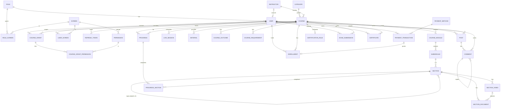

# Data Model — SQL Server

Physical design for SQL Server + EF Core, derived from the frontend demo. Business rules (BR-IDs) live in `modules/*.md`.

## 1. Conventions
| Topic | Rule |
|---|---|
| Engine | SQL Server, EF Core |
| Naming | PascalCase, **singular** table names (`User`, `Course`); FK columns `<Entity>Id` (`CourseId`) |
| Primary key | `Id int IDENTITY(1,1)` on every table (incl. lookup and join tables) |
| Public identifiers | Kept as separate unique columns: `Course.Slug`, `PaymentTransaction.TransactionNo`, `Certificate.Code`. Used in URLs; never the PK |
| Soft delete | Every table has `IsDeleted` and an EF global query filter `IsDeleted = 0`. Deleting a row sets `IsDeleted = 1`, **except** hard-delete tables (marked `IHardDelete` in code: RoleScreen, UserScreen, CourseGrant, CourseGrantPermission, ProgressSection and RefreshToken), which are physically removed. Where a business rule says "delete" (e.g. BR-CMS-13, BR-COM-09) the service soft-deletes the row and its listed children |
| Foreign keys | `ON DELETE NO ACTION` everywhere (soft delete means no physical cascades) |
| Unique keys | Filtered unique indexes `WHERE IsDeleted = 0`, so a soft-deleted row doesn't block re-use |
| Audit | Every table has `CreatedAt` and `UpdatedAt` (UTC, set automatically on save). No `CreatedBy`/`UpdatedBy`; columns that record a person exist only where a business rule needs them (e.g. `ReviewedByUserId`) |
| Date/time | `datetime2(3)`, always **UTC**. Live session start time is entered in Asia/Dhaka and converted to UTC on save; converted back for display |
| Money | `decimal(18,2)`, currency BDT |
| Booleans | `bit NOT NULL` with default |
| Enums | Lookup tables (section 4) referenced by FK; application code uses the lookup's `Code` |
| Text | `nvarchar` (Unicode, Bangla-safe). Lengths in section 3 |
| Ordering | Child lists that have a display order have `SortOrder int NOT NULL` |

### 1.1 Standard columns (on EVERY table — written as "+ std" below)
| Column | Type | Null | Default | Notes |
|---|---|---|---|---|
| CreatedAt | datetime2(3) | NOT NULL | `sysutcdatetime()` | set on insert |
| UpdatedAt | datetime2(3) | NULL | — | set on every update and soft delete |
| IsDeleted | bit | NOT NULL | 0 | soft delete flag (hard-delete tables are removed instead) |

## 2. Tables overview
| Area | Tables |
|---|---|
| Lookups | Permission, Screen, Category, CourseFormat, CourseLevel, CourseBadge, DocumentType, MaterialType, EnrollmentStatus, PaymentMethod, PaymentStatus, Currency, CertificationMode, ExamType, SubmissionStatus |
| Identity & access | User, RefreshToken, Role, RoleScreen, UserScreen, CourseGrant, CourseGrantPermission |
| Catalogue | CategorySkill, Instructor, InstructorExpertise, Course, CourseOutcome, CourseRequirement, CourseModule, Submodule, Section, SectionVideo, SectionDocument, LiveSession, Material |
| Commerce & learning | Enrollment, PaymentTransaction, Progress, ProgressSection |
| Certification | CertificationRule, ExamSubmission, Certificate |
| Community | Post, Comment |

## 3. Text length defaults (please review)
| Kind | Length | Applies to |
|---|---|---|
| Person name | nvarchar(100) | User.Name, Instructor.Name, snapshot names |
| Email | nvarchar(256) | User.Email, PaymentTransaction.UserEmail |
| Phone | nvarchar(20) | User.Phone |
| Title / label | nvarchar(200) | titles without a frontend limit (module, section, video, document, session, material, exam, role name, instructor title) |
| URL | nvarchar(2048) | all URL/link/image columns |
| Long text | nvarchar(max) | Course.Description, Instructor.Bio, ExamInstructions, outcome/requirement text |
| Code | nvarchar(50) | lookup `Code`, icon classes, Language |
| Slug | nvarchar(200) | Course.Slug |
| **Frontend limits kept** | Course.Title 120, Course.Subtitle 200, Course.CoverLabel 30, Post.Title 120, Post.Body 2000, Comment.Body 1000, ExamSubmission.Notes 1000, ExamSubmission.Feedback 1000, Certificate.RevokedReason 200 | |

## 4. Lookup tables
All lookup tables share this shape (+ std):
| Column | Type | Null | Key | Notes |
|---|---|---|---|---|
| Id | int IDENTITY | NOT NULL | PK | |
| Code | nvarchar(50) | NOT NULL | UQ | value used by code/API |
| Name | nvarchar(100) | NOT NULL | | display name (English) |
| SortOrder | int | NOT NULL | | |

| Table | Extra columns | Seed `Code` values |
|---|---|---|
| CourseFormat | — | `Pre-recorded`, `Live`, `Hybrid` |
| CourseLevel | — | `Beginner`, `Intermediate`, `Advanced` |
| CourseBadge | — | `Bestseller`, `New`, `Popular` |
| DocumentType | `FileExtension nvarchar(10) NOT NULL` | `PDF` (.pdf), `DOCX` (.docx), `PPTX` (.pptx) |
| MaterialType | — | `PDF`, `Slides`, `Worksheet`, `Link` |
| EnrollmentStatus | — | `active`, `revoked` |
| PaymentStatus | — | `pending`, `success`, `failed`, `cancelled`, `refunded` |
| Currency | — | `BDT` |
| CertificationMode | — | `completion`, `exam` |
| ExamType | — | `project`, `presentation` |
| SubmissionStatus | — | `submitted`, `passed`, `failed` |
| Category | `ShortName nvarchar(100) NOT NULL`, `Description nvarchar(500) NOT NULL`, `Icon nvarchar(50) NOT NULL`, `ImageUrl nvarchar(2048) NOT NULL` | `video-editing`, `digital-marketing`, `sports-journalism`, `software-development` |
| PaymentMethod | `Description nvarchar(200) NOT NULL`, `LogoUrl nvarchar(2048) NULL`, `Icon nvarchar(50) NOT NULL` | `bkash`, `nagad`, `rocket`, `card` |
| Screen | `Area nvarchar(20) NOT NULL` CHECK IN ('admin','student'), `Path nvarchar(200) NOT NULL`, `Icon nvarchar(50) NOT NULL`, `IsCourseScoped bit NOT NULL`, `Section nvarchar(50) NULL` | `overview`, `courses`, `instructors`, `users`, `enrollments`, `transactions`, `roles`, `access`, `community-moderation`, `certificates`, `dashboard`, `learn`, `checkout`, `community` |
| Permission | `ScreenId int NOT NULL` FK Screen, `Action nvarchar(20) NOT NULL` (view/create/edit/delete/extra), `IsCourseGrantable bit NOT NULL` | see below |

Permission seed (Code → Screen; ★ = course-grantable):
| Screen | Permissions |
|---|---|
| overview | `reports.view`, `system.reset` |
| courses | `courses.view`★, `courses.create`, `courses.edit`★, `courses.delete` |
| instructors | `instructors.view`, `instructors.create`, `instructors.edit`, `instructors.delete` |
| users | `users.view` |
| enrollments | `enrollments.view`, `enrollments.edit` |
| transactions | `transactions.view`, `transactions.edit`, `transactions.delete` |
| roles | `roles.view`, `roles.edit` |
| access | `access.view`, `access.edit` |
| community-moderation | `community.moderate`★ |
| certificates | `certificates.manage`★ |
| dashboard | `dashboard.view` |
| learn | `learn.view` |
| checkout | `checkout.view` |
| community | `community.view`, `community.post` |
`admin.access` is **not stored** — it is computed (BR-ACL-02). Each screen's "view" permission is the first listed.

## 5. Identity & access (built in backend Step 2)
### User (+ std)
| Column | Type | Null | Default | Key / Constraint | Notes |
|---|---|---|---|---|---|
| Id | int IDENTITY | NOT NULL | | PK | |
| Name | nvarchar(100) | NOT NULL | | app: 2–100 chars | |
| Email | nvarchar(256) | NOT NULL | | UQ filtered | stored trimmed, lower-case |
| Phone | nvarchar(20) | NULL | | | BD pattern (app-validated) |
| PasswordHash | nvarchar(500) | NOT NULL | | | ASP.NET Core `PasswordHasher` (PBKDF2) |
| RoleId | int | NOT NULL | | FK Role | public sign-up = Student |
| HasCustomAccess | bit | NOT NULL | 0 | | 1 = UserScreen rows replace the role's screens (BR-ACL-01) |
| InstructorId | int | NULL | | FK Instructor, UQ filtered | **added in Step 3** with the Instructor table |

### RefreshToken (+ std, hard delete)
| Column | Type | Null | Key | Notes |
|---|---|---|---|---|
| Id | int IDENTITY | NOT NULL | PK | |
| UserId | int | NOT NULL | FK User; index (UserId, ExpiresAt) | |
| TokenHash | nvarchar(64) | NOT NULL | UQ | SHA-256 hex of the token; the raw token is never stored |
| ExpiresAt | datetime2(3) | NOT NULL | | 30 days ("Remember me") or 24 hours |
| RevokedAt | datetime2(3) | NULL | | set on logout / rotation; concurrency token |
| ReplacedByTokenId | int | NULL | FK RefreshToken | rotation chain |
| IsPersistent | bit | NOT NULL | | "Remember me" (BR-AUTH-05); copied to the replacement |
Expired tokens of a user are removed at their next sign-in.

### Role (+ std)
| Column | Type | Null | Default | Key | Notes |
|---|---|---|---|---|---|
| Id | int IDENTITY | NOT NULL | | PK | seed: 1 admin, 2 instructor, 3 user |
| Code | nvarchar(50) | NOT NULL | | UQ filtered | system: `admin`, `instructor`, `user`; new roles `role-<hex>`. Used in the API URLs |
| Name | nvarchar(200) | NOT NULL | | UQ filtered (case-insensitive) | |
| Description | nvarchar(500) | NULL | | | |
| IsSystem | bit | NOT NULL | 0 | | cannot be deleted (BR-ACL-06) |

### RoleScreen (+ std, hard delete) — screens of a role
| Column | Type | Null | Key |
|---|---|---|---|
| Id | int IDENTITY | NOT NULL | PK |
| RoleId | int | NOT NULL | FK Role; UQ (RoleId, ScreenId) |
| ScreenId | int | NOT NULL | FK Screen |
A screen gives all of its permissions (BR-ACL-12). The admin role has no rows: it always has every screen (BR-ACL-01). Seed: instructor and student roles get `dashboard`, `learn`, `checkout`, `community`.

### UserScreen (+ std, hard delete) — a user's own screen list
| Column | Type | Null | Key |
|---|---|---|---|
| Id | int IDENTITY | NOT NULL | PK |
| UserId | int | NOT NULL | FK User; UQ (UserId, ScreenId) |
| ScreenId | int | NOT NULL | FK Screen |
Used only when `User.HasCustomAccess = 1` (BR-ACL-11, BR-ACL-19).

### CourseGrant (+ std, hard delete)
| Column | Type | Null | Key |
|---|---|---|---|
| Id | int IDENTITY | NOT NULL | PK |
| UserId | int | NOT NULL | FK User; UQ (UserId, CourseId) |
| CourseId | int | NOT NULL | index; **FK Course added in Step 3** with the Course table |

### CourseGrantPermission (+ std, hard delete)
| Column | Type | Null | Key | Notes |
|---|---|---|---|---|
| Id | int IDENTITY | NOT NULL | PK | |
| CourseGrantId | int | NOT NULL | FK CourseGrant; UQ (CourseGrantId, PermissionId) | |
| PermissionId | int | NOT NULL | FK Permission | must have `IsCourseGrantable = 1` (BR-ACL-13) |

## 6. Catalogue
### CategorySkill (+ std)
Id PK · CategoryId int NOT NULL FK Category · Skill nvarchar(100) NOT NULL · SortOrder int NOT NULL.

### Instructor (+ std)
| Column | Type | Null | Default | Constraint |
|---|---|---|---|---|
| Id | int IDENTITY | NOT NULL | | PK |
| Name | nvarchar(100) | NOT NULL | | len ≥ 2 |
| Title | nvarchar(200) | NOT NULL | | |
| Bio | nvarchar(max) | NOT NULL | | |
| ExperienceYears | int | NOT NULL | 0 | CHECK ≥ 0 |
| Students | int | NOT NULL | 0 | CHECK ≥ 0 |
| Rating | decimal(2,1) | NOT NULL | 0 | CHECK 0–5 |

### InstructorExpertise (+ std)
Id PK · InstructorId int NOT NULL FK Instructor · Expertise nvarchar(100) NOT NULL · SortOrder int NOT NULL.

### Course (+ std)
| Column | Type | Null | Default | Key / Constraint | Notes |
|---|---|---|---|---|---|
| Id | int IDENTITY | NOT NULL | | PK | |
| Slug | nvarchar(200) | NOT NULL | | UQ filtered; CHECK pattern `^[a-z0-9]+(-[a-z0-9]+)*$` (app) | public URL key |
| Title | nvarchar(120) | NOT NULL | | len 5–120 | |
| Subtitle | nvarchar(200) | NOT NULL | | | |
| Description | nvarchar(max) | NOT NULL | | | |
| CategoryId | int | NOT NULL | | FK Category | |
| CourseFormatId | int | NOT NULL | | FK CourseFormat | |
| CourseLevelId | int | NOT NULL | | FK CourseLevel | |
| CourseBadgeId | int | NULL | | FK CourseBadge | |
| InstructorId | int | NOT NULL | | FK Instructor | |
| IsPublished | bit | NOT NULL | 0 | | |
| IsFeatured | bit | NOT NULL | 0 | | |
| Language | nvarchar(50) | NOT NULL | `Bangla` | | |
| DurationHours | int | NOT NULL | 1 | CHECK ≥ 1 | |
| OriginalPrice | decimal(18,2) | NOT NULL | 0 | CHECK ≥ 0 | |
| Price | decimal(18,2) | NOT NULL | 0 | CHECK ≥ 0 AND Price ≤ OriginalPrice | 0 = free |
| CoverLabel | nvarchar(30) | NOT NULL | | | |
| CoverIcon | nvarchar(50) | NOT NULL | `bi-journal-text` | | |
| ImageUrl | nvarchar(2048) | NULL | | | |
| Rating | decimal(2,1) | NOT NULL | 0 | CHECK 0–5 | demo stat |
| RatingCount | int | NOT NULL | 0 | CHECK ≥ 0 | demo stat |
| Students | int | NOT NULL | 0 | CHECK ≥ 0 | demo stat |
| ContentUpdatedMonth | char(7) | NOT NULL | | `YYYY-MM` | set on each save (BR-CMS-11) |

### CourseOutcome / CourseRequirement (+ std, same shape)
Id PK · CourseId int NOT NULL FK Course · Text nvarchar(max) NOT NULL · SortOrder int NOT NULL. (≥ 1 CourseOutcome per course — app rule.)

### CourseModule (+ std)
Id PK · CourseId int NOT NULL FK Course · Title nvarchar(200) NOT NULL · SortOrder int NOT NULL.

### Submodule (+ std)
Id PK · CourseModuleId int NOT NULL FK CourseModule · Title nvarchar(200) NOT NULL · SortOrder int NOT NULL. App rule: 2–3 non-deleted top-level Sections.

### Section (+ std) — sections and nested topics
| Column | Type | Null | Key / Constraint | Notes |
|---|---|---|---|---|
| Id | int IDENTITY | NOT NULL | PK | |
| CourseId | int | NOT NULL | FK Course | denormalised for progress queries |
| SubmoduleId | int | NULL | FK Submodule | set for top-level sections |
| ParentSectionId | int | NULL | FK Section | set for topics |
| Depth | tinyint | NOT NULL | CHECK 0–3 | 0 = section, 1–3 = topic |
| Title | nvarchar(200) | NOT NULL | | |
| SortOrder | int | NOT NULL | | |
| CHECK | | | exactly one of SubmoduleId / ParentSectionId is not null; Depth = 0 ⇔ SubmoduleId not null | |

### SectionVideo (+ std)
| Column | Type | Null | Default | Constraint |
|---|---|---|---|---|
| Id | int IDENTITY | NOT NULL | | PK |
| SectionId | int | NOT NULL | | FK Section |
| Title | nvarchar(200) | NOT NULL | | |
| Url | nvarchar(2048) | NOT NULL | | |
| Minutes | int | NOT NULL | 10 | CHECK ≥ 1 |
| IsPreview | bit | NOT NULL | 0 | |
| SortOrder | int | NOT NULL | | |

### SectionDocument (+ std)
| Column | Type | Null | Key / Constraint | Notes |
|---|---|---|---|---|
| Id | int IDENTITY | NOT NULL | PK | |
| SectionId | int | NOT NULL | FK Section | |
| SectionVideoId | int | NULL | FK SectionVideo (same section — app rule) | NULL = whole section; set NULL when video deleted (BR-CMS-09) |
| DocumentTypeId | int | NOT NULL | FK DocumentType | |
| Title | nvarchar(200) | NOT NULL | | |
| Url | nvarchar(2048) | NOT NULL | ends with type's FileExtension (app) | |
| SortOrder | int | NOT NULL | | |

### LiveSession (+ std)
| Column | Type | Null | Default | Constraint | Notes |
|---|---|---|---|---|---|
| Id | int IDENTITY | NOT NULL | | PK | |
| CourseId | int | NOT NULL | | FK Course | |
| Title | nvarchar(200) | NOT NULL | | | |
| StartsAtUtc | datetime2(3) | NOT NULL | | | entered as Asia/Dhaka |
| DurationMinutes | int | NOT NULL | 60 | CHECK ≥ 1 | |
| MeetingUrl | nvarchar(2048) | NOT NULL | | | |
| SortOrder | int | NOT NULL | | | |

### Material (+ std)
Id PK · CourseId int NOT NULL FK Course · MaterialTypeId int NOT NULL FK MaterialType · Title nvarchar(200) NOT NULL · Url nvarchar(2048) NOT NULL · SortOrder int NOT NULL.

## 7. Commerce & learning
### Enrollment (+ std)
| Column | Type | Null | Key | Notes |
|---|---|---|---|---|
| Id | int IDENTITY | NOT NULL | PK | |
| UserId | int | NOT NULL | FK User; UQ (UserId, CourseId) filtered | one per user+course (BR-ENR-01) |
| CourseId | int | NOT NULL | FK Course | |
| EnrollmentStatusId | int | NOT NULL | FK EnrollmentStatus | |
| EnrolledAt | datetime2(3) | NOT NULL | | |
| PaymentTransactionId | int | NULL | FK PaymentTransaction | NULL for free courses |

### PaymentTransaction (+ std)
| Column | Type | Null | Default | Key / Constraint | Notes |
|---|---|---|---|---|---|
| Id | int IDENTITY | NOT NULL | | PK | |
| TransactionNo | nvarchar(32) | NOT NULL | | UQ filtered | public id (today `DEMO-YYYYMMDD-XXXXXX`) |
| Gateway | nvarchar(50) | NOT NULL | | | `demo` today |
| UserId | int | NOT NULL | | FK User | |
| UserName | nvarchar(100) | NOT NULL | | | snapshot |
| UserEmail | nvarchar(256) | NOT NULL | | | snapshot |
| CourseId | int | NOT NULL | | FK Course | course row is only soft-deleted, so FK holds |
| CourseSlug | nvarchar(200) | NOT NULL | | | snapshot |
| CourseTitle | nvarchar(120) | NOT NULL | | | snapshot |
| PaymentMethodId | int | NOT NULL | | FK PaymentMethod | |
| MaskedAccount | nvarchar(50) | NOT NULL | | | never full card/wallet |
| OriginalAmount | decimal(18,2) | NOT NULL | | CHECK ≥ 0 | |
| DiscountAmount | decimal(18,2) | NOT NULL | | CHECK ≥ 0 | = Original − Amount |
| Amount | decimal(18,2) | NOT NULL | | CHECK ≥ 0 | charged; computed by server (BR-PAY-05) |
| CurrencyId | int | NOT NULL | | FK Currency | BDT |
| PaymentStatusId | int | NOT NULL | | FK PaymentStatus | |
| FailureReason | nvarchar(200) | NULL | | | |
| FulfilledAt | datetime2(3) | NULL | | | access granted once (BR-PAY-08) |

### Progress (+ std)
Id PK · UserId int NOT NULL FK User · CourseId int NOT NULL FK Course · UQ (UserId, CourseId) filtered. (`UpdatedAt` from std = last change.)

### ProgressSection (+ std)
| Column | Type | Null | Key | Notes |
|---|---|---|---|---|
| Id | int IDENTITY | NOT NULL | PK | |
| ProgressId | int | NOT NULL | FK Progress; UQ (ProgressId, SectionId) filtered | |
| SectionId | int | NOT NULL | FK Section | deleted sections don't count (BR-LRN-05) |
Undo completion (BR-LRN-03) = soft-delete the row. `CreatedAt` = completed at.

## 8. Certification
### CertificationRule (+ std) — 0..1 per course
| Column | Type | Null | Default | Key / Constraint |
|---|---|---|---|---|
| Id | int IDENTITY | NOT NULL | | PK |
| CourseId | int | NOT NULL | | FK Course; UQ filtered |
| IsEnabled | bit | NOT NULL | 1 | |
| CertificationModeId | int | NOT NULL | completion | FK CertificationMode |
| MinProgress | int | NOT NULL | 100 | CHECK 1–100 |
| ExamTypeId | int | NOT NULL | project | FK ExamType |
| ExamTitle | nvarchar(200) | NOT NULL | `Final project` | |
| ExamInstructions | nvarchar(max) | NULL | | |
| MaxScore | int | NOT NULL | 100 | CHECK ≥ 1 |
| PassingScore | int | NOT NULL | 60 | CHECK 1 ≤ PassingScore ≤ MaxScore |
| MaxAttempts | int | NOT NULL | 0 | CHECK ≥ 0 (0 = unlimited) |
No row → API returns the default rule (BR-CERT-01).

### ExamSubmission (+ std)
| Column | Type | Null | Key / Constraint | Notes |
|---|---|---|---|---|
| Id | int IDENTITY | NOT NULL | PK | |
| UserId | int | NOT NULL | FK User | |
| CourseId | int | NOT NULL | FK Course | |
| ExamTypeId | int | NOT NULL | FK ExamType | snapshot at submit |
| Url | nvarchar(2048) | NOT NULL | starts with `https://` (app) | |
| Notes | nvarchar(1000) | NULL | | |
| SubmittedAt | datetime2(3) | NOT NULL | | |
| SubmissionStatusId | int | NOT NULL | FK SubmissionStatus | |
| Score | decimal(9,2) | NULL | CHECK ≥ 0 | see Open Questions (integer?) |
| Feedback | nvarchar(1000) | NULL | | |
| ReviewedByUserId | int | NULL | FK User | |
| ReviewedAt | datetime2(3) | NULL | | |

### Certificate (+ std)
| Column | Type | Null | Key / Constraint | Notes |
|---|---|---|---|---|
| Id | int IDENTITY | NOT NULL | PK | |
| Code | char(14) | NOT NULL | UQ filtered | `CA-YYYY-XXXXXX` |
| UserId | int | NOT NULL | FK User | |
| CourseId | int | NOT NULL | FK Course | |
| UserName | nvarchar(100) | NOT NULL | | snapshot |
| CourseTitle | nvarchar(120) | NOT NULL | | snapshot |
| InstructorName | nvarchar(100) | NOT NULL | | snapshot ('' allowed) |
| CertificationModeId | int | NOT NULL | FK CertificationMode | |
| ExamTypeId | int | NULL | FK ExamType | exam only |
| ScorePercent | int | NULL | CHECK 0–100 | exam only |
| IssuedAt | datetime2(3) | NOT NULL | | |
| IsRevoked | bit | NOT NULL | default 0 | |
| RevokedReason | nvarchar(200) | NULL | | public |
| UQ | | | (UserId, CourseId) filtered `WHERE IsRevoked = 0 AND IsDeleted = 0` | ≤ 1 valid (BR-CERT-03) |

## 9. Community
### Post (+ std)
| Column | Type | Null | Default | Key |
|---|---|---|---|---|
| Id | int IDENTITY | NOT NULL | | PK |
| CourseId | int | NOT NULL | | FK Course |
| AuthorUserId | int | NOT NULL | | FK User |
| Title | nvarchar(120) | NOT NULL | | |
| Body | nvarchar(2000) | NOT NULL | | |
| EditedAt | datetime2(3) | NULL | | |
| IsPinned | bit | NOT NULL | 0 | |
| IsLocked | bit | NOT NULL | 0 | |
| IsHidden | bit | NOT NULL | 0 | |

### Comment (+ std)
| Column | Type | Null | Default | Key / Constraint |
|---|---|---|---|---|
| Id | int IDENTITY | NOT NULL | | PK |
| PostId | int | NOT NULL | | FK Post |
| CourseId | int | NOT NULL | | FK Course (denormalised) |
| ParentCommentId | int | NULL | | FK Comment — must be a top-level comment (1 level, BR-COM-07) |
| AuthorUserId | int | NOT NULL | | FK User |
| Body | nvarchar(1000) | NOT NULL | | |
| EditedAt | datetime2(3) | NULL | | |
| IsHidden | bit | NOT NULL | 0 | |

## 10. Not designed yet (see Open Questions)
Review, ContactMessage, CareerApplication, Opportunity, SportsStory, Testimonial, FaqItem — currently static/simulated in the frontend; table design waits for the business decision.

## 11. Relationships
| Parent | Child | Type | FK column |
|---|---|---|---|
| Role | User | 1–N | User.RoleId |
| Role / Screen | RoleScreen | N–N | RoleId, ScreenId |
| User / Screen | UserScreen | N–N | UserId, ScreenId |
| User / Course | CourseGrant | N–N | UserId, CourseId |
| CourseGrant / Permission | CourseGrantPermission | N–N | CourseGrantId, PermissionId |
| Screen | Permission | 1–N | Permission.ScreenId |
| User | RefreshToken | 1–N | UserId |
| Instructor | User | 1–0..1 | User.InstructorId |
| Category, CourseFormat, CourseLevel, CourseBadge, Instructor | Course | 1–N | |
| Course | CourseModule → Submodule → Section → Section (topics) | 1–N chain | |
| Section | SectionVideo, SectionDocument | 1–N | |
| SectionVideo | SectionDocument | 0..1–N | SectionVideoId |
| Course | LiveSession, Material, CourseOutcome, CourseRequirement, CertificationRule (0..1) | 1–N | |
| User / Course | Enrollment | N–N | |
| PaymentTransaction | Enrollment | 1–0..1 | PaymentTransactionId |
| User, Course, PaymentMethod, PaymentStatus | PaymentTransaction | 1–N | |
| User / Course | Progress | 1 per pair | |
| Progress / Section | ProgressSection | N–N | |
| User / Course | ExamSubmission, Certificate | 1–N | |
| Course | Post → Comment → Comment (reply) | 1–N chain | |

## 12. Indexes (all non-unique unless stated; all filtered `WHERE IsDeleted = 0` where useful)
| Table | Index |
|---|---|
| User | UQ Email; RoleId; UQ InstructorId (not null) |
| RefreshToken | UQ TokenHash; (UserId, ExpiresAt) |
| Role | UQ Code; UQ Name |
| RoleScreen / UserScreen | UQ (RoleId, ScreenId) / UQ (UserId, ScreenId) |
| CourseGrant | UQ (UserId, CourseId); CourseId |
| Course | UQ Slug; (IsPublished, CategoryId); InstructorId; IsFeatured |
| Section | (SubmoduleId, SortOrder); (ParentSectionId, SortOrder); CourseId |
| SectionVideo / SectionDocument | (SectionId, SortOrder) |
| LiveSession | (CourseId, StartsAtUtc) |
| Enrollment | UQ (UserId, CourseId); (CourseId, EnrollmentStatusId); PaymentTransactionId |
| PaymentTransaction | UQ TransactionNo; (UserId, CreatedAt DESC); PaymentStatusId; CourseId; CreatedAt; PaymentMethodId |
| Progress | UQ (UserId, CourseId) |
| ProgressSection | UQ (ProgressId, SectionId) |
| CertificationRule | UQ CourseId |
| ExamSubmission | (CourseId, SubmissionStatusId, SubmittedAt DESC); (UserId, CourseId) |
| Certificate | UQ Code; UQ (UserId, CourseId) where IsRevoked = 0 |
| Post | (CourseId, IsPinned DESC, CreatedAt DESC) |
| Comment | (PostId, CreatedAt); ParentCommentId |

## 13. Open questions (database)
- `ExamSubmission.Score`: integer or decimal? (rule fields are integers.)
- `Course.ContentUpdatedMonth` could be derived from `UpdatedAt`. Keep the column or derive?
- Should `Course.Language` become a lookup table?
- Lookup `Name` is English only. Need a Bangla name column?
- Case-insensitive uniqueness of Email/Role name relies on the database collation (default SQL Server collation is case-insensitive). Confirm collation.
- Business open questions that may add tables: Review, enrollment history, ContactMessage, CareerApplication, AuditLog.

## 14. ER diagram

