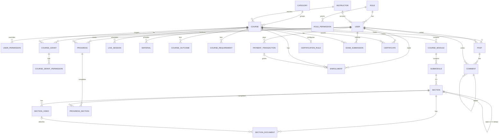

# Data Model (draft for SQL database)

Conventions:
- Types are logical (`string`, `int`, `bigint`, `decimal`, `bool`, `datetime` = UTC). `(inferred)` = not explicit in code.
- In the frontend, lists inside records (string[] / child arrays) are embedded; here they are normalised into child tables.
- **Audit fields (inferred)**: every table gets `CreatedAt`, `CreatedBy` (FK User, nullable), `UpdatedAt`, `UpdatedBy`. Only fields the frontend already uses are listed explicitly below.
- PK = primary key, FK = foreign key, UQ = unique.

## Enums
| Enum | Values |
|---|---|
| CategoryId | `video-editing`, `digital-marketing`, `sports-journalism`, `software-development` |
| CourseFormat | `Pre-recorded`, `Live`, `Hybrid` |
| Level | `Beginner`, `Intermediate`, `Advanced` |
| CourseBadge | `Bestseller`, `New`, `Popular` |
| DocumentType | `PDF`, `DOCX`, `PPTX` |
| MaterialType | `PDF`, `Slides`, `Worksheet`, `Link` |
| EnrollmentStatus | `active`, `revoked` |
| PaymentMethodId | `bkash`, `nagad`, `rocket`, `card` |
| PaymentStatus | `pending`, `success`, `failed`, `cancelled`, `refunded` |
| Currency | `BDT` |
| CertificationMode | `completion`, `exam` |
| ExamType | `project`, `presentation` |
| SubmissionStatus | `submitted`, `passed`, `failed` |
| Permission | `admin.access`*, `reports.view`, `system.reset`, `courses.view`, `courses.create`, `courses.edit`, `courses.delete`, `instructors.view`, `instructors.create`, `instructors.edit`, `instructors.delete`, `users.view`, `enrollments.view`, `enrollments.edit`, `transactions.view`, `transactions.edit`, `transactions.delete`, `roles.view`, `roles.edit`, `access.view`, `access.edit`, `dashboard.view`, `learn.view`, `checkout.view`, `community.view`, `community.post`, `community.moderate`, `certificates.manage` (*derived, never stored) |
| CoursePermission (grantable per course) | `courses.view`, `courses.edit`, `community.moderate`, `certificates.manage` |
| OpportunityTeam | `Sports Media`, `Digital Platform`, `Software Projects` |
| OpportunityType | `Part-time`, `Freelance`, `Internship` |
| SportsTopic | `Cricket`, `Football`, `Analysis`, `Interview`, `Journalism` |
| ContactTopic (inferred) | course slug, `payment`, `career`, `other` |

## Identity & access
### User
| Column | Type | PK/FK | Null | Unique | Notes |
|---|---|---|---|---|---|
| Id | string | PK | no | | |
| Name | string(100) (inferred len) | | no | | min 2 |
| Email | string(256) | | no | UQ (case-insensitive) | stored lower-case |
| Phone | string(20) | | yes | | BD pattern |
| PasswordHash | string | | no | | demo stores plain `password` |
| RoleId | string | FK Role | no | | default `user` |
| HasCustomAccess | bool (inferred) | | no | | true when `access` override exists |
| InstructorId | string | FK Instructor | yes | UQ (inferred) | account ↔ instructor profile |
| CreatedAt | datetime | | no | | |

### Role
| Column | Type | PK/FK | Null | Unique | Notes |
|---|---|---|---|---|---|
| Id | string | PK | no | | system ids: `admin`, `instructor`, `user` |
| Name | string | | no | UQ (case-insensitive) | |
| Description | string | | yes | | |
| IsSystem | bool | | no | | not deletable |

### RolePermission (join Role N–N Permission)
| Column | Type | PK/FK | Null | Notes |
|---|---|---|---|---|
| RoleId | string | PK, FK Role | no | |
| Permission | enum Permission | PK | no | `admin.access` not allowed |

### UserPermission (override; join User N–N Permission)
| Column | Type | PK/FK | Null | Notes |
|---|---|---|---|---|
| UserId | string | PK, FK User | no | When any rows exist (or HasCustomAccess), they replace role permissions |
| Permission | enum Permission | PK | no | |

### CourseGrant
| Column | Type | PK/FK | Null | Unique | Notes |
|---|---|---|---|---|---|
| Id | string | PK | no | | |
| UserId | string | FK User | no | UQ(UserId, CourseId) | |
| CourseId | bigint | FK Course | no | | cascade delete with course |

### CourseGrantPermission
| Column | Type | PK/FK | Null | Notes |
|---|---|---|---|---|
| CourseGrantId | string | PK, FK CourseGrant | no | |
| Permission | enum CoursePermission | PK | no | grant deleted when list empty |

## Catalogue
### Category (static seed; could be a lookup table)
| Column | Type | PK/FK | Null | Notes |
|---|---|---|---|---|
| Id | enum CategoryId | PK | no | |
| Name, ShortName, Description, Icon, Image | string | | no | |

### CategorySkill — CategoryId (FK), Skill string, SortOrder int.

### Instructor
| Column | Type | PK/FK | Null | Notes |
|---|---|---|---|---|
| Id | string | PK | no | |
| Name | string | | no | min 2 |
| Title | string | | no | |
| Bio | text | | no | |
| ExperienceYears | int | | no | ≥ 0 |
| Students | int | | no | ≥ 0, manual |
| Rating | decimal(2,1) | | no | not editable, 0 for new |

### InstructorExpertise — InstructorId (FK), Expertise string, SortOrder int.

### Course
| Column | Type | PK/FK | Null | Unique | Notes |
|---|---|---|---|---|---|
| Id | bigint | PK | no | | timestamp-based in demo |
| Slug | string(150) | | no | UQ | kebab-case |
| Title | string(120) | | no | | 5–120 |
| Subtitle | string(200) | | no | | |
| Description | text | | no | | |
| CategoryId | enum | FK Category | no | | |
| Format | enum CourseFormat | | no | | |
| IsPublished | bool | | no | | default false |
| InstructorId | string | FK Instructor | no | | delete of instructor blocked while referenced |
| Rating | decimal(2,1) | | no | | demo stat |
| RatingCount | int | | no | | demo stat |
| Students | int | | no | | demo stat |
| DurationHours | int | | no | | ≥ 1 |
| Level | enum Level | | no | | |
| Language | string | | no | | default `Bangla` |
| Price | int (BDT) | | no | | ≥ 0, ≤ OriginalPrice |
| OriginalPrice | int (BDT) | | no | | ≥ 0 |
| CoverLabel | string(30) | | no | | |
| CoverIcon | string | | no | | |
| Image | string | | yes | | URL or site path |
| Badge | enum CourseBadge | | yes | | |
| IsFeatured | bool | | no | | |
| UpdatedMonth | char(7) `YYYY-MM` | | no | | `updated` |

### CourseOutcome / CourseRequirement — CourseId (FK), Text string, SortOrder int. (≥ 1 outcome)

### CourseModule
| Column | Type | PK/FK | Null | Notes |
|---|---|---|---|---|
| Id | string | PK | no | |
| CourseId | bigint | FK Course | no | cascade |
| Title | string | | no | |
| SortOrder | int | | no | |

### Submodule — Id PK, ModuleId FK CourseModule (cascade), Title, SortOrder. Rule: 2–3 sections.

### Section (self-referencing for topics)
| Column | Type | PK/FK | Null | Notes |
|---|---|---|---|---|
| Id | string | PK | no | |
| SubmoduleId | string | FK Submodule | yes | set for top-level sections |
| ParentSectionId | string | FK Section | yes | set for topics (depth ≤ 3) |
| Title | string | | no | |
| SortOrder | int | | no | |
| Depth | tinyint (inferred) | | no | 0 = section, 1–3 = topic |
| CHECK | exactly one of SubmoduleId / ParentSectionId is set | | | |

### SectionVideo
| Column | Type | PK/FK | Null | Notes |
|---|---|---|---|---|
| Id | string | PK | no | |
| SectionId | string | FK Section | no | cascade |
| Title | string | | no | |
| Url | string | | no | YouTube/Vimeo/mp4/webm |
| Minutes | int | | no | ≥ 1 |
| IsPreview | bool | | no | |
| SortOrder | int | | no | |

### SectionDocument
| Column | Type | PK/FK | Null | Notes |
|---|---|---|---|---|
| Id | string | PK | no | |
| SectionId | string | FK Section | no | cascade |
| VideoId | string | FK SectionVideo | yes | same section; set NULL on video delete |
| Title | string | | no | |
| Type | enum DocumentType | | no | |
| Url | string | | no | extension must match Type |
| SortOrder | int | | no | |

### LiveSession
| Column | Type | PK/FK | Null | Notes |
|---|---|---|---|---|
| Id | string | PK | no | |
| CourseId | bigint | FK Course | no | cascade |
| Title | string | | no | |
| StartsAt | datetime (local, no zone) | | no | (inferred: store as Asia/Dhaka or UTC) |
| DurationMinutes | int | | no | ≥ 1 |
| MeetingUrl | string | | no | |
| SortOrder | int | | no | |

### Material — Id PK, CourseId FK (cascade), Title, Type enum MaterialType, Url, SortOrder.

### Review (inferred, currently static demo pool) — Id, CourseId FK, UserId FK (inferred), Name, Rating int 1–5, Date, Text.

## Commerce & learning
### Enrollment
| Column | Type | PK/FK | Null | Unique | Notes |
|---|---|---|---|---|---|
| Id | string | PK | no | | |
| UserId | string | FK User | no | UQ(UserId, CourseId) | |
| CourseId | bigint | FK Course | no | | cascade delete with course |
| Status | enum EnrollmentStatus | | no | | |
| EnrolledAt | datetime | | no | | |
| TransactionId | string | FK PaymentTransaction | yes | | null for free courses |

### PaymentTransaction
| Column | Type | PK/FK | Null | Notes |
|---|---|---|---|---|
| Id | string(32) | PK | no | public id |
| Gateway | string | | no | `demo` now |
| GatewayReference | string (inferred) | | yes | real gateway id |
| UserId | string | FK User | no | |
| UserName, UserEmail | string | | no | snapshot |
| CourseId | bigint | (no FK enforced, inferred) | no | course may be deleted |
| CourseSlug, CourseTitle | string | | no | snapshot |
| Method | enum PaymentMethodId | | no | |
| MaskedAccount | string | | no | |
| OriginalAmount, DiscountAmount, Amount | int (BDT) | | no | |
| Currency | enum Currency | | no | `BDT` |
| Status | enum PaymentStatus | | no | |
| FailureReason | string | | yes | |
| FulfilledAt | datetime | | yes | access granted once |
| CreatedAt, UpdatedAt | datetime | | no | |

### Progress
| Column | Type | PK/FK | Null | Unique | Notes |
|---|---|---|---|---|---|
| Id | string | PK | no | | demo `userId:courseId`; or surrogate |
| UserId | string | FK User | no | UQ(UserId, CourseId) | |
| CourseId | bigint | FK Course | no | | |
| UpdatedAt | datetime | | no | | |

### ProgressSection (join Progress N–N Section)
| Column | Type | PK/FK | Null | Notes |
|---|---|---|---|---|
| ProgressId | string | PK, FK Progress | no | |
| SectionId | string | PK (FK Section, set null/ignore on delete) | no | ids of removed sections are ignored in % |
| CompletedAt | datetime (inferred) | | no | |

### CertificationRule (1–1 Course)
| Column | Type | PK/FK | Null | Notes |
|---|---|---|---|---|
| CourseId | bigint | PK, FK Course | no | |
| Enabled | bool | | no | |
| Mode | enum CertificationMode | | no | |
| MinProgress | int | | no | 1–100 |
| ExamType | enum ExamType | | no | |
| ExamTitle | string | | no | |
| ExamInstructions | text | | yes | |
| MaxScore | int | | no | ≥ 1 |
| PassingScore | int | | no | 1..MaxScore |
| MaxAttempts | int | | no | 0 = unlimited |

### ExamSubmission
| Column | Type | PK/FK | Null | Notes |
|---|---|---|---|---|
| Id | string | PK | no | |
| UserId | string | FK User | no | |
| CourseId | bigint | FK Course | no | |
| ExamType | enum ExamType | | no | snapshot |
| Url | string | | no | https |
| Notes | string(1000) | | yes | |
| SubmittedAt | datetime | | no | |
| Status | enum SubmissionStatus | | no | |
| Score | decimal | | yes | |
| Feedback | string(1000) | | yes | |
| ReviewedBy | string | FK User | yes | |
| ReviewedAt | datetime | | yes | |

### Certificate
| Column | Type | PK/FK | Null | Unique | Notes |
|---|---|---|---|---|---|
| Id | string | PK | no | | |
| Code | string(14) | | no | UQ | `CA-YYYY-XXXXXX` |
| UserId | string | FK User | no | | |
| CourseId | bigint | FK Course | no | | |
| UserName, CourseTitle, InstructorName | string | | no | | snapshots |
| Mode | enum CertificationMode | | no | | |
| ExamType | enum ExamType | | yes | | |
| ScorePercent | int | | yes | | |
| IssuedAt | datetime | | no | | |
| IsRevoked | bool | | no | | |
| RevokedReason | string(200) | | yes | | |
| Constraint | at most one non-revoked per (UserId, CourseId) — filtered unique index | | | | |

## Community
### Post
| Column | Type | PK/FK | Null | Notes |
|---|---|---|---|---|
| Id | string | PK | no | |
| CourseId | bigint | FK Course | no | cascade |
| AuthorId | string | FK User | no | (keep posts if user deleted → "Former member") |
| Title | string(120) | | no | |
| Body | string(2000) | | no | |
| CreatedAt | datetime | | no | |
| EditedAt | datetime | | yes | |
| IsPinned, IsLocked, IsHidden | bool | | no | |

### Comment
| Column | Type | PK/FK | Null | Notes |
|---|---|---|---|---|
| Id | string | PK | no | |
| PostId | string | FK Post | no | cascade |
| CourseId | bigint | FK Course | no | denormalised |
| ParentId | string | FK Comment | yes | 1 level only; cascade replies |
| AuthorId | string | FK User | no | |
| Body | string(1000) | | no | |
| CreatedAt | datetime | | no | |
| EditedAt | datetime | | yes | |
| IsHidden | bool | | no | |

## Site content (currently static / not stored)
- **ContactMessage** (inferred): Id, Name, Email, Phone?, Topic, Message, CreatedAt.
- **CareerApplication** (inferred): Id, Name, Email, Phone, OpportunityId/Role, PortfolioUrl?, Message(600)?, CreatedAt, Status (inferred).
- **Opportunity**: Id int, Role, Team enum, Type enum, Description, Icon; OpportunitySkill(OpportunityId, Skill).
- **SportsStory**: Id int, Topic enum, Title, Excerpt, Date, ReadMinutes, Image?, Icon.
- **Testimonial**: Name, Course, Outcome, Rating, Text. **FaqItem**: Question, Answer.

## Relationships
| From | To | Type | Notes |
|---|---|---|---|
| Role | User | 1–N | |
| Role | Permission | N–N via RolePermission | |
| User | Permission | N–N via UserPermission (override) | |
| User | Course | N–N via CourseGrant (+ CourseGrantPermission) | |
| Instructor | User | 1–0..1 | User.InstructorId |
| Category | Course | 1–N | |
| Instructor | Course | 1–N | |
| Course | CourseModule → Submodule → Section → Section(topics) | 1–N chain | |
| Section | SectionVideo, SectionDocument | 1–N | Document → Video 0..1 |
| Course | LiveSession, Material, CourseOutcome, CourseRequirement | 1–N | |
| User | Course | N–N via Enrollment | |
| PaymentTransaction | Enrollment | 1–0..1 | |
| User | PaymentTransaction | 1–N | |
| User + Course | Progress | 1–1 per pair; Progress N–N Section | |
| Course | CertificationRule | 1–0..1 | default used when missing |
| User + Course | ExamSubmission | 1–N | |
| User + Course | Certificate | 1–N (≤ 1 valid) | |
| Course | Post → Comment → Comment(reply) | 1–N chain | |

## Suggested indexes
- User(Email) unique; User(RoleId); User(InstructorId).
- Course(Slug) unique; Course(IsPublished, CategoryId); Course(InstructorId); Course(IsFeatured).
- CourseGrant(UserId, CourseId) unique.
- Enrollment(UserId, CourseId) unique; Enrollment(CourseId, Status); Enrollment(TransactionId).
- PaymentTransaction(UserId, CreatedAt desc); (Status); (CourseId); (CreatedAt); (Method).
- Progress(UserId, CourseId) unique.
- ExamSubmission(CourseId, Status, SubmittedAt desc); (UserId, CourseId).
- Certificate(Code) unique; Certificate(UserId, CourseId) filtered unique where IsRevoked = 0.
- Post(CourseId, IsPinned desc, CreatedAt desc); Comment(PostId, CreatedAt); Comment(ParentId).
- Section(SubmoduleId, SortOrder); Section(ParentSectionId, SortOrder).

## ER diagram

